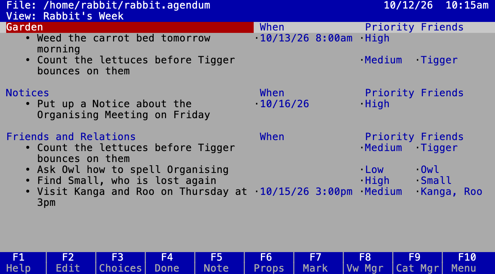

# Wol's Agendum

**Wol's Agendum** (Agendum for short) is a clone of **Lotus Agenda**, the 1988 DOS personal information manager, written in Elixir with a terminal UI that looks and feels like the original. Wol is how Owl spells his name in A. A. Milne's books about the Hundred Acre Wood, and the program's manual is Owl teaching Rabbit to use it; an *agendum* is one thing to be done. It is said "wolz a-JEN-dum": *Wol* rhymes with "doll", and *Agendum* is said like "agenda" (ADR 0019).

New to Lotus Agenda? [`docs/AGENDA_HISTORY.md`](docs/AGENDA_HISTORY.md) explains why people loved the original and what made it unique; where Agendum is going is in [`docs/VISION.md`](docs/VISION.md).

You type free-form items. Agendum files them into categories: the one you typed them under, and any whose names appear in the text. Views show the same items arranged in different ways, and you change the data directly in the views.



## Find your way

- [The user guide](docs/guide/index.html): the short version, with a worked example (open it in a browser).
- [The manual](docs/manual/index.html): the long one, as Owl teaches Rabbit to use Agendum.
- [`docs/INDEX.md`](docs/INDEX.md): every document, what it is for and when to read it.
- [`docs/SPEC.md`](docs/SPEC.md): what Agendum does, rule by rule, each one checked against Agenda or marked as our choice.
- [`docs/ROADMAP.md`](docs/ROADMAP.md): what comes next; the done list is in [`docs/ROADMAP_DONE.md`](docs/ROADMAP_DONE.md).
- [`docs/adr/`](docs/adr/): the architecture decision records, why the code is the way it is.
- [`docs/meetings/`](docs/meetings/): the minutes of the project's panel meetings in Owl's house, where a panel of imagined experts discusses the owner's agenda and the owner decides. The voices are lenses, not the real people's words.
- [`docs/reviews/`](docs/reviews/): the same panel's dated reviews of the whole project, with scores, evidence and the trend since the last one.


## Installing

On a Mac or on Linux, with [Homebrew](https://brew.sh) (it brings Erlang along):

```sh
brew install jamting/agendum/agendum
agendum --demo            # sample data from the Agenda patent
agendum ~/work.agendum    # your own file
brew uninstall agendum    # to remove it again
```

Or download `agendum` from the [releases](https://github.com/jamting/agendum/releases): it needs Erlang/OTP 28 or later.

## Running from source

Requires Elixir ≥ 1.20 on OTP ≥ 28 (for the built-in raw terminal mode).

```sh
mix deps.get
mix run -e 'Agendum.CLI.main(["--demo"])'       # sample data from the Agenda patent
mix run -e 'Agendum.CLI.main(["--rabbit"])'     # Rabbit's file from the manual
mix escript.build && ./agendum ~/work.agendum   # standalone binary
mix docs --open                                 # API and design docs, guide and manual, in the browser
./agendum --mono ~/work.agendum                 # monochrome (also: --theme mono, or NO_COLOR=1)
./agendum --theme zenburn ~/work.agendum        # themes: classic (Agenda's colours, the default), mono,
                                                #   modus-operandi, modus-vivendi, alabaster, zenburn, ayu, borland
./agendum --lang=swedish --fallback=english f   # read dates typed in Swedish (and English)
./agendum --number-order=dmy --date-separator=. f  # type dates as 12.11.26 for this session
./agendum --version                             # the version and the build, for a bug report
# Utilities ▸ Customize saves your theme, date languages and input format in ~/.config/agendum/preferences
```

To start from Agenda's Activities Planner (tasks, people, projects, priorities, expenses, sixteen views and a few macros, no items), copy the starter file and open the copy:

```sh
cp starters/planner.agendum ~/planner.agendum && ./agendum ~/planner.agendum
```

## Quick tour

The guide and the manual (Find your way, above) say it all at more leisure; `mix docs` also puts them beside the API documentation. In short:

- **Type** under a section to add an item. It is assigned to that section's category, and automatically to any category it mentions.
- Dates in the text count: "Call Bob next Friday" gets a When date. **ALT-F2** sets one explicitly.
- **→ / TAB** moves into columns. Type a name to assign (new names create subcategories) or a date (`tomorrow`, `friday`, `2026-12-24`) in the When column.
- **F9** opens the category manager: type to add, F7/F8 promote/demote, F6 properties (mutually exclusive children, short names, category links).
- **ALT-D / ALT-R** add sections and columns. **F8** manages views (F6 there: a view's properties, as View ▸ Properties). **F10** or **/** opens the menu.
- **CTRL-Z / CTRL-Y** undo and redo. **CTRL-S** saves, **CTRL-Q** quits.
- Function keys are required, as in Agenda: on a Mac, hold **fn** with them or make them standard function keys (System Settings ▸ Keyboard). **CTRL-N** replaces INS (new item/category), **CTRL-E** = F2 edit, and ALT is ⌥ (Option) with "Use Option as Meta key" on. To use ⌘N, ⌘Z, ⌘S and so on, map them in your terminal; see [`docs/KEYBOARD.md`](docs/KEYBOARD.md).
- **F1** is help about where you are, as Agenda's: links in bold (arrows and ENTER), **F3** the index, **F5** Find, **F8** back; **F6** Keys lists every key and leads to the commands you can run there (greyed when they cannot, with the reason) and to describing a key.

## Development

The code is a pure functional core with an imperative shell. See [`CLAUDE.md`](CLAUDE.md) for conventions, [`docs/SPEC.md`](docs/SPEC.md) for behaviour, [`docs/ARCHITECTURE.md`](docs/ARCHITECTURE.md) for structure, [`docs/DATA_MODEL.md`](docs/DATA_MODEL.md) and [`docs/DATA_ACCESS.md`](docs/DATA_ACCESS.md) for the data layer, and [`docs/ROADMAP.md`](docs/ROADMAP.md) for what's next.

```sh
mix check   # the quality gate: format, warnings as errors, Credo, Dialyzer, tests
mix agendum.starters             # rebuild starters/planner.agendum (a test checks it is current)
mix agendum.starters --samples   # a copy full of sample data, for testing: tmp/planner-samples.agendum
```

## Contributing

[`CONTRIBUTING.md`](CONTRIBUTING.md) takes you from a fresh machine to a first change: installing Erlang and Elixir, running the checks, finding your way in the code and the documents, and the workflow for a change.

The checks run on every push and the long fuzz run every night. Contributions from others open later, once a lawyer has checked the contributor licence agreement (`CLA.md`).

## Licence

Wol's Agendum is open source. The code is licensed under the GNU Affero General Public License, version 3 only (`AGPL-3.0-only`, in `LICENSE`): you may use, change and share it, and if you run a changed version for others over a network, you offer them its source. The documents (the guide, the manual and `docs/`) are licensed under Creative Commons Attribution 4.0 (`CC BY 4.0`, in `LICENSES/CC-BY-4.0.txt`): copy and adapt them, with credit. Why these: ADR 0051.

The typography of the blog, the guide and the manual, and its fonts (`docs/fonts/` for the guide and the manual), are other people's work under their own licences: [The Proportional Web](https://owickstrom.github.io/the-proportional-web/) by Oskar Wickström (MIT, `lib/agendum/core/extras/site_assets/the-proportional-web-LICENSE.md`) and the fonts Alegreya, Alegreya SC and Courier Prime (SIL Open Font License, `site_assets/OFL.txt` and `docs/fonts/OFL.txt`).
