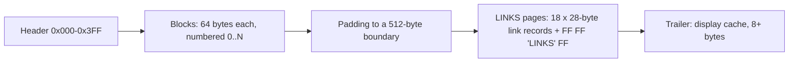
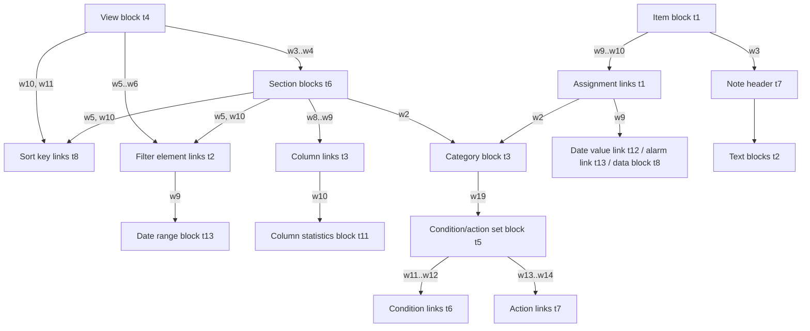

# Lotus Agenda's .AG file format

2026-10-14/15 · reverse engineered by Claude for Mattias Jämting

What a Lotus Agenda 2.0 data file (`.AG`, backup `.BG`) contains and how to
read it, so that Agendum can import old Agenda files. Nothing here was
published by Lotus; it was worked out from the four starter files shipped
with Agenda 2.0 and from files made by running Agenda headlessly in DOSBox,
changing one thing and comparing the bytes (about 150 such experiments).
How that was done, and what is still open, is in
[the research log](plans/AGENDA_FILE_FORMAT_LOG.md). A reference reader
that implements this document is `tools/agformat/agdump.py` (`.AG` → JSON);
how to drive Agenda for more experiments is in
`tools/agformat/DRIVING_AGENDA.md`.

Confidence marks used below: **✔** confirmed by an experiment (Agenda made
the change, the bytes moved as described); **~** inferred from consistent
patterns in all files but not tested one at a time; **?** unknown.

## In short

- The file is a **dump of Agenda's own memory pool**, which explains its
  shape: Agenda (written in C) keeps everything in fixed-size records that
  point at each other by number. There is no compression and no encryption.
- Little-endian 16-bit words throughout; text is 8-bit DOS code page
  (CP437/CP850) and C strings (NUL-terminated); dates are 8-byte IEEE
  doubles counting days since 1899-12-30 (the Lotus 1-2-3 / Excel serial
  date; the fraction is the time of day).
- Three regions: a **1024-byte header** (file settings), an array of
  **64-byte blocks** (items, categories, views, sections, text), and
  **512-byte "LINKS" pages** holding **28-byte link records** (assignments,
  columns, sort keys, filters, conditions, actions, date values, alarms).
- An **item** is a block holding its text; its assignments are a doubly
  linked list of link records. The same link records are also threaded on
  a second list per **category**: a sparse matrix, items × categories, as
  the Agenda patent (US 5,115,504) describes.
- Every setting of every box (view, section, column, category, file
  properties) is stored; most are bit fields, listed below with the box
  label they belong to.
- Relative and recurring dates ("next Friday", "every other Monday at
  9am") are stored both as the resolved date and as an 8-byte **date
  expression**, so recurrence survives an import.
- A **password** does not encrypt the file. It is stored in the header XOR
  `0xAB`; the data stays readable.

## File layout ✔

| Offset                   | Size                    | Contents                                                          |
| ------------------------ | ----------------------- | ----------------------------------------------------------------- |
| `0x000`                  | 1024                    | Header                                                            |
| `0x400`                  | 64 × (N+1)              | Blocks 0..N, block _n_ at `0x400 + 64·n`; N is header word `0x3A` |
| end of blocks            | to next multiple of 512 | Padding (stale bytes; ignore)                                     |
| next 512 boundary        | 512 × K                 | Link pages                                                        |
| after the last link page | rest of file            | Trailer                                                           |

Each **link page** holds 18 link records (18 × 28 = 504 bytes) followed by
the 8-byte marker `FF FF 4C 49 4E 4B 53 FF` (`"LINKS"`). Pages follow each
other until a page without the marker; record _k_ of a page is free when
its first word is 0 or its type is 0. A link record's first word is its id,
so its place in the file does not matter. Stale records can survive (one
type-8 record in the Information Sifter starter points past the last block;
nothing refers to it): follow references, do not scan by type alone.

The **trailer** is `[count, 0, section block, item block…, 0]` (16-bit
words, `count` = number of words after it): the rows of the section shown
when the file was saved, including built-in summary rows. It is a display
cache; an importer can ignore it.

**File Save writes a complete file** without quitting ✔: the same layout,
without the trailer and possibly with extra (empty) link pages. Quit also
saves. A file copied while Agenda was running between saves may be stale.
The `.BG` file is the previous save, in the same format.

### Free lists ✔

Free blocks keep their own number in word 0 and have type 0 (word 1);
words 2 and 3 link them in a doubly linked free list. Agenda grows the pool
about 30 blocks at a time. Header `0x38`/`0x58` are the head and tail of
the free-block list and `0x78` its length; `0x3C`/`0x5A`/`0x76` the same for
free link records. A freed link record keeps its id and is zeroed. An
importer reads only what the lists of live objects reach and ignores both.

## Header ✔/~

| Offset  | Size | Meaning                                                                                                 |     |
| ------- | ---- | ------------------------------------------------------------------------------------------------------- | --- |
| `0x000` | 2    | `54 00` (`"T"`, NUL): signature                                                                         | ✔   |
| `0x002` | 41   | File description (File Properties), C string                                                            | ✔   |
| `0x02B` | 13   | Password XOR `0xAB`, C string (so `AB AB …` when there is none)                                         | ✔   |
| `0x038` | 2    | Head of the free-block list (`0x58` tail, `0x78` count)                                                 | ✔   |
| `0x03A` | 2    | Highest block number N                                                                                  | ✔   |
| `0x03C` | 2    | Head of the free-link list (`0x5A` tail, `0x76` count)                                                  | ✔   |
| `0x03E` | 2    | Highest link id                                                                                         | ✔   |
| `0x040` | 2    | Root category block (MAIN), always 9                                                                    | ✔   |
| `0x042` | 2    | First view (views form an alphabetical list)                                                            | ✔   |
| `0x044` | 2    | Current view                                                                                            | ✔   |
| `0x05C` | 2    | Counts up by one on every save                                                                          | ~   |
| `0x05E` | 2    | Make backup on open (1 = yes)                                                                           | ✔   |
| `0x062` | 2    | Text block with the export/Done file name (`EMPTY!.STF`)                                                | ~   |
| `0x074` | 2    | Number of categories under MAIN, MAIN included                                                          | ✔   |
| `0x07C` | 2    | Tab size                                                                                                | ✔   |
| `0x08A` | 2    | Auto-assign global settings: bits `0x300` match on (1 item text, 2 note text, 3 both)                   | ✔   |
| `0x08C` | 2    | File settings, bits below                                                                               | ✔   |
| `0x08E` | 2    | Auto-assign and protection defaults, bits below                                                         | ✔   |
| `0x090` | 2    | Global protection: `0x1` users can add views, `0x6` default view protection                             | ✔   |
| `0x098` | 2    | `0x2` assignment actions on; `0x100` get reservation manually                                           | ✔   |
| `0x09A` | 2    | First macro block                                                                                       | ✔   |
| `0x09C` | 2    | Last macro block                                                                                        | ~   |
| `0x168` | 8    | Date last saved (double)                                                                                | ✔   |
| `0x170` | 8    | Date created (double)                                                                                   | ~   |
| `0x178` | 2×3  | Blocks of the date categories Entry, When, Done (20, 18, 16)                                            | ✔   |
| `0x17E` | 2    | Last date category; `0x180` first (date categories form a list, see Category)                           | ✔   |
| `0x182` | 2×2  | Global date column format (same encoding as a date column's w10, w11)                                   | ~   |
| `0x186` | 2    | Morning (`0xC8hh`, hh = hour); `0x188` evening; `0x18A` afternoon                                       | ✔   |
| `0x18C` | 2    | An hour (`0xC8hh`) following the evening setting                                                        | ?   |
| `0x18E` | 2    | Beginning of week (0 Sunday, 1 Monday …); `0x190` end of week                                           | ✔   |
| `0x192` | 2    | Bit 0: "Month alone means" last day (else first day)                                                    | ✔   |
| `0x194` | 2    | Data block with the Print Layout settings (0 until set)                                                 | ✔   |
| `0x198` | 8    | Varies per file, unchanged between saves; an id                                                         | ?   |
| `0x1C4` | 12   | `"051361041162"` in every file seen (also files made today): probably the installation's serial number | ?   |
| `0x1E8` | 2    | Block of the item the cursor was on                                                                     | ✔   |
| `0x1F4` | ~30  | The last values chosen in boxes (noise)                                                                 | ~   |

Header `0x08C`:

| Bits     | File Properties setting                                                       |
| -------- | ----------------------------------------------------------------------------- |
| `0x0100` | Insert new columns in all sections (else current section)                     |
| `0x00C0` | Empty trash: 0 on demand, `0x40` file closed, `0x80` end of day, `0xC0` when discarded |
| `0x0E00` | Process Done items: 0 no action, `0x200` discard, `0x800` export              |
| `0x2000` | Assignment conditions on                                                      |
| `0x4000` | Text matching on                                                              |

Header `0x08E` (values 1 = no/first choice, 2 = yes/second choice):

| Bits     | Setting                                                    |
| -------- | ---------------------------------------------------------- |
| `0x0003` | Relationship of text and assignment conditions: 1 OR, 2 AND |
| `0x000C` | Assignment conflicts: 8 override the old, 4 keep the old   |
| `0x0030` | Default category protection                                |
| `0x00C0` | Default category can have new children                     |
| `0x0300` | Required match strength: 1 exact, 2 partial, 3 minimal     |
| `0x0C00` | Confirm assignments: 3 never, 1 always, 2 sometimes        |
| `0x3000` | Ignore suffixes                                            |
| `0xC000` | Ignore accents                                             |

Not in the `.AG`: Utilities Customize (colours, key map, decimal
separator…) is a program setting ✔, and named print sets live in their own
file ✔.

## Blocks ✔

Every block is 64 bytes and starts with four words:

| Word | Meaning                                       |
| ---- | --------------------------------------------- |
| 0    | Its own number                                |
| 1    | Type (table below); 0 = free                  |
| 2    | Usually "next": a continuation block          |
| 3    | Usually "previous", or the owner of the block |

So a block is found by number at `0x400 + 64·n`, and its first word must
equal _n_; block 0 is not used. Text longer than a block continues in a
chain of **text blocks** (type 2) through word 2. Each text block carries a
C string of up to 55 characters in bytes 8–63; the text of a chain is the
concatenation of these pieces.

| Type | Block                                                     | Words 2, 3                        |     |
| ---- | --------------------------------------------------------- | --------------------------------- | --- |
| 0    | free                                                      | next, previous free block         | ✔   |
| 1    | **item**                                                  | text continuation, note           | ✔   |
| 2    | **text** (continuation)                                   | next, previous (or owner)         | ✔   |
| 3    | **category**                                              | name text block, note             | ✔   |
| 4    | **view**                                                  | name continuation, first section  | ✔   |
| 5    | condition/action set of a category                        |                                   | ✔   |
| 6    | **section** (of a view)                                   | category, previous section        | ✔   |
| 7    | **note** header                                           | first text block, owner           | ✔   |
| 8    | data (binary or value text)                               | next, bytes used in this block    | ✔   |
| 9    | family settings of a category's children                  | category, its parent              | ~   |
| 10   | **macro**                                                 | text continuation, previous macro | ✔   |
| 11   | column statistics (count, total … rows) of a numeric column |                                   | ✔   |
| 12   | macro variable (`%name` at byte 8, then its value)        |                                   | ~   |
| 13   | date range of a filter element                            |                                   | ✔   |

Blocks 1–8 of every file are the four system categories (head + name):
`!Trash!` (1), `!Circular Reference!` (3), `!Current Alarms!` (5),
`!Past Alarms!` (7). Block 9 is MAIN; Done is 16, When 18, Entry 20; in a
new file block 11 is the Initial View and 12 its Initial Section. Blocks
29–33 are the built-in summary rows `COUNT`, `TOTAL`, `AVERAGE`, `MINIMUM`,
`MAXIMUM` (item blocks with flag `0x40`).

### Item (type 1) ✔

| Word / bytes | Meaning                                               |
| ------------ | ----------------------------------------------------- |
| w2           | First text continuation block (0 if the text fits)    |
| w3           | Note header block (type 7), 0 if none                 |
| w9           | First assignment link of the item                     |
| w10          | Last assignment link                                  |
| w24          | Flags; `0x40` = built-in summary row (skip it)        |
| bytes 50–61  | Start of the item text: up to 11 characters and a NUL |
| others       | 0 in every file seen                                  |

The item's id is its block number. Item text = bytes 50–61 as a C string,
then the pieces of the text chain from w2. Example: "The quick brown fox
jumps…" (118 characters) is 11 characters in the item block plus two text
blocks.

An item's **entry date, when date, done date** are not fields of the item:
they are assignments to the date categories Entry, When and Done, with the
date as the assignment's value (below). Its **alarm** is an assignment too
(below). Marks and the cursor are not stored.

**Discarded items** stay in the file: ALT-F4 removes all their assignments
and assigns them to `!Trash!` (block 1) instead ✔. An importer skips items
whose only category is block 1.

### Note (type 7) ✔

w2 = first text block, w3 = owner (item or category). The note text is the
chain from w2; lines are separated by CR (`0x0D`).

A **note file** (Item Properties, Note file) is a note header with w2 = 0,
w9 = 1 and w4 = a text block holding the file name (relative to the `.AG`'s
directory when it is there: `NOTE1.TXT`) ✔. The note's text is not in the
`.AG`; an importer reads the file, if it still exists.

### Category (type 3) ✔

A category is a head block (type 3) plus a name chain: w2 points at a text
block whose string is the name field as Agenda stores it:

    Name;Short name;text condition;text condition…

so `Calls;Phone;Telephone` is the category Calls, short name Phone, also
matching "Telephone"; `Follow up;;(follow up);(waiting for)` has no short
name. Quotes, parentheses and other punctuation are Agenda's text-condition
syntax (User's Guide ch. 19). A long name continues in more text blocks.

| Word     | Meaning                                                                                          |     |
| -------- | ------------------------------------------------------------------------------------------------ | --- |
| w2       | Name text block                                                                                  | ✔   |
| w3       | Note header (type 7), 0 if none                                                                  | ✔   |
| w4, w5   | First/last assignment link (items assigned to this category)                                     | ✔   |
| w6, w7   | Last/first section headed by this category (sections linked by their w21/w22)                    | ✔   |
| w8, w9   | Last/first reference to it: filter elements (t2), condition (t6) and action (t7) links           | ✔   |
| w10, w11 | Last/first column (type-3 link) showing this category                                            | ✔   |
| w14      | Previous sibling                                                                                 | ✔   |
| w15      | Next sibling (category manager order)                                                            | ✔   |
| w16      | Parent                                                                                           | ✔   |
| w17      | First child                                                                                      | ✔   |
| w18      | Last child                                                                                       | ✔   |
| w19      | Condition/action set (type-5 block), 0 if none                                                   | ✔   |
| w20, w21 | Ends of the list of sort keys (type-8 links) on this category                                    | ✔   |
| w22      | Its node in the name index (type-9 link)                                                         | ✔   |
| w23      | Settings (standard and date categories differ; tables below)                                     | ✔   |
| w25      | An assignment link id, or 1: a cache, changes when items are edited                              | ~   |
| w26      | **Type** and settings (below)                                                                    | ✔   |
| w27      | Family settings block (type 9) shared by its siblings                                            | ~   |
| w28      | Standard: settings (below). Date: previous date category                                         | ✔   |
| w29      | Standard: assignment conditions (0 global, 1 off, 2 on; 4 in new categories). Date: next date category | ✔   |
| w30      | Date: "Which one" (the n-th date in the text) − 1                                                | ✔   |

The hierarchy starts at MAIN (block 9, header `0x040`) and is walked with
w17 then w15. The date categories form their own doubly linked list
(w28 previous, w29 next; header `0x180` first, `0x17E` last): Done, When,
Entry, then user date categories in creation order.

w26, all categories:

| Bits     | Meaning                                                                                       |
| -------- | --------------------------------------------------------------------------------------------- |
| `0x0001` | Children are not exclusive (so a standard category is 1, with exclusive children 0)           |
| `0x000C` | Type: 0 standard, `0x4` unindexed, `0x8` numeric, `0xC` date (whole word 1, 0, 5, 9, 13)      |
| `0x0C00` | Assignment actions: 0 global, `0x400` off, `0x800` on                                         |
| `0x03C0` | Apply conditions: 0 automatically; on demand `0x140` (`0x100` from the global setting); never `0x280` (`0x200`) |

w28 of a standard category (Category Properties and its Advanced settings):

| Bits     | Meaning                                                             |
| -------- | ------------------------------------------------------------------- |
| `0x0100` | Always set                                                          |
| `0x0003` | Match on: 0 global, 1 item text, 2 note text, 3 both                |
| `0x0008` | Match category name **off**                                         |
| `0x0010` | Match short name **off**                                            |
| `0x0060` | Relationship of text and conditions: 0 global, `0x20` OR, `0x40` AND |
| `0x0080` | Explicit assignments **not** allowed                                |
| `0x0600` | Confirm assignments: 0 global, `0x200` always, `0x400` sometimes    |
| `0xC000` | Text matching: 0 global, `0x4000` off, `0x8000` on                  |

w23 of a standard category:

| Bits     | Meaning                                                               |
| -------- | --------------------------------------------------------------------- |
| `0x0003` | Category is protected: 0 global, 1 no, 2 yes                          |
| `0x0008` | Set when the category has been shown in the Category Manager (noise) |
| `0x0180` | Required match strength: 0 global, `0x80` exact, `0x100` partial, `0x180` minimal |
| `0x0600` | Ignore suffixes: 0 global, `0x200` no, `0x400` yes                    |
| `0x1800` | Ignore accents: 0 global, `0x800` no, `0x1000` yes                    |

w23 of a date category (Advanced settings):

| Bits     | Meaning                                                                                                                                                                                     |
| -------- | ------------------------------------------------------------------------------------------------------------------------------------------------------------------------------------------- |
| `0x8000` | Date category                                                                                                                                                                               |
| `0x4000` | Category can use recurring dates                                                                                                                                                            |
| `0x1E00` | Assign item date, choice × `0x200`: 0 never, 1 when entered, 2 when item text edited, 3 when note edited, 4 item or note edited, 5 when assigned, 6 assigned or edited, 7 from the item text, 8 from the note text, 9 from item or note text |
| `0x0100` | Set the item date from the When key                                                                                                                                                         |
| `0x0080` | Set the item date from the Done key                                                                                                                                                         |
| `0x0060` | Assignment conflicts: 0 global, `0x20` keep the old, `0x40` override                                                                                                                       |
| `0x0003` | Protected, as for standard categories                                                                                                                                                       |

So Entry is `0x8208` (date, set when the item is entered), When `0xCF08`
(date, recurring, from the item text, When key), Done `0x8088` (date, Done
key).

### Condition/action set (type 5) ✔

A category with conditions, actions or a special action points (w19) at a
type-5 block:

| Word     | Meaning                                                              |
| -------- | -------------------------------------------------------------------- |
| w6       | The owning category                                                  |
| w9       | Export: text block with the file name (default `EXPORT.STF`)         |
| w11, w12 | First/last assignment condition (type-6 links)                       |
| w13, w14 | First/last assignment action (type-7 links)                          |
| w15      | Special action: 0 none, 8 discard item, `0x10` mark done, `0x18` export item |

### View (type 4) ✔

| Word / bytes | Meaning                                                                    |     |
| ------------ | -------------------------------------------------------------------------- | --- |
| w2           | Name continuation (text block), 0 if the name fits                         | ✔   |
| w3, w4       | First/last section                                                         | ✔   |
| w5, w6       | First/last filter element (type-2 link)                                    | ✔   |
| w8, w9       | Previous/next view (alphabetical)                                          | ✔   |
| w10, w11     | Primary/secondary sort key (type-8 link), 0 for none                       | ✔   |
| w12          | Bits `0x3` sort new items (0 on leaving a section, 1 when entered, 2 on demand); datebook: `0x30` period, `0x300` (below) | ✔   |
| w13          | Section the cursor was in                                                  | ~   |
| w15, w16     | Datebook: from/to (weekday 0–7 for a week or longer; `0xC8hh` hour for a day) | ✔   |
| w18          | Number of columns, and display state                                       | ~   |
| w20          | Flags (below)                                                              | ✔   |
| w21          | Flags (below)                                                              | ✔   |
| bytes 44–63  | Start of the name: up to 19 characters and a NUL                           | ✔   |

| Word, bits    | View Properties setting                                                |
| ------------- | ---------------------------------------------------------------------- |
| w20 `0x0001`  | Hide done items                                                        |
| w20 `0x0002`  | Hide inherited items                                                   |
| w20 `0x0040`  | Hide dependent items                                                   |
| w20 `0x0080`  | Section separators                                                     |
| w20 `0x8000`  | Hide empty sections                                                    |
| w20 `0x1800`  | View protection: 0 global, `0x800` none, `0x1000` append only, `0x1800` full |
| w20 `0x0400`  | Display state (set in a running session; noise)                        |
| w21 `0x0010`  | Always set                                                             |
| w21 `0x0020`  | Number items                                                           |
| w21 `0x0040`  | Hide column heads                                                      |
| w21 `0x0006`  | Section sorting: 0 none, 2 category order, 4 alphabetic, 6 numeric     |

A **datebook view** has w12 `0x200` (or `0x100` with a day period) and the
period in w12 `0x30` (0 day, `0x10` week, `0x20` month, `0x30` quarter) ✔.
Agenda stores it fully materialized: one section per day (or per hour
slot), each headed by the date category, with a section filter whose date
range is a relative expression for that day ("this Tuesday"), a time-only
column, and a view sort key on the date category (sequence: date). An
importer recreates the datebook from the view settings and ignores the
generated sections.

### Section (type 6) ✔

| Word     | Meaning                                                                               |     |
| -------- | ------------------------------------------------------------------------------------- | --- |
| w2       | Section head category                                                                 | ✔   |
| w3, w4   | Previous/next section of the view                                                     | ✔   |
| w5, w6   | First/last filter element (type-2 link) of the section                                | ✔   |
| w7       | The view it belongs to                                                                | ✔   |
| w8, w9   | First/last column (type-3 link)                                                       | ✔   |
| w10, w11 | Primary/secondary sort key (type-8 link) of the section; 0 = the view's (w11 ~)       | ✔   |
| w12      | Sort new items for the section, and display state (`0x10`, `0x8000` noise)            | ~   |
| w13      | Width of the item column                                                              | ✔   |
| w15–w17  | Statistics rows (count, total, average, minimum, maximum), as in the type-11 block   | ✔   |
| w19      | Protection and display flags (`0x4` set with view protection)                         | ~   |
| w21, w22 | Next/previous section headed by the same category                                     | ✔   |

### Macro (type 10) ✔

w3 = previous macro, w5 = next macro; the macro text starts at byte 24 and
continues through w2. Its first line is the macro's name in braces, for
example `{Create/Update contact list}`; lines end with CR.

### Data (type 8) ✔

w2 = next data block, w3 = bytes used in this block. Holds binary settings
(the five blocks 34–38 of every file, the print layout from header
`0x194`) and the text of unindexed values.

### Column statistics (type 11) ✔

A numeric column's w10 points at a type-11 block; w2–w4 hold which summary
rows the column shows: w2 bit 0 count, `0x100` total; w3 bit 0 average,
`0x100` minimum; w4 bit 0 maximum. The section's w15–w17 hold the same.

### Date range (type 13) ✔

The date range of a filter element (View or Section Properties, Filter, F4
on a date category):

| Bytes | Meaning                                                      |
| ----- | ------------------------------------------------------------ |
| 6–13  | Start: date expression (see Date expressions)                |
| 14–21 | Start date (double), resolved                                |
| 22    | 1 if the start is relative                                   |
| 24–31 | End: date expression                                         |
| 32–39 | End date (double)                                            |
| 40    | 1 if the end is relative                                     |
| 50–57 | The moment the range was last evaluated (double)             |

An empty start or end is all zeros.

## Link records ✔

28 bytes = 14 words; word 0 is the id, word 1 the type.

| Type | Record                                        |     |
| ---- | --------------------------------------------- | --- |
| 0    | free                                          | ✔   |
| 1    | **assignment** of an item to a category       | ✔   |
| 2    | **filter element** of a view or section       | ✔   |
| 3    | **column** of a section                       | ✔   |
| 6    | element of an assignment condition            | ✔   |
| 7    | element of an assignment action               | ✔   |
| 8    | **sort key** of a view or section             | ✔   |
| 9    | node of the category-name index (an AVL tree) | ✔   |
| 12   | **date value**                                | ✔   |
| 13   | **alarm**                                     | ✔   |

### Assignment (type 1) ✔

| Word / bytes | Meaning                                                         |
| ------------ | --------------------------------------------------------------- |
| w2           | Category block                                                  |
| w3           | Previous assignment of the same item                            |
| w4           | Next assignment of the same item                                |
| w5           | Item block                                                      |
| w6           | Previous assignment in the same category                        |
| w7           | Next assignment in the same category                            |
| w8           | Flags (below)                                                   |
| w9           | Value reference (date value, data block, alarm)                 |
| bytes 18–25  | Numeric value (double), when flag `0x80` is set without `0x100` |

Flags in w8:

| Bits     | Meaning                                                                      |
| -------- | ---------------------------------------------------------------------------- |
| `0x0000` | assigned explicitly (typed into a section or column)                         |
| `0x0001` | assigned by text matching (category name, short name, also match)            |
| `0x0002` | assigned by an assignment condition                                          |
| `0x0040` | set automatically by Agenda (the Entry date, a When date read from the text) |
| `0x0100` | has a value; w9 is the id of a **date value** link (type 12)                 |
| `0x0080` | numeric value in bytes 18–25                                                 |
| `0x0180` | unindexed value: w9 is a **data block** (type 8) with the text               |
| `0x0200` | alarm: the category is `!Current Alarms!` and w9 is an **alarm** link        |

Examples seen: Entry `0x140`, Done `0x100`, a numeric Amount `0x80`
(42.5 stored as the double `0x4045400000000000`), an unindexed Page `0x180`.

### Date value (type 12) ✔

| Bytes | Meaning                                                              |
| ----- | -------------------------------------------------------------------- |
| 4–9   | 0                                                                    |
| 10–17 | How the date was given: a **date expression** (below)                |
| 18–25 | **The date** (double)                                                |
| 26–27 | Kind: 0 absolute, 1 relative, 2 recurring                            |

A date without a time has fraction 0 ("Dentist on 11/20/26" → 46346.0).
A relative date resolved by days or weeks keeps the time of day at which it
was entered ("Lunch next Friday" typed at 23:28 got 23:28); one resolved by
months or longer is at 00:00.

### Date expressions ✔

The 8 bytes that say how a date was given (date value bytes 10–17, and the
start and end of a date range). Worked out from about 70 phrases typed as
item text.

**Absolute** (kind 0): the 8 bytes are the date as a double; the lowest
byte is or-ed with `0x80` when a time was given (`11/20/26 at 3pm` →
`80 00 00 00 54 A1 E6 40`).

**Relative** (kind 1) and **recurring** (kind 2):

| Byte | Meaning                                                                                                                                 |
| ---- | --------------------------------------------------------------------------------------------------------------------------------------- |
| 0    | Unit in the low nibble: 2 named month, 4 hours, 5 days, 6 working days, 7 weekday, 9 weeks, `0xA` fortnights, `0xB` months, `0xD` quarters, `0xE` years. `0xC0` set: recurring. `0x50` set: byte 4 is a day of the month |
| 1    | Relative: index × 16 + position. Index: weekday 1–7 (Monday = 1) or month 1–12; position 1 beginning, 2 end, 3 the whole unit (next/last/this). Recurring weekday: the weekday itself |
| 2–3  | Signed count: next 1, last −1, "N units from today" N, "N units ago" −N                                                                |
| 4    | Relative: day of the month − 1 (with `0x50` in byte 0). Recurring: the interval (1 every, 2 every other / every 2)                     |
| 5    | `0x10`: "this" (this week, end of this month, the second of the month)                                                                  |
| 6–7  | Time of day: hour + minute × 32 (10:30 = `0x03CA`); hour 24 (`0x18`) = no time                                                          |

| Typed                     | Bytes                     | Typed                    | Bytes                     |
| ------------------------- | ------------------------- | ------------------------ | ------------------------- |
| today                     | `05 00 00 00 00 00 18 00` | every Monday             | `C7 01 00 00 01 00 18 00` |
| tomorrow                  | `05 00 01 00 00 00 18 00` | every other Monday       | `C7 01 00 00 02 00 18 00` |
| yesterday                 | `05 00 FF FF 00 00 18 00` | every Monday at 9am      | `C7 01 00 00 01 00 09 00` |
| 3 days ago                | `05 00 FD FF 00 00 18 00` | every day                | `C5 00 00 00 01 00 18 00` |
| next Monday               | `07 13 01 00 00 00 18 00` | every 2 weeks            | `C9 00 00 00 02 00 18 00` |
| last Friday               | `07 53 FF FF 00 00 18 00` | each month               | `CB 00 00 00 01 00 18 00` |
| next week                 | `09 03 01 00 00 00 18 00` | every year               | `CE 00 00 00 01 00 18 00` |
| end of next month         | `0B 02 01 00 00 00 18 00` | 3 hours from now         | `04 00 03 00 00 00 18 00` |
| beginning of next month   | `0B 01 01 00 00 00 18 00` | in 5 working days        | `06 03 05 00 00 00 18 00` |
| this quarter              | `0D 63 00 00 00 10 18 00` | in a fortnight           | `0A 00 01 00 00 00 18 00` |
| next April                | `02 43 01 00 00 00 18 00` | nov 20                   | `52 B1 00 00 13 00 18 00` |
| today at 3pm              | `05 00 00 00 00 00 0F 00` | at 3pm / noon            | `05 01 00 00 00 00 0F 00` |

Agenda itself drops what it cannot parse: "every weekday" and "the 15th"
give no date, "every Tuesday and Thursday" keeps only Tuesday. A bare
"4:00" is 16:00 (Agenda assumes working hours).

### Column (type 3) ✔

| Word   | Meaning                                                    |
| ------ | ---------------------------------------------------------- |
| w2     | Category shown in the column                               |
| w3, w4 | Next/previous column showing the same category             |
| w5     | Section                                                    |
| w6, w7 | Previous/next column in the section                        |
| w8     | Width + 1 (the box's width plus the separating space)      |
| w9     | Screen column where it starts                              |
| w10    | Numeric: column statistics block (type 11). Date: format   |
| w11    | Numeric: format. Date: time format (`0x0A00` …)            |
| w12, w13 | Copies of w3/w4 when the column is linked with other sections (~) |

Date column format (w10), Column Properties:

| Bits     | Meaning                                                              |
| -------- | -------------------------------------------------------------------- |
| `0x000F` | Date format: 0 global default, 1 MMDDYY … 5 YYMMDD                   |
| `0x0060` | Date separator: 0 `/`, `0x20` `-`, `0x40` `.`                        |
| `0x0400` | 12-hour clock                                                        |
| `0x0800` | Show am/pm                                                           |
| `0x1000` | Show day of week                                                     |
| `0x6000` | Display: 0 date only, `0x2000` date time, `0x4000` time date, `0x6000` time only |

Numeric column format (w11):

| Bits     | Meaning                                    |
| -------- | ------------------------------------------ |
| `0x0003` | Label: 0 none, 1 `%`, 2 currency `$`       |
| `0x01F0` | Decimal places × 16                        |
| `0x0200` | Link with other sections                   |
| `0x0400` | Total row (~)                              |
| `0x1000` | Display % of total                         |
| `0x2000` | Set with view protection                   |
| `0x4000` | Negative numbers in parentheses            |
| `0x8000` | Thousands separator                        |

Checked against the screen: the Planner's Tasks view shows `Activity`,
`People`, `Project`, `When` with widths 8, 7, 8, 17, the order and widths
read from these records.

### Sort key (type 8) ✔

One per sort key of a view (view w10/w11) or a section (section w10/w11).

| Word   | Meaning                                                    |
| ------ | ---------------------------------------------------------- |
| w2     | Category (0 when sorting on item text)                     |
| w5     | The view or section                                        |
| w7, w8 | Next/previous sort key on the same category                |
| w9     | Flags (below)                                              |

| Bits      | Meaning                                                                  |
| --------- | ------------------------------------------------------------------------ |
| `0x0040`  | Key of a view (a section's own key lacks it)                             |
| `0x0080`  | Sort on item text (with `0x100`: category note)                          |
| `0x0100`  | Sort on a category                                                       |
| `0x0002`  | Descending                                                               |
| `0x0020`  | Items without a value ("n/a") at the top                                 |
| `0x000C`  | Sequence: 0 category hierarchy, 4 alphabetic, 8 numeric, `0xC` date      |
| `0x0010`  | Seen on keys on date categories                                          |

Checked against the screen: the Planner's Activities view sorts on When,
ascending, n/a's at the bottom.

### Filter element (type 2) ✔

One per category in the Filter of a view (view w5/w6) or a section
(section w5/w6).

| Word   | Meaning                                                           |
| ------ | ----------------------------------------------------------------- |
| w2     | Category                                                          |
| w3, w4 | Previous/next element of the same filter                          |
| w5     | The view or section                                               |
| w6, w7 | Next/previous reference to the same category (category w8/w9)     |
| w8     | `0x1` items must **not** be assigned; `0x2` outside the date range |
| w9     | Date categories: date range block (type 13), 0 if none            |

The Planner's "Completed This Week" view filters Done between "beginning
of this week" and "end of this week"; "Overdue" keeps When up to
"yesterday".

### Assignment conditions (type 6) and actions (type 7) ✔

Elements of a category's condition/action set (type-5 block). Both: w2 =
the category tested or assigned, w3/w4 = previous/next element of the set,
w5 = the set block, w6/w7 = next/previous reference to that category. w8:
for a condition 0 = "must be assigned to", 1 = "must not be"; for an
action 0 = assign, 1 = break the assignment. Planner's Unassigned is "in
Tasks and not in People", as the STF export says.

### Alarm (type 13) ✔

Item Alarm makes an assignment to `!Current Alarms!` with flag `0x200`;
its w9 is an alarm link: w5 = the date category the alarm follows (When),
w6 = minutes before.

### Category-name index (type 9) ✔

An AVL tree over the category names, used by Agenda to find a category
when matching text. w2 = category, w5/w6 = left/right child, w7 = parent,
w11 = balance. Link 1 holds the root in w5. It holds no data that is not
also in the category blocks; an importer ignores it.

## Reading a file

1. Check `T\0` at offset 0. Read N from `0x3A`.
2. Load the blocks `0x400 + 64·n` for n = 1..N and the link pages from the
   next 512-byte boundary on, while each page ends with `FF FF "LINKS" FF`.
3. **Categories:** from block 9, depth first through w17 (first child) and
   w15 (next sibling). Name = text chain from w2, split at `;` into name,
   short name and text conditions. Type from w26, note from w3, settings
   from w23/w26/w28/w29, conditions and actions from the w19 set.
4. **Items:** every block with w0 = n, w1 = 1 and no `0x40` in w24. Text =
   bytes 50–61 + the chain from w2; note from w3 (or the note file it
   names). Assignments: from w9 through link w4. For each, the category
   (w2) and, by flags, its value; a date value also has its expression.
   An assignment to block 5 with flag `0x200` is the alarm. Skip items
   whose only assignment is to block 1 (`!Trash!`).
5. **Views:** from header `0x42` through w9. Name = bytes 44–63 + chain
   from w2; flags from w20/w21; sort keys w10/w11; filter from w5.
   Sections from w3 through w4, each with its columns (w8 through link w7),
   filter and sort keys. A datebook (w12 `0x300`) is recreated from its
   settings.
6. **File settings** from the header words listed above, if wanted.

`tools/agformat/agdump.py` does all this and checks the cross references;
it reads all files at hand (the four starters, 13 test files from the
first round, the owner's used Planner and the files of the second round,
some 150 experiments) without an error, apart from the one stale record
mentioned under File layout.

## Mapping to Agendum

| Agenda                                | Agendum (`docs/DATA_MODEL.md`)                                                                                             |
| ------------------------------------- | -------------------------------------------------------------------------------------------------------------------------- |
| item block                            | item; text, note                                                                                                           |
| assignment link                       | explicit link (store only flags 0 = explicit; text-match and condition assignments can be recomputed, or kept as explicit) |
| Entry / When / Done assignment values | the item's entry, when and done dates; a recurring When keeps its expression                                               |
| category block, hierarchy w16–w18     | category tree; name; short name; also match                                                                                |
| w26 types                             | standard / exclusive / unindexed / numeric / date                                                                          |
| category settings w23/w28/w29         | category properties (match name/short name, text matching, protection, date settings)                                      |
| numeric / unindexed values            | category values on the item                                                                                                |
| view, section, column                 | view, sections, columns with widths and formats                                                                            |
| view flags, sort keys, filters        | view properties: hide done…, sorting, filter                                                                               |
| datebook view                         | datebook view (period, start/end)                                                                                          |
| conditions and actions (type 5/6/7)   | assignment conditions and actions, special actions                                                                         |
| alarms                                | not imported (Agendum has none yet)                                                                                        |
| note files                            | the note text, read from the file                                                                                          |
| macros, print layout                  | not imported                                                                                                               |

## Not yet known

Nothing an import needs. Left open:

- Family settings blocks (type 9) and a category's w25 (a cache).
- Header `0x18C`, the 8 bytes at `0x198`, the string at `0x1C4`.
- Macro variables (type 12): the name is clear, the value encoding is not.
- Some display-state bits (view w13, w18; section w12, w19).
- The time-format word of date columns (w11) and the global date format
  words `0x182`/`0x184` in detail.
- Agenda 1.0 files and the files the owner remembers as encrypted: every
  2.0 file seen is unencrypted, password or not.
