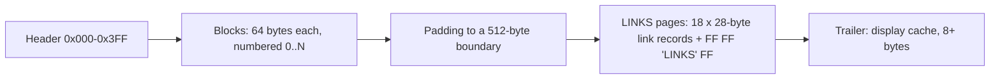

# Lotus Agenda's .AG file format

2026-10-14 · reverse engineered by Claude for Mattias Jämting

What a Lotus Agenda 2.0 data file (`.AG`, backup `.BG`) contains and how to
read it, so that Agendum can import old Agenda files. Nothing here was
published by Lotus; it was worked out from the four starter files shipped
with Agenda 2.0 and from files made by running Agenda headlessly in DOSBox,
changing one thing and comparing the bytes. How that was done, and what is
still open, is in [the research log](plans/AGENDA_FILE_FORMAT_LOG.md).
A reference reader that implements this document is
`tools/agformat/agdump.py` (`.AG` → JSON).

Confidence marks used below: **✔** confirmed by an experiment (Agenda made
the change, the bytes moved as described); **~** inferred from consistent
patterns in all files but not tested one at a time; **?** unknown.

## In short

- The file is a **dump of Agenda's own memory pool**, which explains its
  shape: Agenda (written in C) keeps everything in fixed-size records that
  point at each other by number. There is no compression and no encryption.
- Little-endian 16-bit words throughout; text is 8-bit DOS code page
  (CP437/CP850) and C strings (NUL-terminated); dates are 8-byte IEEE
  doubles counting days since 1899-12-30 (the Lotus 1-2-3 / Excel serial
  date; the fraction is the time of day).
- Three regions: a **1024-byte header**, an array of **64-byte blocks**
  (items, categories, views, text), and **512-byte "LINKS" pages** holding
  **28-byte link records** (assignments of items to categories, columns,
  conditions, date values).
- An **item** is a block holding its text; its assignments are a doubly
  linked list of link records. The same link records are also threaded on
  a second list per **category**: a sparse matrix, items × categories, as
  the Agenda patent (US 5,115,504) describes.
- A **password** does not encrypt the file. It is stored in the header XOR
  `0xAB`; the data stays readable.

## File layout ✔

| Offset                     | Size                    | Contents                                               |
| -------------------------- | ----------------------- | ------------------------------------------------------ |
| `0x000`                    | 1024                    | Header                                                 |
| `0x400`                    | 64 × (N+1)              | Blocks 0..N, block *n* at `0x400 + 64·n`; N is header word `0x3A` |
| end of blocks              | to next multiple of 512 | Padding (stale bytes; ignore)                          |
| next 512 boundary          | 512 × K                 | Link pages                                             |
| after the last link page   | rest of file            | Trailer                                                |

Each **link page** holds 18 link records (18 × 28 = 504 bytes) followed by
the 8-byte marker `FF FF 4C 49 4E 4B 53 FF` (`"LINKS"`). Pages follow each
other until a page without the marker; record *k* of a page is free when
its first word is 0. A link record's first word is its id, so its place in
the file does not matter.

The **trailer** is `[count, 0, section block, item block…, 0]` (16-bit
words, `count` = number of words after it): the rows of the section shown
when the file was saved, including built-in summary rows. It is a display
cache; an importer can ignore it.

A file copied **while Agenda had it open** has the same layout without the
trailer, possibly with extra pages; what Agenda had not yet written is
missing. Agenda writes a consistent file on File Save and on Quit. The
`.BG` file is the previous save, in the same format.

## Header ✔/~

| Offset  | Size | Meaning                                                                    |     |
| ------- | ---- | -------------------------------------------------------------------------- | --- |
| `0x000` | 2    | `54 00` (`"T"`, NUL): signature                                            | ✔   |
| `0x002` | 41   | File description (File Properties), C string                               | ✔   |
| `0x02B` | 13   | Password XOR `0xAB`, C string (so `AB AB …` when there is none)            | ✔   |
| `0x038` | 2    | Head of the free-block list                                                | ~   |
| `0x03A` | 2    | Highest block number N                                                     | ✔   |
| `0x03C` | 2    | Head of the free-link list                                                 | ~   |
| `0x03E` | 2    | Highest link id                                                            | ✔   |
| `0x040` | 2    | Root category block (MAIN), always 9                                       | ✔   |
| `0x042` | 2    | First view (views form an alphabetical list)                               | ✔   |
| `0x044` | 2    | Current view                                                               | ✔   |
| `0x074` | 2    | Number of categories under MAIN, MAIN included                             | ✔   |
| `0x09A` | 2    | First macro block                                                          | ✔   |
| `0x09C` | 2    | Last macro block                                                           | ~   |
| `0x168` | 8    | Date last saved (double)                                                   | ✔   |
| `0x170` | 8    | Date created (double)                                                      | ~   |
| `0x178` | ~    | Display settings: default column widths, colours (`C8 08` …)               | ?   |
| `0x198` | 12   | Varies per file, unchanged between saves; an id or hash                    | ?   |
| `0x1C4` | 12   | `"051361041162"` in every file seen (also files made today)                | ?   |
| `0x1E8` | 2    | Block of the item the cursor was on                                        | ✔   |

The other words hold program settings (Utilities Customize, print and date
settings). No import needs them yet.

## Blocks ✔

Every block is 64 bytes and starts with four words:

| Word | Meaning                                           |
| ---- | ------------------------------------------------- |
| 0    | Its own number (0 in a free block)                |
| 1    | Type (table below)                                |
| 2    | Usually "next": a continuation block              |
| 3    | Usually "previous", or the owner of the block     |

So a block is found by number at `0x400 + 64·n`, and its first word must
equal *n*; block 0 is not used. Text longer than a block continues in a
chain of **text blocks** (type 2) through word 2. Each text block carries a
C string of up to 55 characters in bytes 8–63; the text of a chain is the
concatenation of these pieces.

| Type | Block                         | Words 2, 3                         | Notes |
| ---- | ----------------------------- | ---------------------------------- | ----- |
| 0    | free                          |                                    | ✔ |
| 1    | **item**                      | text continuation, note            | ✔ |
| 2    | **text** (continuation)       | next, previous (or owner)          | ✔ |
| 3    | **category**                  | name text block, note              | ✔ |
| 4    | **view**                      | name continuation, first section   | ✔ |
| 5    | assignment-condition set      | (0, 0)                             | ~ |
| 6    | **section** (of a view)       | category, previous section         | ✔ |
| 7    | **note** header               | first text block, owner            | ✔ |
| 8    | data (binary or value text)   | next, bytes used in this block     | ✔ |
| 9    | family settings of a category's children | category, its parent    | ~ |
| 10   | **macro**                     | text continuation, previous macro  | ✔ |
| 11   | ? (12 in Planner/Account)     |                                    | ? |
| 12   | ? (2 in People)               |                                    | ? |
| 13   | datebook date range           |                                    | ~ |

Blocks 1–8 of every file are the four system categories (head + name):
`!Trash!` (1), `!Circular Reference!` (3), `!Current Alarms!` (5),
`!Past Alarms!` (7). Block 9 is MAIN; in a new file block 11 is the Initial View. Blocks 29–33 are
the built-in summary rows `COUNT`, `TOTAL`, `AVERAGE`, `MINIMUM`, `MAXIMUM`
(item blocks with flag `0x40`).

### Item (type 1) ✔

| Word / bytes | Meaning                                                  |
| ------------ | -------------------------------------------------------- |
| w2           | First text continuation block (0 if the text fits)       |
| w3           | Note header block (type 7), 0 if none                    |
| w9           | First assignment link of the item                        |
| w10          | Last assignment link                                     |
| w24          | Flags; `0x40` = built-in summary row (skip it)           |
| bytes 50–61  | Start of the item text: up to 11 characters and a NUL    |
| others       | 0 in every file seen                                     |

The item's id is its block number. Item text = bytes 50–61 as a C string,
then the pieces of the text chain from w2. Example: "The quick brown fox
jumps…" (118 characters) is 11 characters in the item block plus two text
blocks.

An item's **entry date, when date, done date** are not fields of the item:
they are assignments to the date categories Entry, When and Done, with the
date as the assignment's value (below).

**Discarded items** stay in the file: ALT-F4 removes all their assignments
and assigns them to `!Trash!` (block 1) instead ✔. An importer skips items
whose only category is block 1.

### Note (type 7) ✔

w2 = first text block, w3 = owner (item or category). The note text is the
chain from w2; lines are separated by CR (`0x0D`). Bytes 8–63 of the note
header hold note settings (?), for example the note file name if the note
is kept in a separate file (not yet tested).

### Category (type 3) ✔

A category is a head block (type 3) plus a name chain: w2 points at a text
block whose string is the name field as Agenda stores it:

    Name;Short name;text condition;text condition…

so `Calls;Phone;Telephone` is the category Calls, short name Phone, also
matching "Telephone"; `Follow up;;(follow up);(waiting for)` has no short
name. Quotes, parentheses and other punctuation are Agenda's text-condition
syntax (User's Guide ch. 19). A long name continues in more text blocks.

| Word | Meaning                                                                 |     |
| ---- | ----------------------------------------------------------------------- | --- |
| w2   | Name text block                                                         | ✔   |
| w3   | Note header (type 7), 0 if none                                         | ✔   |
| w4   | First assignment link (items assigned to this category)                 | ✔   |
| w5   | Last assignment link                                                    | ✔   |
| w6, w7 | Usually equal; a section of a view that shows this category           | ~   |
| w8, w9 | Last/first condition element (type-6 link) that tests this category   | ~   |
| w10, w11 | Last/first column (type-3 link) showing this category               | ~   |
| w14  | Previous sibling                                                        | ✔   |
| w15  | Next sibling (category manager order)                                   | ✔   |
| w16  | Parent                                                                  | ✔   |
| w17  | First child                                                             | ✔   |
| w18  | Last child                                                              | ✔   |
| w19  | Assignment-condition set (type-5 block), 0 if none                      | ✔   |
| w20, w21 | The ends of the list of date filters (type-8 links) on this category | ~   |
| w22  | Its node in the name index (type-9 link)                                | ✔   |
| w23  | Flags: `0x0002` with an STF `CP:yes`, `0x2000` with `CHC:no`; date categories `0x8000` set | ~ |
| w26  | **Type**: 1 standard, 0 standard with exclusive children, 5 unindexed, 9 numeric, 13 date | ✔ |
| w27  | Family settings block (type 9) shared by its siblings                   | ~   |
| w28  | Standard categories: `0x10` match category name, `0x08` match short name; date categories: date settings | ✔ |

The hierarchy starts at MAIN (block 9, header `0x040`) and is walked with
w17 then w15. Exclusive is a property of the parent (Priority has w26 = 0,
its children High/Medium/Low have 1). Entry, When and Done are date
categories (w26 = 13) created with every file.

### View (type 4) ✔

| Word / bytes | Meaning                                                     |     |
| ------------ | ----------------------------------------------------------- | --- |
| w2           | Name continuation (text block), 0 if the name fits          | ✔   |
| w3           | First section                                               | ✔   |
| w4           | Last section                                                | ✔   |
| w8           | Previous view (alphabetical)                                | ✔   |
| w9           | Next view                                                   | ✔   |
| w12          | 0 or 1 in a standard view, `0x2xx` in a datebook            | ~   |
| w15, w16     | Datebook: first and last hour (`0xC808` = 8:00, `0xC812` = 18:00) | ~ |
| w20          | View flags (`0x80`, `0x400`…)                               | ?   |
| bytes 44–63  | Start of the name: up to 19 characters and a NUL            | ✔   |

### Section (type 6) ✔

| Word | Meaning                                       |
| ---- | --------------------------------------------- |
| w2   | Section head category                         |
| w3   | Previous section                              |
| w4   | Next section                                  |
| w7   | The view it belongs to                        |
| w8   | First column (type-3 link)                    |
| w9   | Last column                                   |
| w10… | Sort order, filters, display settings (?)     |

### Macro (type 10) ✔

w3 = previous macro, w5 = next macro; the macro text starts at byte 24 and
continues through w2. Its first line is the macro's name in braces, for
example `{Create/Update contact list}`; lines end with CR.

### Data (type 8) ✔

w2 = next data block, w3 = bytes used in this block. Holds binary settings
(the five blocks 34–38 of every file) and the text of unindexed values.

## Link records ✔

28 bytes = 14 words; word 0 is the id, word 1 the type.

| Type | Record                                            |     |
| ---- | ------------------------------------------------- | --- |
| 0    | free                                              | ✔   |
| 1    | **assignment** of an item to a category           | ✔   |
| 2    | datebook range / view filter                      | ~   |
| 3    | **column** of a section                           | ✔   |
| 6    | element of an assignment condition                | ✔   |
| 7    | element of an assignment action                   | ~   |
| 8    | date filter of a view                             | ~   |
| 9    | node of the category-name index (an AVL tree)     | ✔   |
| 12   | **date value**                                    | ✔   |

### Assignment (type 1) ✔

| Word / bytes | Meaning                                                         |
| ------------ | --------------------------------------------------------------- |
| w2           | Category block                                                  |
| w3           | Previous assignment of the same item                            |
| w4           | Next assignment of the same item                                |
| w5           | Item block                                                      |
| w6           | Previous assignment in the same category                        |
| w7           | Next assignment in the same category                            |
| w8           | Flags (below)                                                   |
| w9           | Value reference (date or unindexed value)                       |
| bytes 18–25  | Numeric value (double), when flag `0x80` is set without `0x100` |

Flags in w8:

| Bits         | Meaning                                                                 |
| ------------ | ----------------------------------------------------------------------- |
| `0x0000`     | assigned explicitly (typed into a section or column)                    |
| `0x0001`     | assigned by text matching (category name, short name, also match)       |
| `0x0002`     | assigned by an assignment condition                                     |
| `0x0040`     | set automatically by Agenda (the Entry date, a When date read from the text) |
| `0x0100`     | has a value; w9 is the id of a **date value** link (type 12)            |
| `0x0080`     | numeric value in bytes 18–25                                            |
| `0x0180`     | unindexed value: w9 is a **data block** (type 8) with the text          |

Examples seen: Entry `0x140`, Done `0x100`, a numeric Amount `0x80`
(42.5 stored as the double `0x4045400000000000`), an unindexed Page `0x180`.

### Date value (type 12) ✔

| Bytes  | Meaning                                                                 |
| ------ | ----------------------------------------------------------------------- |
| 4–9    | 0                                                                       |
| 10–17  | How the date was given: the same double again, or, for a relative date typed in the text ("next Friday", "every Monday at 10am"), an encoded date expression (?) |
| 18–25  | **The date** (double)                                                   |
| 26–27  | Kind: 0 a date typed as a date; 1, 2 relative dates; for Entry dates this word repeats the top of the double |

A date without a time has fraction 0 ("Dentist on 11/20/26" → 46346.0).
"Lunch next Friday" typed at 23:28 got 23:28 as its time.

### Column (type 3) ✔

| Word | Meaning                                                  |
| ---- | -------------------------------------------------------- |
| w2   | Category shown in the column                             |
| w3, w4 | Next/previous column showing the same category          |
| w5   | Section                                                  |
| w6   | Previous column in the section                           |
| w7   | Next column in the section                               |
| w8   | Width in characters                                      |
| w9–w13 | Format and display settings (?)                         |

Checked against the screen: the Planner's Tasks view shows `Activity`,
`People`, `Project`, `When` with widths 8, 7, 8, 17, the order and widths
read from these records.

### Assignment conditions (type-5 block, type-6 links) ✔

A category with conditions points (w19) at a type-5 block: w6 = the owning
category, w11/w12 = first/last element. Each element (type-6 link): w2 = the
category tested, w3/w4 = previous/next element of the set, w5 = the set
block, w6/w7 = next/previous element testing the same category, w8 = 0 for
"must be assigned to" and 1 for "must not be". Planner's Unassigned is "in
Tasks and not in People", the STF export says the same.

### Category-name index (type 9) ✔

An AVL tree over the category names, used by Agenda to find a category
when matching text. w2 = category, w5/w6 = left/right child, w7 = parent,
w11 = balance. Link 1 holds the root in w5. It holds no data that is not
also in the category blocks; an importer ignores it.

## Reading a file

1. Check `T\0` at offset 0. Read N from `0x3A`.
2. Load the blocks `0x400 + 64·n` for n = 1..N and the link pages from the
   next 512-byte boundary on, while each page ends with `FF FF "LINKS" FF`.
3. **Categories:** from block 9, depth first through w17 (first child) and
   w15 (next sibling). Name = text chain from w2, split at `;` into name,
   short name and text conditions. Type from w26, note from w3.
4. **Items:** every block with w0 = n, w1 = 1 and no `0x40` in w24. Text =
   bytes 50–61 + the chain from w2; note from w3. Assignments: from w9
   through link w4. For each, the category (w2) and, by flags, its value.
   Skip items whose only assignment is to block 1 (`!Trash!`).
5. **Views:** from header `0x42` through w9. Name = bytes 44–63 + chain
   from w2. Sections from w3 through w4; columns from section w8 through
   link w7.

`tools/agformat/agdump.py` does exactly this and checks the cross
references; it reads all files at hand (the four starters, 13 test files
and a Planner file with real use) without an error.

## Mapping to Agendum

| Agenda                                 | Agendum (`docs/DATA_MODEL.md`)                     |
| -------------------------------------- | -------------------------------------------------- |
| item block                             | item; text, note                                   |
| assignment link                        | explicit link (store only flags 0 = explicit; text-match and condition assignments can be recomputed, or kept as explicit) |
| Entry / When / Done assignment values  | the item's entry, when and done dates              |
| category block, hierarchy w16–w18      | category tree; name; short name; also match       |
| w26 types                              | standard / exclusive / unindexed / numeric / date  |
| numeric / unindexed values             | category values on the item                        |
| view, section, column                  | view, sections, columns with widths                |
| conditions (type 5/6)                  | assignment conditions                              |
| macros                                 | not imported                                       |

## Not yet known

- Sorting, filters and display settings in views and sections (view words
  w10–w21, section words w10 and on, column words w9–w13).
- The encoding of relative and recurring dates (date value bytes 10–17).
- Date-category settings (w28 of date categories) and the flags word w23.
- Actions (type-7 links), datebook ranges (type 2, block type 13), block
  types 11 and 12.
- Note files kept outside the `.AG`, item and category alarms.
- Agenda 1.0 files and the files the owner remembers as encrypted: every
  2.0 file seen is unencrypted, password or not.

The research log lists the experiments that would settle each of these.
