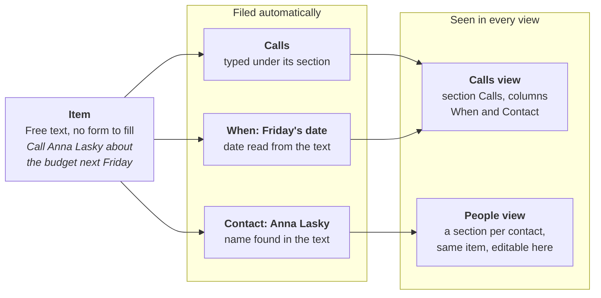

# Lotus Agenda: why people used it and what made it unique

2026-10-08 · Mattias Jämting

Lotus Agenda (1988, MS-DOS) let people type thoughts in first and organize them later. Every note could belong to many categories at once, and the program filed it automatically by reading the text. Users could rearrange the same notes into any number of editable views. It sold modestly — roughly 200,000 copies — and Lotus dropped it in the early 1990s, but its ideas (one item in many places, smart folders, filing by rules) still shape personal information tools today.

## Background

Agenda was Lotus founder Mitch Kapor's last project at the company, designed with Jerry Kaplan and Ed Belove. Kapor later called it his favorite product: "the first personal information manager" ([Kapor oral history, 2006](http://archive.computerhistory.org/resources/text/Oral_History/Kapor_Mitch/Kapor_Mitch.oral_history.2006.102657943.pdf)). It ran on IBM PCs under MS-DOS with 640 KB of memory, in a full-screen text interface.

| When | What happened                                                                                                                                      |
| ---- | -------------------------------------------------------------------------------------------------------------------------------------------------- |
| 1992 | Release 2.0b, the final version ([Wikipedia](https://en.wikipedia.org/wiki/Lotus_Agenda))                                                          |
| 1992 | US patent 5,115,504 granted, covering the item/category data structures ([patent](https://patents.google.com/patent/US5115504A/en))                |
| 1990 | Designers publish "Agenda: A Personal Information Manager" in _Communications of the ACM_ 33(7) ([ACM](https://cacm.acm.org/author/todd-r-drake/)) |
| 1988 | Release 1.0 ships; patent application filed in November ([patent](https://patents.google.com/patent/US5115504A/en))                                |

Rather than port Agenda to Windows, Lotus replaced it with Lotus Organizer ([Wikipedia](https://en.wikipedia.org/wiki/Lotus_Agenda)).

## Why people used it

People used Agenda to keep track of "a hundred things going on at once" without deciding up front where each thing belonged. Lotus pitched it at people who manage projects and people and "need to look at their jobs from multiple perspectives" (launch brochure, quoted in [EPA PC TAP report, 1989](https://mirrorservice.org/sites/www.bitsavers.org/pdf/us_epa/pc_tap/PC_TAP_Consumer_Report_%2301_Personal_Information_Managment_Systems_198908.pdf)). The reasons fans gave come down to four:

- **Capture without filing.** You typed a note as it came to mind, such as "See Wendy on Tuesday 3pm", with no form or fields to fill in first ([Wikipedia](https://en.wikipedia.org/wiki/Lotus_Agenda)).
- **The program did the filing.** Typing "important planning meeting next Wednesday" produced a dated to-do; names in the text filed the note under those people ([EPA report](https://mirrorservice.org/sites/www.bitsavers.org/pdf/us_epa/pc_tap/PC_TAP_Consumer_Report_%2301_Personal_Information_Managment_Systems_198908.pdf)).
- **Many perspectives on one set of notes.** The same items could appear as a to-do list by date, a list per person, or a list per project, all editable.
- **A tool for thinking, not just storing.** Kapor called it "a thought organizer" ([oral history](http://archive.computerhistory.org/resources/text/Oral_History/Kapor_Mitch/Kapor_Mitch.oral_history.2006.102657943.pdf)); James Fallows still calls it "the sainted Lotus Agenda", the start of his "software for thinking" journey ([Fallows](https://fallows.substack.com/p/interesting-software-update)).

It was never for everyone. Users in the US Environmental Protection Agency's 1989 trial disagreed sharply:

| Who                  | What they said                                                                                                                 |
| -------------------- | ------------------------------------------------------------------------------------------------------------------------------ |
| A fan, six months in | Saw at once that it matched "the way he naturally organizes things"                                                            |
| A manager            | "A nice package to handle to-do lists"                                                                                         |
| A sceptic            | "An incredibly powerful, full featured, unstructured data base" but the "hardest program to learn and use that I've ever seen" |
| A dropout            | Chose not to continue "after using it daily for nearly a month"                                                                |

The report's verdict: you had to use it daily "for a month or more" to appreciate it, and many casual users would not ([EPA report](https://mirrorservice.org/sites/www.bitsavers.org/pdf/us_epa/pc_tap/PC_TAP_Consumer_Report_%2301_Personal_Information_Managment_Systems_198908.pdf)). Those who did stayed loyal: years after Lotus dropped it, "thousands of people" still used Agenda because they could not find anything comparable ([The Palmtop Paper](https://www.palmtoppaper.com/ptphtml/43/43c00005.htm)).

## Unique features

Agenda's core idea was the item/category database: free-text items and named categories exist independently, joined by many-to-many links, so one note can sit in many places at once ([patent](https://patents.google.com/patent/US5115504A/en)). In 1988 most PC databases forced each record into one fixed set of fields. Everything else in the table builds on that idea.

One typed sentence is linked to three categories without the user filing it, and appears, editable, in every view that shows any of them.

| Feature                          | What it did                                                                                                                                            | Source                                                                                                                                                           |
| -------------------------------- | ------------------------------------------------------------------------------------------------------------------------------------------------------ | ---------------------------------------------------------------------------------------------------------------------------------------------------------------- |
| Items in many categories         | A single note could belong to a project, a person and a priority at once; categories formed a hierarchy, and membership flowed up to parent categories | [Patent](https://patents.google.com/patent/US5115504A/en)                                                                                                        |
| Automatic filing by text         | New or edited items were scanned for category names, so "Meet with John Smith on Tuesday" also landed in the John Smith category                       | [Patent](https://patents.google.com/patent/US5115504A/en)                                                                                                        |
| Plain-language dates             | "next Wednesday", "tomorrow", "next month" and "every Friday" became real dates in the When category                                                   | [EPA report](https://mirrorservice.org/sites/www.bitsavers.org/pdf/us_epa/pc_tap/PC_TAP_Consumer_Report_%2301_Personal_Information_Managment_Systems_198908.pdf) |
| Views you edit directly          | Views arranged items into sections and columns, and every change was made in the view itself; there was no separate data-entry mode                    | [Patent](https://patents.google.com/patent/US5115504A/en)                                                                                                        |
| Typing a category into a column  | Typing "High" next to an item under a Priority column assigned it, creating the category if it was new                                                 | [Patent](https://patents.google.com/patent/US5115504A/en)                                                                                                        |
| Guessing intent                  | When a new item matched two categories that could not both apply, Agenda copied the choice of the neighbouring item in the view                        | [Patent](https://patents.google.com/patent/US5115504A/en), claim 7                                                                                               |
| Mutually exclusive categories    | A family like High / Medium / Low allowed one choice per item, with dialogs to resolve existing conflicts                                              | [User's Guide](https://archive.org/details/lotus-agenda-users-guide)                                                                                             |
| Conditions and actions           | Rules that assigned items or set dates automatically, such as linking one category to another; Agenda could also ask before assigning                  | [User's Guide](https://archive.org/details/lotus-agenda-users-guide), [patent](https://patents.google.com/patent/US5115504A/en)                                  |
| Task dependencies and done marks | Items could depend on other items, and could be marked done                                                                                            | [EPA report](https://mirrorservice.org/sites/www.bitsavers.org/pdf/us_epa/pc_tap/PC_TAP_Consumer_Report_%2301_Personal_Information_Managment_Systems_198908.pdf) |
| Importing and searching text     | External documents such as captured email could be imported and parsed, and searched with Boolean logic                                                | [EPA report](https://mirrorservice.org/sites/www.bitsavers.org/pdf/us_epa/pc_tap/PC_TAP_Consumer_Report_%2301_Personal_Information_Managment_Systems_198908.pdf) |

In short, Agenda let users impose structure _after_ capturing information, and change that structure at any time without losing data.

## Reception, decline and legacy

Agenda was praised and talked about far more than it was bought. PC Magazine called it the "most talked about" personal information manager, and it cost $395 a copy in 1989, among the most expensive in its class ([EPA report](https://mirrorservice.org/sites/www.bitsavers.org/pdf/us_epa/pc_tap/PC_TAP_Consumer_Report_%2301_Personal_Information_Managment_Systems_198908.pdf)). It sold about 200,000 copies before Lotus discontinued it in the early 1990s. The steep learning curve limited its audience, and the DOS program was never ported to Windows ([Wikipedia](https://en.wikipedia.org/wiki/Lotus_Agenda)). It was later released as freeware.

Its ideas outlived it, carried forward by the people who loved it:

| Year | Descendant or echo                                                                                                                                                                                                |
| ---- | ----------------------------------------------------------------------------------------------------------------------------------------------------------------------------------------------------------------- |
| 2020 | VC Brad Feld on Roam Research: "Agenda is the only product that augmented my brain and how I think until I started using Roam" ([Feld](https://feld.com/archives/2020/11/roam-my-new-favorite-software-product/)) |
| 2008 | Kapor's open-source [Chandler](https://en.wikipedia.org/wiki/Chandler_%28software%29) 1.0, "inspired by" Agenda's free-form approach; its troubled development is the subject of the book _Dreaming in Code_        |
| 2003 | Microsoft Outlook adds search folders, similar to Agenda's rule-based categories ([Wikipedia](https://en.wikipedia.org/wiki/Lotus_Agenda))                                                                        |
| 1997 | James Fallows writes that he still uses Agenda despite the difficulty of running it under Windows ([Wikipedia](https://en.wikipedia.org/wiki/Lotus_Agenda))                                                       |

Kapor summed up why the idea persisted: Agenda "did things you still can't do on a PC" in letting people define their own categories ([oral history, 2006](http://archive.computerhistory.org/resources/text/Oral_History/Kapor_Mitch/Kapor_Mitch.oral_history.2006.102657943.pdf)).

## What this means for our clone

Agendum now has the core that made Agenda distinctive, and the "magic" users praised most: dates and rules taken from plain text. Rule numbers refer to [`SPEC.md`](SPEC.md). The table was first written on 2026-10-08 and brought up to date on 2026-10-15; [`ROADMAP.md`](ROADMAP.md) has the current status, and [`plans/AGENDA_PARITY.md`](plans/AGENDA_PARITY.md) how close Agendum is to Agenda as a whole.

| Agenda feature                                   | In Agendum today                                                                 | Still open                                                   |
| ------------------------------------------------ | -------------------------------------------------------------------------------- | ------------------------------------------------------------ |
| Items in many categories, hierarchy, inheritance | Done (R1–R5)                                                                     | —                                                            |
| Automatic filing by text                         | Done: names, short names, Also match, proper names, settings per file and category (R10–R16c) | —                                               |
| Editable views, typing into columns              | Done, with sorting, filters, columns per section, datebooks (R20–R29, R36, R47, R55–R62) | —                                                    |
| Guessing intent from the neighbouring item       | Done (R12)                                                                       | —                                                            |
| Mutually exclusive categories                    | Done, including conflict dialogs (R7–R7d)                                        | —                                                            |
| Plain-language dates                             | Done: from item text and notes, times, recurring dates, date categories, languages (R6a, R6b, R14–R14f) | Recurring items on every date they recur (`plans/RECURRING_OCCURRENCES.md`) |
| Conditions and actions                           | Done: conditions, date and numeric conditions, text conditions, actions, Execute (R15–R15e) | —                                                 |
| Task dependencies                                | Done (R43)                                                                       | —                                                            |
| Searching text                                   | Done: the view, the file, notes with replace (R37, R39)                          | —                                                            |
| Importing                                        | JSON and web calendars (R44, R45)                                                | Agenda's own files (`.AG`, STF): the format is known (`AGENDA_FILE_FORMAT.md`), the importer is next |
| The note editor                                  | Editing, marking, cut and paste, search and replace, word wrap (R39, R63, R64)   | Agenda's own control panel, menu and keys (`plans/NOTE_EDITOR.md`) |

The history also gives a design lesson. Agenda's power came with a learning curve that drove casual users away within a month. Keep the clone's first minutes simple: the demo file, the F1 help and sensible defaults matter as much as features.

## Sources

- [Oral History of Mitch Kapor](http://archive.computerhistory.org/resources/text/Oral_History/Kapor_Mitch/Kapor_Mitch.oral_history.2006.102657943.pdf), interviewed by William Aspray, Computer History Museum, 2006
- [PC TAP Consumer Report #1: Personal Information Management Systems](https://mirrorservice.org/sites/www.bitsavers.org/pdf/us_epa/pc_tap/PC_TAP_Consumer_Report_%2301_Personal_Information_Managment_Systems_198908.pdf), US EPA, August 1989
- [US patent 5,115,504, Information Management System](https://patents.google.com/patent/US5115504A/en), Belove et al., Lotus Development Corporation, 1992 (also in `docs/reference/`)
- [Lotus Agenda 2.0 manuals](https://archive.org/details/lotus-agenda-users-guide) (User's Guide, Quick Start), Internet Archive
- [Agenda: a personal information manager](https://cacm.acm.org/author/todd-r-drake/), Kaplan, Kapor, Belove, Landsman, Drake, _Communications of the ACM_ 33(7), 1990 (the text is in `docs/reference/`)
- "Hidden Agendas, Lost Cities", System Stack: an essay on using Agenda today, against modern task managers and Getting Things Done (in `docs/reference/`)
- [Lotus Agenda](https://en.wikipedia.org/wiki/Lotus_Agenda) and [Chandler (software)](https://en.wikipedia.org/wiki/Chandler_%28software%29), Wikipedia
- [A Brief History of Lotus Agenda](https://www.palmtoppaper.com/ptphtml/43/43c00005.htm), The Palmtop Paper
- ["Interesting Software" Update](https://fallows.substack.com/p/interesting-software-update), James Fallows
- [Roam: My New Favorite Software Product](https://feld.com/archives/2020/11/roam-my-new-favorite-software-product/), Brad Feld, November 2020

Not verified: James Fallows's 1992 review of Agenda in _The Atlantic_, which secondary sources describe; the original article could not be retrieved.
