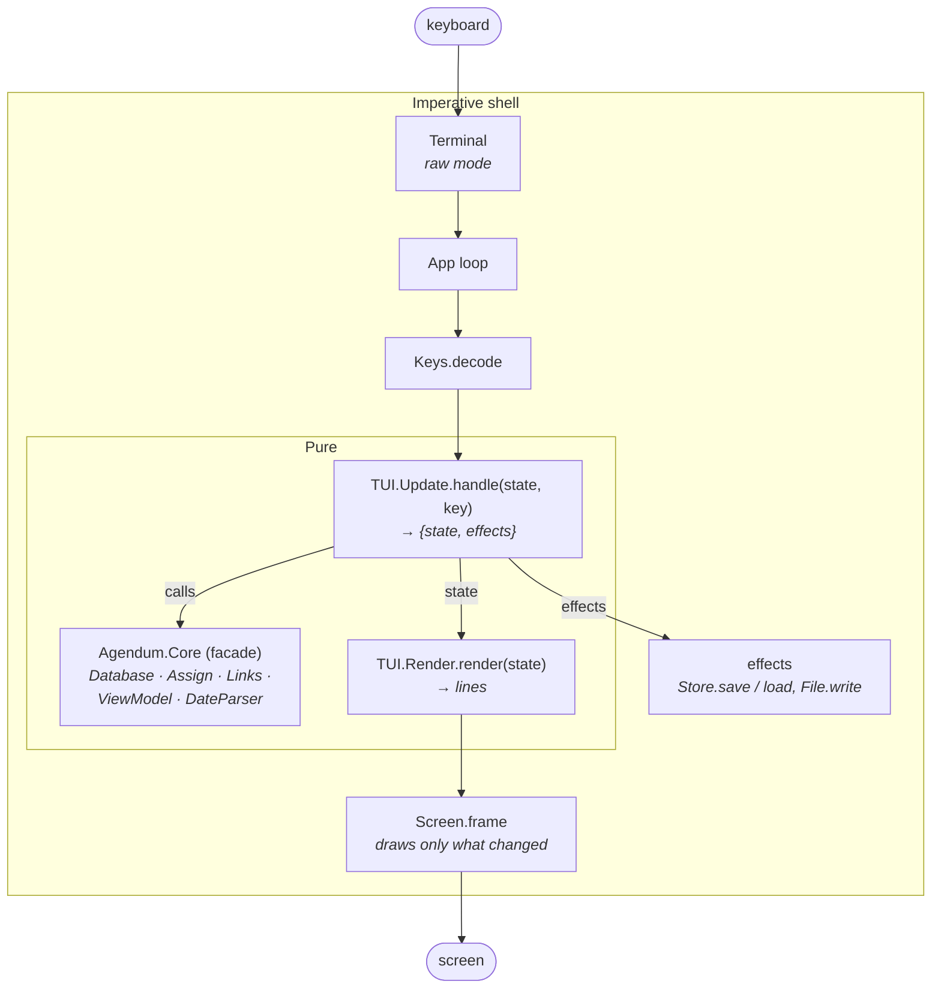

# Architecture

**Functional core, imperative shell.** All of Agendum's logic and the whole UI state machine are pure functions over immutable values. A thin shell does terminal I/O and file I/O.

## The extras' shelf

The extras (ADR 0043: features that fail its test for the truthful clone, the micro-blog and its site, Markdown, feeds, Zettel ids and links, calendar subscriptions) live in namespaces of their own (ADR 0044): `Agendum.Core.Extras.*` (`lib/agendum/core/extras/`), the facade's extras area `Agendum.Core.Facade.Extras.*`, their boxes in `Agendum.TUI.Extras.*` and their shell modules in `Agendum.Extras.*`. Faithful code does not call the core's extras: `test/agendum/architecture_test.exs` reads the calls (`:xref`) and allows only the file's modules (`Database`, `JSONFile`, `Store`, `Starters.Golden`, `Invariants`), `Agendum.Core`'s delegations to the extras' facade area, the extras' own homes, and two named exceptions (Assign's link blanking, ViewModel's Zettel id column). Their stored structs (`Feed`, `Blog`, `Calendar`) moved in format 38; `Store` maps the old names on load.

## What a front end may use

Code built on the core (the TUI today, a second front end later, CLAUDE.md rule 6) uses three things, and only these (the owner, 2026-10-31):

- **The facade**, `Agendum.Core`: every change to a file goes through it.
- **`Agendum.Core.Database`'s read functions**: those whose `@spec` does not return a database. Its write functions are the facade's to call (`test/agendum/architecture_test.exs`).
- **The stored structs**, read only: their fields are the file's format (`docs/DATA_MODEL.md`, `docs/JSON_FORMAT.md`), versioned and guarded by the golden files.

A function of the first two is removed or changed only after it has been marked `@deprecated` for at least one minor version, and both steps are listed under the CHANGELOG's **Facade** heading. Everything else under `lib/agendum/core/` may change without notice.

## Modules

### Core (`lib/agendum/core*`) — pure

| Module                                                         | Responsibility                                                                                                                                          |
| -------------------------------------------------------------- | ------------------------------------------------------------------------------------------------------------------------------------------------------- |
| `Agendum.Core`                                                  | Facade with user-level operations (add item, assign by name, add section…): a table of contents of `defdelegate`s. The UI uses this.                    |
| `Agendum.Core.Facade.*`                                         | Its areas: `Files`, `Items`, `Assignments`, `Dates`, `Alarms`, `Numbers`, `Texts`, `Dependencies`, `Rules`, `Categories`, `Views`, `Macros`, `Trash` (R24a); and the extras' area, `Agendum.Core.Facade.Extras.*`: `Calendars` (R45), `Feeds` (R75), `Publishing` (R74), `Zettels` (R73).        |
| `Agendum.Core.Browse`                                           | Browsing dates (R47, R48): where it starts, a move, going to a date, the view as browsed, the command that keeps it. |
| `Agendum.Core.Reasons`                                          | Why an item is in a category (R67), worked out with `Assign`'s rules.                                               |
| `Agendum.Core.Command`                                          | The command layer (R66, ADR 0036): a user action as data (`{:mark_done, ids}`), run by `Agendum.Core.run/3` on ids; each command's name and summary. |
| `Agendum.Core.Command.Changes`                                  | What a command changed, found by comparing the database before and after.                                                                               |
| `Agendum.Core.Facade.Changes`                                   | What every change to an item goes through: user assignments, dates from rules, settling (conditions, actions).                                          |
| `Agendum.Core.Database`                                         | The file as one immutable struct: items, categories, views, links, id counter. Primitive operations and queries (`member?/3`, `items_in/2`, hierarchy). |
| `Agendum.Core.FileCheck`                                        | The check a file passes when opened: types through the JSON reading, then the invariants; a damaged file is refused (R82d, ADR 0052). |
| `Agendum.Core.Invariants`                                       | The data model's invariants as one check (`violations/1`), run after every key by the fuzz walks (DATA_MODEL.md, "Invariants").                    |
| `Agendum.Core.Links`                                            | Bidirectional many-to-many relation (the patent's link structures).                                                                                     |
| `Agendum.Core.Assign`                                           | Assignment rules: exclusion, category links, text matching, ambiguity resolution.                                                                       |
| `Agendum.Core.ViewModel`                                        | Read model: projects a view to sections, rows and column cells.                                                                                         |
| `Agendum.Core.ViewColumns`                                      | Columns per section (R55): adding to one section or all, linked columns changing together, removing from one section or all.                            |
| `Agendum.Core.Datebook`                                         | Datebook views: their settings, the time slots of a period, which items a slot shows (R47).                                                             |
| `Agendum.Core.MonthCalendar`                                    | The pop-up calendar's month as weeks, and the moves of its highlight (R46).                                                                             |
| `Agendum.Core.Macro`                                            | A macro kept in the file: name, keystrokes in Agenda's notation, attached key, where it runs (R50).                                                     |
| `Agendum.Core.Extras.Markdown`                                         | The micro-blog's own Markdown subset, with task boxes and Zettel links, as HTML; everything else escaped (R74).                                         |
| `Agendum.Core.Extras.Xml`                                              | A small, forgiving XML reader that makes no atoms from what it reads, for feeds (R75).                                                                   |
| `Agendum.Core.Extras.Utf8`                                             | Text from outside (a calendar, a feed) made valid UTF-8 before it is parsed: a byte that is not UTF-8 is read as Latin-1.                                 |
| `Agendum.Core.Extras.FeedParser`                                       | RSS 2.0, RSS 1.0 and Atom read into entries; feed dates; HTML as plain text (R75).                                                                      |
| `Agendum.Core.Extras.Feed`, `Agendum.Core.Extras.FeedSync`                    | A feed subscription, and its entries mirrored into items: new ones added, changed ones updated, old ones fading unless kept (R75).                       |
| `Agendum.Core.Extras.Blog`                                             | The micro-blog's settings, kept in the file, and its posts, newest first (R74).                                                                         |
| `Agendum.Core.Extras.Address`                                          | A post's page address from the Site's pattern (`{zettel}`, `{slug}`, `{year}` …), made unique, and the slug from a title (R74).                          |
| `Agendum.Core.Extras.BlogFeed`                                         | One of the blog's own feeds' settings: title, description, folder (R74).                                                                                  |
| `Agendum.Core.Extras.PostRecord`                                       | What publishing remembers of a post: its address, a fingerprint, the day it was found changed (R74).                                                    |
| `Agendum.Core.Extras.Template`                                         | The site's templates: a logic-less, Mustache-style language read by Agendum's own reader; a mistake with its line (R74).                                 |
| `Agendum.Core.Extras.Upload`                                           | Where the blog is written and how it is uploaded, the person's (kept in their preferences, not the file); the rsync target check (R74).                  |
| `Agendum.Core.Extras.Site`                                             | The blog as a static site, `{path, content}` pairs: index, a page per post, RSS, JSON Feed, stylesheet and fonts (compiled in from `site_assets/`); what publishing changes in a folder (R74).       |
| `Agendum.Core.DateParser`                                       | Date expressions relative to a given `today`.                                                                                                           |
| `Agendum.Core.TextCondition`                                    | Agenda's "Also match" text conditions: `;` any, `,` all, `!`, `~`, `^`, wildcards (R15d).                                                               |
| `Agendum.Core.TextMatch`                                        | How a file matches text to categories: on/off, match on, strength, enclosed text, suffixes, accents (R16a), proper names (R16c).                        |
| `Agendum.Core.Trash`                                            | A file's trash (R24a): the discarded items, the day the oldest went in, and File Properties ▸ Empty trash. |
| `Agendum.Core.Recurrence`                                       | The rule of a recurring When date and the next date from a base date (R14a).                                                                            |
| `Agendum.Core.Context`                                          | The time, date languages and input format (R14c, R41b), passed wherever typed dates are read; `parser_opts/2` adds the file's `DateSettings`; `prepare/1` carries the date rules compiled once (ADR 0035). |
| `Agendum.Core.InputFormat`                                      | How one person types dates: number order, date separator, 12/24-hour clock; nil is the language's (R41b).                                               |
| `Agendum.Core.JSONFile`                                         | A whole file as JSON and back, checked on import (R44; schema in `JSON_FORMAT.md`).                                                                     |
| `Agendum.Core.FileDefaults`                                     | The defaults for new files (File Properties ▸ Update defaults, R82a): the file's settings that differ from Agenda's, taken and put on a new file.          |
| `Agendum.Core.AgFile` (`Reader`, `Convert`, `CP437`)           | A Lotus Agenda `.AG` file imported: its bytes read (`AGENDA_FILE_FORMAT.md`), made a JSON document, built and checked by `JSONFile` (R72).                 |
| `Agendum.Core.Extras.ICal`                                             | Reads the events of an iCalendar (`.ics`) file: title, description, start, repeat rule, status (R45).                                                   |
| `Agendum.Core.Extras.ICal.TimeZone`                                    | A calendar's own time zones (VTIMEZONE): a time in a named zone to UTC, without a time-zone database (R45).                                             |
| `Agendum.Core.Extras.Calendar`, `Agendum.Core.Extras.CalendarSync`             | A calendar subscription; a refresh applied to the file, mirroring the calendar (R45).                                                                   |
| `Agendum.Core.Extras.Ingested`                                                 | The ingested categories: each feed's and calendar's own, and the Feeds and Calendars families, which the person reads but does not fill or restructure (R75a, ADR 0048). |
| `Agendum.Core.DateLanguage` (+ `English`, `Swedish`)            | Language packs for reading dates: words, phrase patterns, day/month order, clock (R14c). `DateParser` does the arithmetic.                              |
| `Agendum.Core.Search`                                           | Text search: whether an item's text or note matches (R37).                                                                                              |
| `Agendum.Core.RangeFilter`                                      | Date and numeric filter ranges: checking, matching, the value a new item gets (R28a).                                                                   |
| `Agendum.Core.NumberFormat`                                     | Reading and showing numbers, and the calculations of numeric columns (R29).                                                                             |
| `Agendum.Core.DateFormat`                                       | How a file or date column displays dates and times: order, separator, clock, Relative, Week # (R41, R41a).                                              |
| `Agendum.Core.DateRule`                                         | How a date category gets dates: Assign item date, Which one, Done and When keys (R6b).                                                                  |
| `Agendum.Core.DateSettings`                                     | How a file reads dates: week, quarter and year boundaries, month alone, morning/afternoon/evening (R14e).                                               |
| `Agendum.Core.TextSearch`                                       | Finding and replacing literal text in a note's lines (R39).                                                                                             |
| `Agendum.Core.Extras.Fingerprint`                                      | A text's fingerprint (`:erlang.phash2/2`, 2^32 values): what an extra keeps of the text it filed, to tell later whether the item still says it (ADR 0048). |
| `Agendum.Core.Extras.ZettelId`                                         | Quadsyl-24: a Zettel number to its pronounceable id (`bonalaku`) and back; the reserved words (`docs/QUADSYL.md`, ADR 0039).                              |
| `Agendum.Core.Extras.ZettelLinks`                                      | Links between zettels: `[[bonalaku]]` and bare ids in a text, what an item links to, what links to it (R73b).                                          |
| `Agendum.Core.Item`, `Agendum.Core.Category`, `Agendum.Core.View` | Plain structs.                                                                                                                                          |

### TUI (`lib/agendum/tui/*`)

Every screen, box and control-panel mode, and how each is reached, is mapped in [`SCREENS.md`](SCREENS.md).

The folder keeps at its top what everything goes through (`State`, `Update`, `Render`, `App`, `Layout`, `Menu`, `History`, the macros, the splash and developer screens, `DebugLog`, `CategoryScreens`), and groups the rest by what it is for:

- `tui/boxes/` (`Agendum.TUI.Boxes.*`): every box, and the machinery they share: `Box` (the behaviour a box module implements, and the registry from mode type to module), `Template` (layouts), `BoxNav` (moving), `BoxCancel` (ENTER and ESC), `BoxDefaults` (F8 and ALT-F8), `BoxChoices` (letters and F3), `BoxEdit` (F2), `FieldHelp`, `FieldTyping`. Every box keeps everything about it in its own module: keys, drawing, key bar, help, how it ends (`docs/plans/archive/REFACTORING.md`, step 3). `Update` sends a box its keys, and `Render.Boxes` draws its frame, through the registry. A new box is a module with `use Agendum.TUI.Boxes.Box` and its options (`finish:`, `indicator:`, `cancels:`, `choices:`), the callbacks (`handle/3`, `title/2`, `content/4`, `keys/2`, `help/0`; `field/2`, `width/2`, `finish/1` where needed), and a line in `Box.registry/0`. A box with fixed settings is drawn from a `Template` layout; the lists (pickers, profiles, calendar, macros, files, views) draw their own rows;
- `tui/terminal/` (`Agendum.TUI.Terminal.*`): keys in, screen out: `Keys`, `Screen`, `Draw`, `Theme` and its palettes (`Agendum.TUI.Terminal` itself, the raw terminal, is the folder's parent module);
- `tui/typing/` (`Agendum.TUI.Typing.*`): typing text: `LineEdit`, `TextEdit`, `Completion`, `NoteSearch`;
- `tui/moves/` (`Agendum.TUI.Moves.*`): the control-panel modes that move something: `Browse`, `ColumnMove`, `ColumnWidth`, `ItemReposition`, `SectionMove`;
- `tui/render/`, `tui/update/`, `tui/category_screens/`: the parts of `Render`, `Update` and `CategoryScreens`.

| Module                                        | Pure? | Responsibility                                                                                                                   |
| --------------------------------------------- | ----- | -------------------------------------------------------------------------------------------------------------------------------- |
| `Agendum.TUI.State`                            | ✔     | UI state: db, path, cursor, scroll, **mode stack**, inline edit, message, queued effects.                                        |
| `Agendum.TUI.Effect`                           | ✔     | The closed list of effects the TUI asks the shell for (`t/0`, `known?/1`); `App` logs and skips any other, rather than crash.    |
| `Agendum.TUI.Modes`                            | ✔     | A struct for each kind of mode on the stack (ADR 0037), from one table; `new/1` makes a map one.                               |
| `Agendum.TUI.Update`                           | ✔     | Key → state transitions: keys for every screen, the clock (`tick/2`), dispatch to the screen on top.                            |
| `Agendum.TUI.Update.Results`                   | ✔     | The shell's answers: after `App` carries out an effect, the result becomes the new state (saved, loaded, imported, a copy written, trashed); the extras' answers are beside them (`Extras.*.Results`). |
| `Agendum.TUI.Update.*`                         | ✔     | Its parts: `ViewKeys` (the view's keymap lookup and `run`), `Editing` (inline), `Marked` (and moves), `Prompts` (and Y/N), `Notes`, `Actions` (`perform/2`).          |
| `Agendum.TUI.Command`, `Agendum.TUI.Commands`, `Agendum.TUI.CommandDocs`  | ✔     | The commands keys can run, as data: id, name, summary, a longer text (R65b), what a count does; by place: the view's, a note's, the menu's, the category and view managers', every box's shared ones and the global ones so far; a box's own are in its module (`Box.keymap/1`, `commands/1`, `run/3`, `typing?/2`) (R65, ADR 0033).          |
| `Agendum.TUI.Keymap`                           | ✔     | Which command a key runs, by place (the view, a note, the menu, the moves and searching, typing on a line and in a note, the category and view managers, the keys every box shares, the global keys), the keys that stand for others (CTRL-N = INS) and key names (R65, ADR 0033). |
| `Agendum.TUI.HelpScreen`                       | ✔     | The help screen (F1): the topic for where you are, its links and Agenda's keys (R65e); from F6 Keys the command list and describe key (R65).                |
| `Agendum.TUI.Help.Topic`                       | ✔     | A help topic: its title and body, laid out to a width; a written topic's `**links**` parsed (ADR 0047).                                                     |
| `Agendum.TUI.Help.Topics`                      | ✔     | Every help topic by title: the written ones (`lib/agendum/tui/help/topics/*.txt`, compiled in) and those made from places, boxes, menus and keymaps; the Help Index (ADR 0047).|
| `Agendum.TUI.Menu`                             | ✔     | The Lotus two-line menu tree, in Agenda's shape (R81a): the view's, a note's and the category manager's (R81).                    |
| `Agendum.TUI.Boxes.Box`                              | ✔     | The behaviour of a box module (handle, title, content, keys, help, width; finish, indicator, cancels, choices) and the registry of box modules. |
| `Agendum.TUI.Boxes.BoxNav`                           | ✔     | Moving between a box's settings as Agenda: → ← along a row, ↓ ↑ keeping to the side (`Template.grid/2`).                         |
| `Agendum.TUI.Boxes.BoxChoices`                       | ✔     | A setting's choices (what SPACE goes through): the first letter picks one, F3 lists them.                                        |
| `Agendum.TUI.Boxes.ChoiceListBox`                    | ✔     | The list of a setting's choices that F3 opens.                                                                                   |
| `Agendum.TUI.Boxes.BoxCancel`                        | ✔     | A settings box applies on ENTER (the screen behind as it was until then, one undo step) and ESC puts back the file and preferences as they were (ADR 0030).                                     |
| `Agendum.TUI.Boxes.BoxDefaults`                      | ✔     | F8 DEFAULT puts the highlighted setting back to its default, ALT-F8 DFLTALL every setting of the box (R81c).                     |
| `Agendum.TUI.Boxes.BoxEdit`                          | ✔     | F2 EDIT edits the highlighted setting's text, opens a "..." setting, and does nothing on a list of choices, as Agenda's. |
| `Agendum.TUI.Boxes.FieldHelp`                        | ✔     | Help for a box's highlighted field, in the control panel (SPEC §5).                                                              |
| `Agendum.TUI.CategoryScreens`                  | ✔     | Hierarchy screens: opening them, their rows, cursor, collapsing families, inline edits, dispatch to the parts.                   |
| `Agendum.TUI.CategoryScreens.*`                | ✔     | Its parts: `Manager` (F9), `Picker`, `Profile` (F3), `Properties` (F6), `Choices` (exclusive children, moves).                   |
| `Agendum.TUI.Boxes.ViewManager`                      | ✔     | View manager.                                                                                                                    |
| `Agendum.TUI.Layout`                           | ✔     | Flattens a view to cursor rows and wrapped lines; keeps the cursor anchored and visible.                                         |
| `Agendum.TUI.Places`                           | ✔     | Where the person left a file (R69) and the views used lately (R68): kept in the preferences as the file is left, gone back to when it is opened.                 |
| `Agendum.TUI.Typing.Completion`                       | ✔     | Automatic completion while typing a column entry: the matches (from `Core.completions/3`) and the one shown.                     |
| `Agendum.TUI.Boxes.ItemProperties`                   | ✔     | The Item Properties box: text, note, statistics and the item's assignments (R34).                                                |
| `Agendum.TUI.Boxes.SortBox`                          | ✔     | The Sort box: a view's or a section's sort keys (R36).                                                                           |
| `Agendum.TUI.Boxes.SearchBox`                        | ✔     | The Search box and search mode (ALT-N / ALT-P / F7), and the Show View (R37).                                                    |
| `Agendum.TUI.Boxes.GoTo`                             | ✔     | ALT-F5 GO TO: a box listing the view's section heads (R42).                                                                       |
| `Agendum.TUI.Boxes.CopyBox`                          | ✔     | ALT-F9 COPY: the view's sections, to put the item in one as well (R42).                                                           |
| `Agendum.TUI.Boxes.MoveBox`                          | ✔     | ALT-F10 MOVE on an item: Agenda's box of the view's sections; the item(s) go last in the one chosen (R26).                          |
| `Agendum.TUI.Boxes.QuestionsBox`                     | ✔     | Utilities Questions: confirming suggested assignments (R16).                                                                     |
| `Agendum.TUI.Boxes.ExecuteBox`                       | ✔     | Utilities Execute: the Execute box, ALT-X and ALT-E (R15e).                                                                      |
| `Agendum.TUI.Boxes.ActionBox`                        | ✔     | The Date Action / Numeric Action box (R15b).                                                                                     |
| `Agendum.TUI.Boxes.RangeFilterBox`                   | ✔     | The Date Filter / Numeric Filter box (R28a).                                                                                     |
| `Agendum.TUI.Boxes.CategoryStatsBox`                 | ✔     | Category Statistics: how much of the file uses a category (Category Properties ▸ Statistics).                                     |
| `Agendum.TUI.Boxes.FileStatsBox`                     | ✔     | File Statistics: the items, those with notes, the categories, and the averages (File Properties ▸ File statistics).               |
| `Agendum.TUI.Boxes.CategoryMatchBox`                 | ✔     | A standard category's Advanced settings: its own text matching (R16b).                                                            |
| `Agendum.TUI.Boxes.DateRuleBox`                      | ✔     | A date category's Advanced settings: Assign item date, Which one, Done and When keys (R6b).                                       |
| `Agendum.TUI.Boxes.AutoAssignBox`                    | ✔     | File Properties ▸ Auto-assign settings: the file's text matching and confirming (R16, R16a).                                       |
| `Agendum.TUI.Boxes.ColumnAddBox`                     | ✔     | The Column Add box: a new column's head, width, position and Insert in (R55).                                                      |
| `Agendum.TUI.Boxes.ItemColumnBox`                    | ✔     | Item Column Properties: a section's item column, automatic or by hand, linked (R55).                                               |
| `Agendum.TUI.Boxes.ViewProps`                        | ✔     | The View Properties box: name, sorting, the Hide settings, statistics, the view's sections and filter, as Agenda's (R78).       |
| `Agendum.TUI.Boxes.ViewStatsBox`                     | ✔     | The View Statistics box: marked items, sections and items in the view (R78).                                                    |
| `Agendum.TUI.Boxes.SectionBox`                       | ✔     | The Section Properties box: head, sorting, statistics, filter and the section's columns (R61).                                    |
| `Agendum.TUI.Boxes.NumericFunctionsBox`              | ✔     | Select Numeric Functions: the calculations of a section's numeric columns (R61, R29).                                             |
| `Agendum.TUI.Boxes.FieldTyping`                      | ✔     | Typing text into a box's field: a column head's name (an existing category or a new one), a column title.                          |
| `Agendum.TUI.Boxes.ColumnBox`                        | ✔     | The Column Properties box, one for every column: head, width, link (R55); a numeric column's format (R29), a date column's (R41a). |
| `Agendum.TUI.Boxes.FileProperties`                   | ✔     | The File Properties box: Insert new columns in, and the boxes of date and auto-assign settings (R55).                             |
| `Agendum.TUI.Boxes.DateFormatRows`                   | ✔     | The date display settings as box rows, shared by File and Column Properties (R41a).                                              |
| `Agendum.TUI.Boxes.DateSettingsBox`                  | ✔     | Global Date Settings: the file's week, quarter, year and times of day (R14e).                                                     |
| `Agendum.TUI.Boxes.DisplayFormatBox`                 | ✔     | Display Format: how the file shows dates and times, with a sample (R41).                                                          |
| `Agendum.TUI.Boxes.InputFormatBox`                   | ✔     | The Input Format box: the person's number order, separator and clock, saved as preferences (R41b).                               |
| `Agendum.TUI.Boxes.CustomizeBox`                     | ✔     | Utilities ▸ Customize: the person's theme and date languages, saved as preferences (R40, R14c).                                       |
| `Agendum.TUI.Boxes.CalendarBox`                      | ✔     | The pop-up calendar: F3 in a date column, ALT-C anywhere (R46).                                                                  |
| `Agendum.TUI.Boxes.DatebookSettings`, `Agendum.TUI.Moves.Browse` | ✔     | A datebook view's settings, in its View Properties; browsing it to other periods (R47).                                                              |
| `Agendum.TUI.Messages` | ✔     | Lotus Agenda's own messages, adapted, for the situations Agendum meets too (the texts step; checked against `AGENDA.RI` by `agenda_messages_test.exs`). |
| `Agendum.TUI.Boxes.ScheduleBox`                      | ✔     | Utilities ▸ Show ▸ Sched: one date's items in the Show View (R49).                                                                      |
| `Agendum.TUI.MacroKeys`                        | ✔     | Key events as macro text in Agenda's notation (`{F10}vc{ENTER}`), and back (R50).                                                |
| `Agendum.TUI.Macros`                           | ✔     | The macro manager (ALT-F3), Learn mode and running macros (ALT-Z), one undo step a run (R50).                                    |
| `Agendum.TUI.Boxes.MacroProps`                       | ✔     | The Macro Properties box: name, keystrokes, attached key, where it runs (R50).                                                   |
| `Agendum.TUI.Boxes.SelectFile`                       | ✔     | The Select File box: F3 in a file-name prompt lists a folder (read by `Store.list_dir/1`) to pick from (R51).                    |
| `Agendum.TUI.Splash`                           | ✔     | The splash screen at start, until a key or three seconds; the startup prompt waits under it (R52).                               |
| `Agendum.Sample`                                | ✔     | The built-in files: `--demo` (the patent's example, used by the tests) and `--rabbit` (Rabbit's file from the manual).            |
| `Agendum.TUI.Extras.CalendarsBox`                     | ✔     | Extras ▸ Calendars: subscribe, read now, how often and how far ahead (R45).                                             |
| `Agendum.TUI.Extras.FeedsBox`                         | ✔     | Extras ▸ Feeds: subscribe to a feed, how often it is read, how long its entries stay (R75). |
| `Agendum.TUI.Extras.PublishBox`                       | ✔     | Extras ▸ Publish ▸ Publish and Site: publishing, and the micro-blog's settings kept in the file (R74). |
| `Agendum.TUI.Extras.BlogFeedsBox`                     | ✔     | Extras ▸ Publish ▸ Feeds: the blog's own feeds, one for each category under Posts (R74). |
| `Agendum.TUI.Extras.BlogFeedBox`                      | ✔     | A feed's title, description and folder (R74). |
| `Agendum.TUI.Extras.UploadBox`                        | ✔     | Extras ▸ Publish ▸ Upload: where the site is written and uploaded, the person's; an older file's moved to the preferences (R74). |
| `Agendum.TUI.Extras.SubscriptionPropsBox`             | ✔     | F6 in the Feeds or Calendars manager: a feed's or a calendar's name and settings (R75, R45). |
| `Agendum.TUI.Extras.Feeds.Messages`                   | ✔     | What the feeds say: prompts, questions, messages, kept beside the extra (UI guidelines rule 7.5). |
| `Agendum.TUI.Extras.Calendars.Messages`               | ✔     | What the calendars say, kept beside the extra (rule 7.5). |
| `Agendum.TUI.Extras.Publish.Messages`                 | ✔     | What publishing says, one text per error and step, kept beside the extra (rule 7.5). |
| `Agendum.TUI.Extras.PublishPreviewBox`                | ✔     | What publishing would write, change and remove, before anything is written (R74). |
| `Agendum.TUI.Extras.Feeds.Results`, `Agendum.TUI.Extras.Calendars.Results`, `Agendum.TUI.Extras.Publish.Results` | ✔ | The shell's answers only the extras ask for (a feed or calendar read, one read before subscribing, an OPML list, a link opened, the site's folder read and the upload), kept beside each extra; `App.background/2` and `perform/2` hand them over |
| `Agendum.TUI.Extras.Reads` | ✔ | What a feed's and a calendar's read share: only a read this file asked for, of the address it still has, is filed, into open boxes' snapshots too, as one undo step |
| `Agendum.TUI.Extras.Prompts` | ✔ | The extras' answers to prompts and questions (subscribing, renaming, OPML, the SFTP password, unsubscribing); `Update.Prompts` hands them over |
| `Agendum.TUI.Boxes.ImportReportBox`                  | ✔     | The report after a Lotus Agenda file was imported: what came over, what was left out, items filed differently (R72). |
| `Agendum.TUI.Boxes.RunByName`                        | ✔     | CTRL-X: run a command by its name, the matches best first (R65d, ADR 0040). |
| `Agendum.TUI.Typing.NoteSearch`                       | ✔     | The Search/Replace box in a note, ALT-S, and confirming each replacement (R39).                                                  |
| `Agendum.TUI.Typing.NoteUndo`                         | ✔     | Undo and redo inside an open note, a word at a time, file changes from the note included (R64g).                                 |
| `Agendum.TUI.Boxes.AwayBox`                          | ✔     | "While you were away": the alarms that came due while the file was closed, grouped (R70).                                        |
| `Agendum.TUI.DevTools`                         | ✔     | The hidden developer screen (ESC ?): state for debugging, and a key tester.                                                      |
| `Agendum.Starters.Planner`                     | ✔     | The Activities Planner starter file, built through `Agendum.Core` (R60, ADR 0028); `Planner.Views`, `Planner.Macros`, `Planner.Samples` (sample data). |
| `Agendum.Starters.GTD`                         | ✔     | The Getting Things Done starter file, built through `Agendum.Core` (R60a, ADR 0028). |
| `Agendum.Starters.Journal`                     | ✔     | The Journal starter file (Dreams, Mood, Training, Gym, Health), built through `Agendum.Core` (R60b, ADR 0028). |
| `Agendum.Starters.Clinic`                      | ✔     | An Easter egg and showcase (`agendum --clinic`): Christopher Robin's psychotherapy clinic, mid-work, dated from today; `Clinic.Items`, `Clinic.Views`. |
| `Agendum.Starters.Golden`                      | ✔     | The golden file of the format: the Planner with samples plus everything it leaves unused, so every stored field is set; `facts/1` (DATA_MODEL.md, "On disk"). |
| `Mix.Tasks.Agendum.Golden`                    | ✘     | `mix agendum.golden`: writes the current format version's golden file and its facts to `test/fixtures/formats/`, never over an existing one. |
| `Mix.Tasks.Agendum.Fuzz`                      | ✘     | `mix agendum.fuzz [RUNS] [--seed N]`: the long fuzz run, its output kept in a dated file in `tmp/fuzz/`, the last 30. |
| `Mix.Tasks.Agendum.Smoke`                     | ✘     | `mix agendum.smoke [WORDS]`: the real-terminal scenarios (`tools/smoke/scenarios.py`), each tried twice before it fails. |
| `Mix.Tasks.Agendum.Hooks`                     | ✘     | `mix agendum.hooks`, a step of `mix check`: warns, without failing, when git's `core.hooksPath` leads to no `pre-push` hook. |
| `Mix.Tasks.Agendum.Pages`                     | ✘     | `mix agendum.pages`, after `mix docs`: puts the public site together in `_build/pages` (the front page from `pages/`, the guide, the manual, the API docs, an `llms.txt` made from `docs/INDEX.md`) and fails on a link that starts with `/` or leads nowhere; run by `.github/workflows/pages.yml`. |
| `Agendum.TestLog` (`test/support/`)           | ✘     | An ExUnit formatter: every test run's seed and failures in a dated file in `tmp/check/`, the last 30 (`test/test_helper.exs`). |
| `Mix.Tasks.Agendum.Starters`                  | ✘     | `mix agendum.starters [--samples]`: writes the starter file (a build tool, not part of the program).                             |
| `Agendum.Thoughts`, `Mix.Tasks.Agendum.Thoughts`     | ✘     | `mix agendum.thoughts [--next-meeting]`: the owner's thoughts from their project file as Markdown, for a session or the `meeting` skill; `--init PATH` makes the file; `--import-docs` puts the project's documents into it as Disposable items (workshop tooling, not part of the program). |
| `Agendum.TUI.Render`                           | ✔     | State → list of styled lines: the control panel, the body (the view or a full screen), the boxes over it, the key bar.           |
| `Agendum.TUI.Render.*`                         | ✔     | Its parts: `ControlPanel`, `View`, `Managers`, `Note`, `Help` (F6 Keys in the help: all keys, from the keymaps), `Boxes`, `KeyBar` (made from the keymaps, ADR 0045; ALT-K's ALT, CTRL and SHIFT bars), `Text`, `Export`.   |
| `Agendum.TUI.Terminal.Draw`, `Agendum.TUI.Terminal.Theme`         | ✔     | Line/box primitives; symbolic style → ANSI codes in the chosen theme (classic, mono and the terminal schemes, R40).                               |
| `Agendum.TUI.Terminal.Width`                                       | ✔     | How many columns text takes on the terminal: two for a wide (CJK, emoji) character (R40).                                                         |
| `Agendum.TUI.Terminal.Theme.Palettes`                 | ✔     | The themes made from terminal colour schemes (`THEMES.md`, R40).                                                                 |
| `Agendum.TUI.Boxes.Template`                         | ✔     | Box layouts written as they look: `[field   ]` in brackets, filled and lined up; the fields' order is the cursor's.                |
| `Agendum.TUI.Terminal.Keys`                             | ✔     | Raw input bytes → key events (xterm sequences, ALT; ESC + a key arriving together is ALT, as Option as Meta sends it, ADR 0032).                                                          |
| `Agendum.TUI.Typing.LineEdit`, `Agendum.TUI.Typing.TextEdit`  | ✔     | Single-line and multi-line edit buffers.                                                                                         |
| `Agendum.TUI.Boxes.WhatToCopyBox`                    | ✔     | Agenda's What to copy box: F3, F4 or ALT-F4 with nothing marked asks Word, Line or All text, in a note or a line.                  |
| `Agendum.TUI.Boxes.AbandonBox`                       | ✔     | Agenda's Abandon File box: "Revert to last saved version: No" (R82).                                                               |
| `Agendum.TUI.Boxes.Scroll`                          | ✔     | A list box of entries several lines each (feeds, calendars) scrolled by whole entries, with "▲ … more above" and "▼ … more below". |
| `Agendum.TUI.Boxes.UpdateDefaultsBox`                | ✔     | Agenda's Update defaults question: "Update new file properties? Yes" (R82a).                                                       |
| `Agendum.TUI.Boxes.NewFileBox`                       | ✔     | Agenda's New File box: Description and Password for a file that does not exist yet (R82, ADR 0046).                                |
| `Agendum.TUI.Boxes.PasswordBox`                      | ✔     | Agenda's small password boxes for Set file password: the current, the new, the new again (R82, ADR 0046).                          |
| `Agendum.TUI.Boxes.ErrorBox`                         | ✔     | Agenda's Error box, any key closes it; untitled, its notifications (R37, R24a).                                                    |
| `Agendum.TUI.Boxes.SetAlarmBox`                      | ✔     | Agenda's Set Alarm box: Date category and Minutes before (R38).                                                                    |
| `Agendum.TUI.Boxes.UndiscardBox`                     | ✔     | Agenda's Item Undiscard box: All items in trash or Last item in trash (R24a).                                                      |
| `Agendum.TUI.Boxes.ConditionsActionsBox`             | ✔     | Agenda's Copy and Clear Conditions/Actions boxes: Condition & action, Condition or Action (R15f).                                  |
| `Agendum.TUI.Boxes.FindTopicBox`                     | ✔     | Agenda's Find Topic box in the help, "Topic to find:" (R65e).                                                                      |
| `Agendum.TUI.Boxes.SelectHelpScreenBox`              | ✔     | Agenda's Select Help Screen box: the topics Find found (R65e).                                                                     |
| `Agendum.TUI.Typing.LineClip`                        | ✔     | Agenda's editing keys wherever a line is typed: F7 Mark, F3 Copy, F4 Cut, ALT-F4 Delete, F2 Paste, F5 Note, F1 Help.              |
| `Agendum.TUI.Typing.Wrap`                             | ✔     | Word wrap in the note editor, for the screen only: a note's lines as rows (R64).                                                  |
| `Agendum.TUI.Terminal.Screen`                           | ✔     | Diffs two frames into minimal ANSI output.                                                                                       |
| `Agendum.TUI.Sound`, `Agendum.TUI.Update.Sounds` | ✔     | Agenda's sounds: the tones and their WAV bytes; which key makes which, from the state before and after it (R76, ADR 0042).      |
| `Agendum.TUI.Speaker`                          | ✘     | Plays a sound with `afplay`, `paplay` or `aplay`, or rings the terminal's bell (R76, ADR 0042).                                  |
| `Agendum.TUI.Terminal`                         | ✘     | Raw mode, alternate screen, size, input reader process.                                                                          |
| `Agendum.TUI.App`                              | ✘     | Main loop: read → decode → update → run effects (an unknown one logged and skipped) → render.                                    |
| `Agendum.TUI.DebugLog`                         | ✘     | The debug log when `AGENDUM_LOG` is set: build, input, timed effects, file fingerprints, slow answers with view and memory, crashes with the state, Erlang's logger reports (never on the screen); web addresses by host only; a file with a password's text kept out; ten kept (ADR 0027). |
| `Agendum.Store`                                | ✘     | Save/load (`term_to_binary` in a versioned envelope, atomic write); folder listings for the Select File box.                     |
| `Agendum.Preferences`                          | ✘     | The person's preferences file: theme, languages, input format (with the number separators), key map, confirm mode, auto-save, sound, name, company, last file, where each file was left (`Agendum.Preferences.Place`, R69), the defaults for new files (R82a) (`key = value`, ADR 0008).               |
| `Agendum.Extras.CalendarFetch`                        | ✘     | Downloads a subscribed calendar (HTTPS, `:httpc`) and reads its events (R45).                                                    |
| `Agendum.Extras.FeedFetch`                            | ✘     | Reads a feed from the web (the calendar's HTTPS download) and opens a link in the browser (R75).                                 |
| `Agendum.Extras.Publish`                              | ✘     | The blog's folder read and written, and uploaded by rsync or SFTP (`:ssh_sftp`); `~/.netrc` passwords (R74, ADR 0041).           |
| `Agendum.CLI`                                  | ✘     | `main/1` for the escript.                                                                                                        |

## Key design decisions

- **Mode stack.** Overlays (menu, managers, pickers, prompts) are pushed on `state.modes`; ESC pops. Full-screen modes (category manager, view manager, note) replace the body; boxes (picker, profile, properties) draw over it. Help is a full-screen mode drawn as a large box over the faded screen it was opened from, boxes and all (R65c).
- **Effects as data.** `Update` never performs I/O. It queues effects (`{:save, path, opts}`, `{:load, path}`, `{:write_text, path, text}`, `:quit`) that `App` executes, feeding results back through `Update.Results.saved/4` and similar; effects a result asks for (quitting once a save succeeded, R71) run next. This keeps every UI behaviour testable with plain key sequences.
- **The clock comes in from outside.** On every pass of its loop `App` calls the pure `Update.tick(state, now)`, which updates the clock, rings due alarms and asks for a `:bell` effect. Tests drive time the same way.
- **Cursor anchoring.** The cursor is stored as a stable key (`{:item, section_index, item_id}` or `{:section, index}`) and re-found after every change (`Layout.settle/1`), so it follows an item when automatic assignment or edits reshuffle the view.
- **Subsumption is computed.** Only explicit links are stored. Deleting a category therefore needs no cascade logic beyond dropping its links (R4).
- **One id space.** Items, categories and views share `next_id`, like the patent's single object file.

See [`DATA_MODEL.md`](DATA_MODEL.md) for the data structures and [`DATA_ACCESS.md`](DATA_ACCESS.md) for the query/update API and its algorithms. See `docs/adr/` for the reasoning behind the larger choices.

## Developer tools

- `ESC ?` in the program: debugging info and a key tester (`Agendum.TUI.DevTools`).
- `AGENDUM_LOG=1`: a debug log of each session in `~/.local/state/agendum/logs` (or `AGENDUM_LOG=FOLDER`), the last ten kept, web addresses written by their host only; a crash writes its stack trace and the state (`Agendum.TUI.DebugLog`, ADR 0027).
- `tools/smoke/smoke.py`: runs the real program in a pseudo-terminal, sends keys by name and prints the screen as text, sandboxed from the person's preferences (CLAUDE.md, "Testing the real terminal"). Wide characters take two cells, as in a terminal.
- `tools/smoke/scenarios.py` (`mix agendum.smoke`): smoke runs with what their last screen must and must not show; nightly in CI after the fuzz walks.
- `tools/agformat/`: drives the real Lotus Agenda 2.0 headless in DOSBox Staging, and dumps and compares `.AG` files (`tools/agformat/DRIVING_AGENDA.md`, `AGENDA_FILE_FORMAT.md`).
- `tools/screenshots/`: draws screens of the TUI as PNGs (macOS), to compare its look with Agenda 2.0 (ADR 0018): `MIX_ENV=test mix run tools/screenshots/screenshots.exs [--theme NAME]` writes them to `tmp/screenshots/`. `screenshots.exs` drives the TUI with keys like the tests; `render.swift` draws each screen.

## Architecture decision records

| ADR                                                     | Decision                                                         |
| ------------------------------------------------------- | ---------------------------------------------------------------- |
| [0001](adr/0001-functional-core-imperative-shell.md)    | Functional core, imperative shell; Elm-style TUI                 |
| [0002](adr/0002-own-terminal-layer.md)                  | Our own terminal layer on OTP raw mode, no TUI library           |
| [0003](adr/0003-file-format.md)                         | File format: versioned Erlang terms, upgraded on load            |
| [0004](adr/0004-links-stored-membership-computed.md)    | Store explicit links, compute membership                         |
| [0005](adr/0005-undo-by-snapshots.md)                   | Undo by database snapshots, recorded automatically               |
| [0006](adr/0006-fidelity-and-extensions.md)             | Faithful to Agenda 2.0, with marked extensions                   |
| [0007](adr/0007-keyboard-strategy.md)                   | Agenda's keys first, with alternatives that always work          |
| [0008](adr/0008-file-settings-and-personal-settings.md) | What belongs in the file, and what belongs to the person         |
| [0009](adr/0009-date-language-packs-and-context.md)     | Date language packs, and a context passed to the core            |
| [0010](adr/0010-data-interchange.md)                    | Data interchange: JSON (built), and Agenda's structured files    |
| [0011](adr/0011-conditions-and-actions-settle.md)       | Conditions and actions run in one step after every change        |
| [0012](adr/0012-quality-gate.md)                        | The quality gate: formatter, compiler, Credo, Dialyzer, tests    |
| [0013](adr/0013-reading-dates-file-and-reader.md)       | Reading dates: the file's settings and the reader's language     |
| [0014](adr/0014-negative-links.md)                      | Negative links between any two categories (an extension)         |
| [0015](adr/0015-date-categories-dates-and-rules.md)     | Dates of date categories, and the rules that set them            |
| [0016](adr/0016-global-defaults-local-overrides.md)     | File-wide defaults, with local overrides stored as differences   |
| [0017](adr/0017-text-matching-agenda-rules.md)          | Text matching follows Agenda's word rules                        |
| [0018](adr/0018-agenda-look-from-screenshots.md)        | The look follows screenshots of the real Agenda                  |
| [0019](adr/0019-the-name-wols-agendum.md)               | The name: Wol's Agendum                                          |
| [0021](adr/0021-runtime-dependencies.md)                | Runtime dependencies: only when they keep what the rule protects |
| [0022](adr/0022-themes-not-custom-colours.md)           | Themes, not custom colours                                       |
| [0023](adr/0023-core-facade-over-area-modules.md)       | The core facade: one entry point over area modules               |
| [0024](adr/0024-boxes-drawn-from-layouts.md)            | Settings boxes are drawn from layouts written as they look       |
| [0025](adr/0025-columns-per-section.md)                 | Columns belong to sections, linked by a shared number            |
| [0026](adr/0026-previewing-a-change.md)                 | Previewing a change before it is kept                            |
| [0027](adr/0027-debug-log.md)                           | A debug log of each session, on by an environment variable       |
| [0028](adr/0028-starter-files-built-from-code.md)       | Starter files are built from code, the committed file kept equal |
| [0029](adr/0029-stored-date-phrases-read-in-english-too.md) | Stored date phrases are read in the reader's languages, then English |
| [0030](adr/0030-enter-done-esc-cancels-in-boxes.md)     | In a settings box, ENTER is done and ESC cancels                 |
| [0031](adr/0031-box-keys-as-agenda.md)                  | Keys in a box as Agenda: the arrows move, SPACE changes          |
| [0032](adr/0032-function-keys-required.md)              | Function keys are required: no ESC + digit stand-in              |
| [0033](adr/0033-commands-and-keymaps.md)               | Keys run named commands through keymaps; a count with ALT-digits |
| [0034](adr/0034-format-of-record.md)                   | The format of record: Erlang terms now, a database for many users, JSON for people |
| [0035](adr/0035-caches-travel-in-values.md)            | Caches travel in values the shell keeps                          |
| [0036](adr/0036-core-commands.md)                      | User actions as core commands on ids, returning what changed     |
| [0037](adr/0037-ui-modes-are-structs.md)               | UI modes are structs                                             |
| [0038](adr/0038-legacy-tui-keeps-agendas-keys.md)      | The terminal keeps Agenda's keys; own keys belong to the web; modern keys an extra (2026-10-31) |
| [0039](adr/0039-quadsyl-24-zettel-ids.md)              | Zettel ids are Quadsyl-24, a frozen part of the file format      |
| [0040](adr/0040-run-a-command-by-name.md)              | The terminal runs a command by name (CTRL-X), amending 0038      |
| [0041](adr/0041-blog-uploads-rsync-or-sftp.md)          | The blog uploads by rsync or SFTP, not FTP (OTP deprecates it)   |
| [0042](adr/0042-agendas-sounds-through-the-audio-player.md) | Agenda's sounds, played through the computer's audio player      |
| [0043](adr/0043-what-may-differ-from-agenda.md)         | A truthful clone: what may differ from Agenda; extras behind one switch, amending 0006 |
| [0044](adr/0044-one-repository-extras-on-their-own-shelf.md) | One repository and one program; the extras on a shelf of their own |
| [0045](adr/0045-key-bars-made-from-the-keymaps.md) | Every key bar is made from the keymaps |
| [0046](adr/0046-file-password-encryption.md) | A file password encrypts the file |
| [0047](adr/0047-help-topics.md)              | Help topics: text files compiled in, and pages made from the program|
| [0048](adr/0048-what-an-extra-keeps.md)      | What an extra keeps for itself: a typed struct, ids and fingerprints, ingested categories |
| [0049](adr/0049-extras-use-the-clones-patterns.md) | The extras use the clone's patterns: written down as UI guidelines; no new extras until they meet them; new patterns wait for Beyond Agenda |
| [0050](adr/0050-where-public-stops.md)       | Where public stops: the core, formats, protocol, terminal programs, extras and local agent public; a service adds, never takes away |
| [0051](adr/0051-the-licence.md)              | The licence: AGPL-3.0-only for the code, CC BY 4.0 for the documents, a CLA for contributions (a lawyer's check before publishing) |
| [0052](adr/0052-files-checked-on-opening.md) | A file is checked when it is opened, and a damaged one refused |
