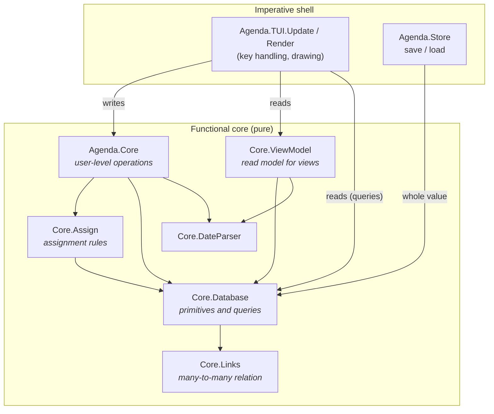
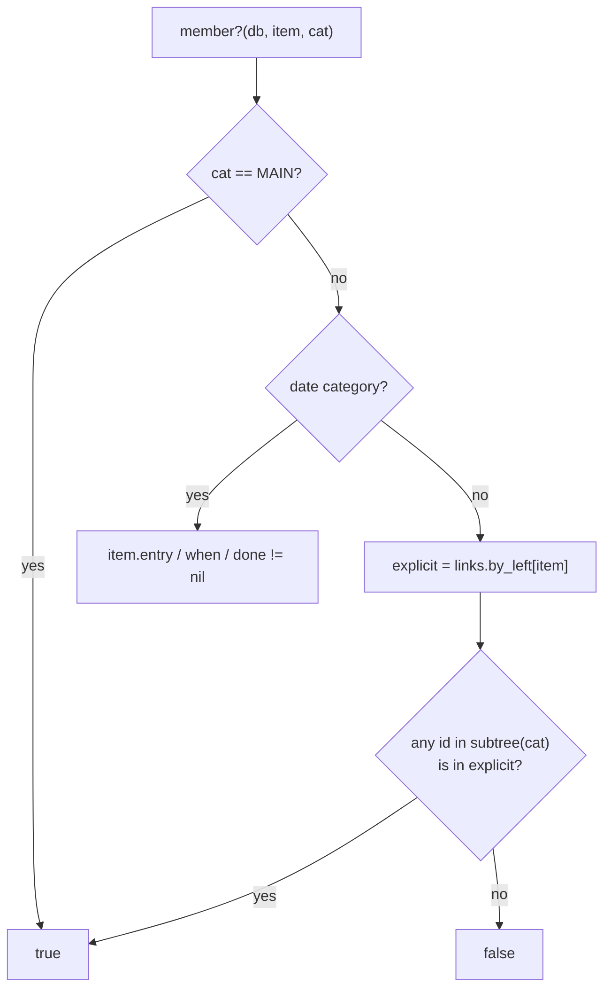
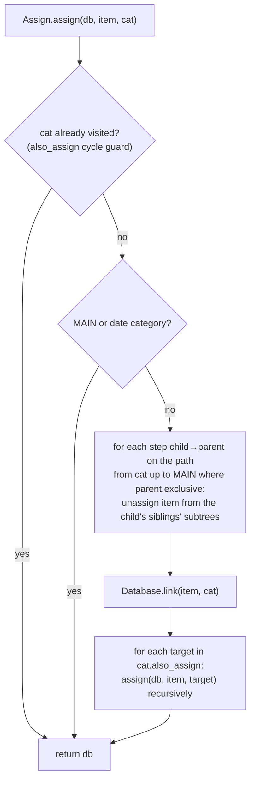
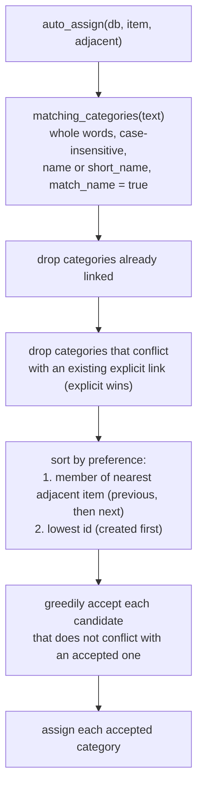
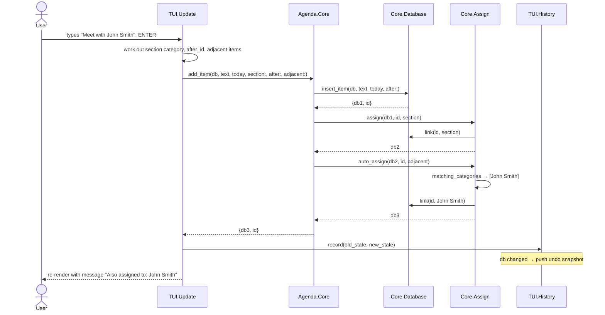
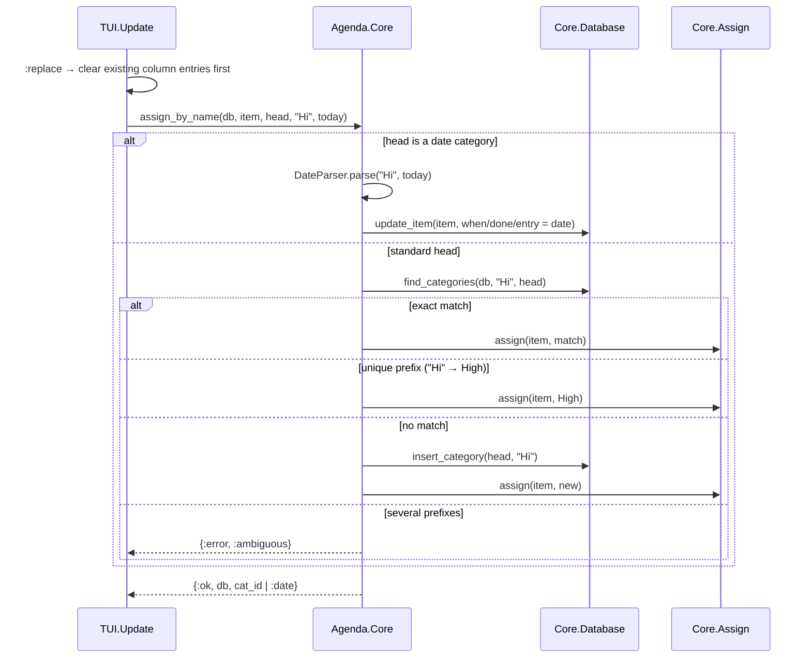
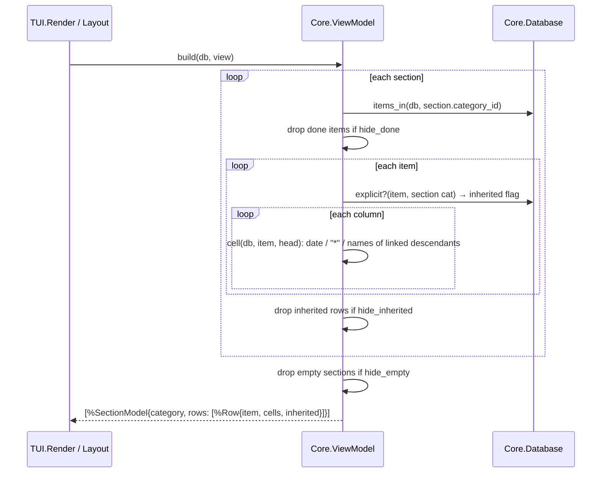

# Data access layer

How the `Database` value is queried and changed. For the structures
themselves, see [`DATA_MODEL.md`](DATA_MODEL.md).

There is no database server and no mutable store. "Data access" is a set of
**pure functions** that take a `Database` and return either an answer or a
new `Database`. Every function here is deterministic. Anything from the
outside world, such as today's date, is passed in as an argument.

## Layers

| Layer | Use it for | Do not |
|---|---|---|
| `Agenda.Core` (facade) | **All changes made by users.** Applies the rules (assignment, auto-assignment, validation) and returns `{:ok, …}`/`{:error, atom}` where input can be invalid. | Bypass it from the UI for writes. |
| `Core.ViewModel` | Building what a view shows (sections, rows, cells). | Put display formatting elsewhere. |
| `Core.Assign` | Rules for how items get into categories. Only the facade calls it. | Re-implement exclusivity or matching in the UI. |
| `Core.Database` | Primitive writes (no rules) and **all queries**. | Expect primitives to enforce assignment rules. |
| `Core.Links` | The raw relation. Only `Database` touches it. | Read `db.links` directly elsewhere. |

The UI reads freely through `Database` queries (e.g. `member?/3`,
`hierarchy/1`), but **every change goes through `Agenda.Core`**, even
simple field updates with no rules. `test/agenda/architecture_test.exs`
enforces this. It fails if any file under `lib/agenda/tui/` calls a
`Database` write function (`insert_*`, `update_*`, `delete_*`, `link`,
`unlink`, `reorder_item`, …) or updates the `db` struct directly.

## API by concern

### Items

| Function | Kind | Description |
|---|---|---|
| `Core.add_item(db, text, today, section:, after:, adjacent:)` | write | Insert, assign to the section's category, then auto-assign. Returns `{db, id}`. |
| `Core.edit_item(db, id, text, adjacent)` | write | Change text, then auto-assign again (only adds assignments). |
| `Core.set_note/3`, `toggle_done/3`, `toggle_mark/2` | write | Field updates. |
| `Core.move_item(db, id, from, to, after:)` | write | ALT-F10: leave `from`, join `to` (never MAIN), optionally reorder after an item. |
| `Core.discard_item(db, id)` | write | Delete the item and all its links. |
| `Database.item(db, id)` / `items(db)` | read | One item / all items in `item_order`. |
| `Database.reorder_item(db, id, after_id)` | write | Move within `item_order`. |

### Categories and the hierarchy

| Function | Kind | Description |
|---|---|---|
| `Core.add_category(db, parent, name, opts)` | write | Insert under `parent`. The name must be unique among siblings: `{:error, :duplicate}`. |
| `Core.find_or_create_category(db, name)` | write | Look up by name anywhere, else create under MAIN. |
| `Core.rename_category/3` | write | `{:error, :protected}` for MAIN/Entry/When/Done. |
| `Core.discard_category(db, id)` | write | Delete the subtree, its links, and view references. |
| `Core.move_category(db, id, parent, after, resolution)`, `promote(db, id, resolution)`, `demote(db, id, resolution)` | write | Restructure. Items put in two exclusive branches are resolved by `:remove_moved` (default), `:remove_other` or `{:new_category, name}` (R7b). Errors: `:cycle \| :protected \| :top_level \| :no_previous_sibling \| :empty \| :duplicate`. |
| `Core.move_conflicts(db, id, parent, after)`, `promote_conflicts/2`, `demote_conflicts/2` | read | `{:ok, item_ids}` that the move would put in conflict, or the move's error. |
| `Database.promote_target/2`, `demote_target/2` | read | Where a promote/demote would move a category: `{:ok, parent, after_id}`. |
| `Core.make_exclusive(db, cat, :parent \| :first_child \| {:new_child, name})` | write | Make children mutually exclusive, resolving items already in several children (R7a). `{:error, :protected \| :empty \| :duplicate}`. |
| `Core.make_unexclusive/2`, `toggle_match_name/2` | write | Rule flags; assignments are kept. |
| `Core.exclusive_conflicts(db, cat)` | read | Items in more than one child branch (offered for resolution by the UI). |
| `Core.set_short_name/3`, `set_category_note/3` | write | Properties; a blank short name clears it. |
| `Core.toggle_also_assign(db, cat, target)` | write | Add/remove a category link. |
| `Database.ancestors/2`, `descendants/2`, `subtree/2`, `depth/2` | read | Tree navigation (ancestors nearest first; descendants in pre-order). |
| `Database.hierarchy(db)` | read | Whole tree as `[{id, depth}]` in pre-order (category manager). |
| `Database.find_categories(db, name, root)` | read | Case-insensitive match on name or short name within a subtree. |
| `Database.previous_sibling/2`, `next_sibling/2`, `protected?/2` | read | Helpers. |

### Assignments and membership

| Function | Kind | Description |
|---|---|---|
| `Core.assign(db, item, cat)` | write | Explicit assignment with exclusivity and `also_assign` (see below). |
| `Core.toggle_assignment(db, item, cat)` | write | Assignment profile: remove just that explicit link, or `assign`. |
| `Core.assign_by_name(db, item, head, text, today)` | write | Typing in a column: date, exact name, unique prefix, or a new child. `{:ok, db, cat_id \| :date}`. |
| `Core.remove_from_category(db, item, cat)` | write | Unlink the category's subtree (or clear the date). |
| `Core.set_date(db, item, date_cat, date)` | write | Set or clear Entry/When/Done. |
| `Core.reassign_all(db)` | write | Run auto-assignment again for every item. |
| `Database.member?(db, item, cat)` | read | **Membership including subsumption.** |
| `Database.items_in(db, cat)` | read | All member items, in item order. |
| `Database.explicit_categories(db, item)`, `explicit?/3` | read | Stored links only. |
| `Database.date_field(db, cat)` | read | `:entry \| :when \| :done \| nil`. |
| `Assign.conflict?(db, a, b)` | read | Can an item be in both? (exclusive families) |
| `Assign.matching_categories(db, text)` | read | Categories whose name occurs in the text. |

### Views

| Function | Kind | Description |
|---|---|---|
| `Core.add_view(db, name, section_ids)`, `rename_view/3`, `discard_view/2` | write | `discard_view` refuses the last view. |
| `Core.move_view(db, view, index)` | write | Reorder in the view manager (index clamped). |
| `Core.add_section/4`, `remove_section/3`, `toggle_section_collapsed/3`, `set_section_category/4` | write | By index within the view. |
| `Core.add_column/5`, `remove_column/3`, `resize_column/4` | write | By index within the view. |
| `Core.toggle_view_option(db, view, :hide_done \| :hide_empty \| :hide_inherited)` | write | View filters. |
| `Database.view/2`, `views/1` | read | One view / all in `view_order`. |
| `ViewModel.build(db, view)` | read | The full read model of a view (below). |
| `ViewModel.cell/3`, `column_entries/3` | read | What one column shows for one item. |

### Persistence

| Function | Description |
|---|---|
| `Store.save(db, path)` | Versioned binary, written atomically. Imperative. |
| `Store.load(path)` | `{:ok, db} \| {:error, :enoent \| :not_an_agenda_file \| {:unsupported_version, v}}`. |

## Key algorithms

### Membership (subsumption)

Only explicit links are stored, so membership is computed:

`items_in(db, cat)` works the other way round. It unions
`links.by_right[c]` for every `c` in `subtree(cat)`, then filters
`item_order` so the result keeps display order.

Because subsumption is never stored, there is no need to cascade on
deletion. Dropping a category's links removes inherited memberships
automatically (the patent's "deleting C5" example).

### Explicit assignment

### Automatic assignment

Two categories **conflict** when they lie under different children of a
common exclusive ancestor (`Assign.conflict?/3`). The sort and greedy
acceptance implement the patent's ambiguity resolution (claim 7).

## Sequences

### Typing a new item under a section

### Typing in a column cell

### Building a view

## Cost

The data lives in memory and is small (a personal database, thousands of
items), so clarity comes before indexes:

| Operation | Cost |
|---|---|
| `item/2`, `category/2`, `view/2`, `explicit?/3` | O(log n) map lookups |
| `ancestors/2`, `depth/2` | O(depth) |
| `subtree/2`, `descendants/2` | O(size of subtree) |
| `member?/3` | O(size of subtree) |
| `items_in/2` | O(subtree links + total items) |
| `ViewModel.build/2` | O(sections × items × columns × subtree); runs on every render |
| Any write | O(log n) for the change itself; old versions share structure |

If large files ever become slow, the first candidates are caching
`ViewModel.build/2` per database value and keeping a descendants index.

## Adding to the data layer

1. **New stored field**: add it to the struct with a default. Bump the format
   version in `Store` and migrate old files in `Store.load/1`. Document it in
   `DATA_MODEL.md`.
2. **New query**: add it to `Core.Database` (or `ViewModel` for display),
   with `@spec` and a test in `test/agenda/core/`.
3. **New rule**: implement it in `Core.Assign` and expose it through
   `Agenda.Core`. Give it a rule number in `SPEC.md`.
4. **New user action**: add it to `Agenda.Core`, returning
   `{:ok, db} | {:error, atom}` when input can be invalid. The UI calls it,
   and undo works automatically.
5. Keep every function pure: no clock, no I/O, no processes.
