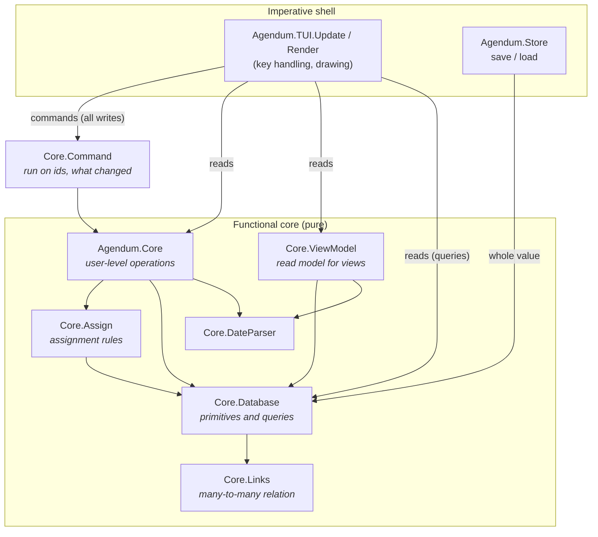
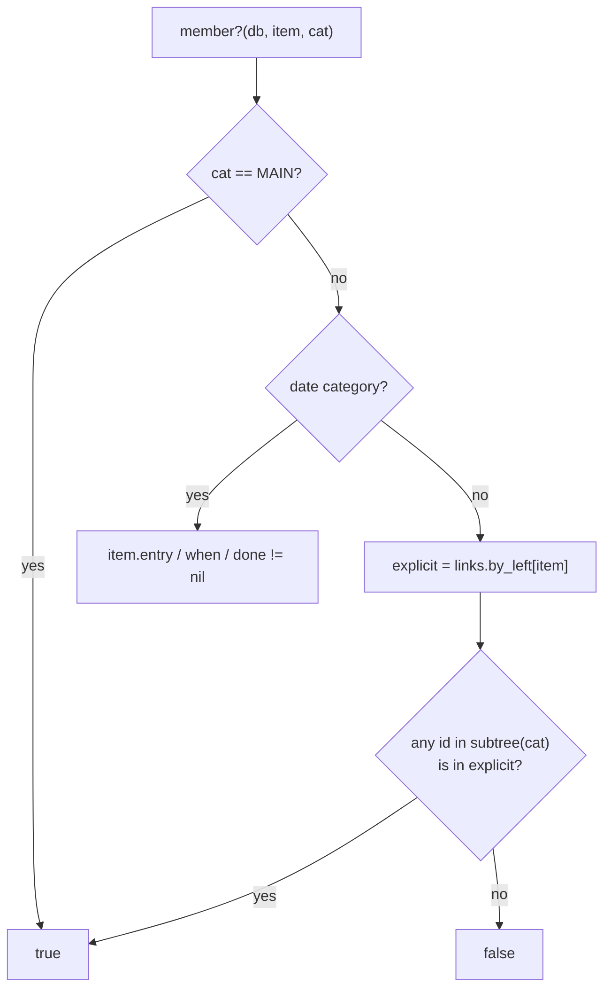
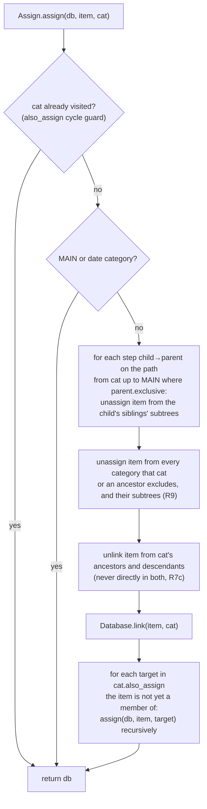
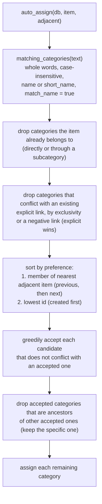
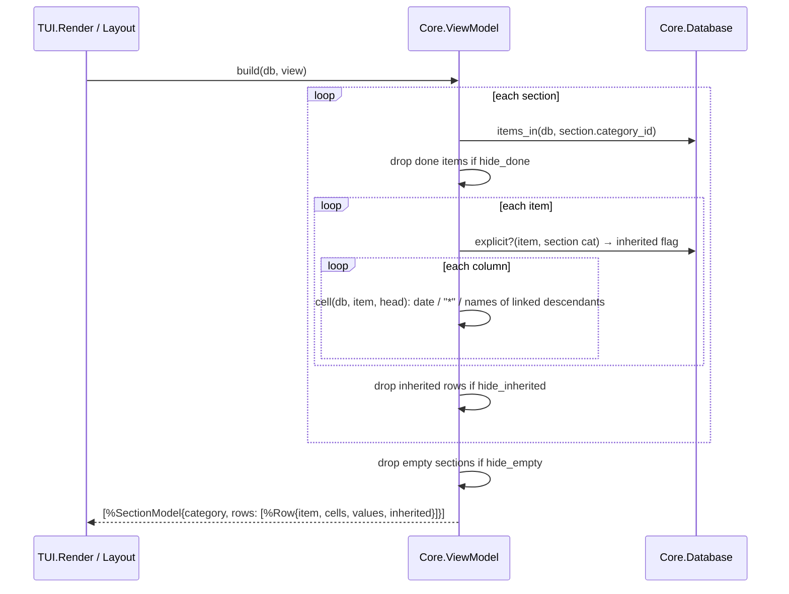

# Data access layer

How the `Database` value is queried and changed. For the structures themselves, see [`DATA_MODEL.md`](DATA_MODEL.md).

There is no database server and no mutable store. "Data access" is a set of **pure functions** that take a `Database` and return either an answer or a new `Database`. Every function here is deterministic. Anything from the outside world, such as today's date, is passed in as an argument.

## Layers

| Layer                   | Use it for                                                                                                                                                     | Do not                                          |
| ----------------------- | -------------------------------------------------------------------------------------------------------------------------------------------------------------- | ----------------------------------------------- |
| `Agendum.Core.run/3` (commands) | **A user action as a command** (R66, ADR 0036): `{:mark_done, ids}` and the like, on ids; returns `{:ok, db, changes}` or `{:error, atom}`. The TUI sends them with `State.run/2`. | Call the facade function a command does. |
| `Agendum.Core` (facade)  | **What a command does, and reads.** Applies the rules (assignment, auto-assignment, validation) and returns `{:ok, …}`/`{:error, atom}` where input can be invalid. | Bypass it from the UI for writes.               |
| `Agendum.Core.ViewModel` | Building what a view shows (sections, rows, cells).                                                                                                            | Put display formatting elsewhere.               |
| `Agendum.Core.Assign`    | Rules for how items get into categories. Only the facade calls it.                                                                                             | Re-implement exclusivity or matching in the UI. |
| `Agendum.Core.Database`  | Primitive writes (no rules) and **all queries**.                                                                                                               | Expect primitives to enforce assignment rules.  |
| `Agendum.Core.Links`     | The raw relation. Only `Database` touches it.                                                                                                                  | Read `db.links` directly elsewhere.             |

The UI reads freely through `Database` queries (e.g. `member?/3`, `hierarchy/1`), but **every change goes through `Agendum.Core`**, even simple field updates with no rules. `test/agendum/architecture_test.exs` enforces this. It reads every call from the compiled modules with OTP's `:xref` (so an alias or an import hides nothing) and fails if an `Agendum.TUI` module calls a `Database` write function: any whose `@spec` returns a database (`insert_*`, `update_*`, `link`, `unlink`, …; a new one is covered without a list, and every public `Database` function must have a spec). It also fails if a TUI file updates a database struct by hand (`%{state.db | …}`, `put_in(state.db…)`), found in the parsed source. The same test checks the core's purity on the compiled calls: no files, terminal, environment, processes, clock or randomness.

## API by concern

### Commands (R66, ADR 0036)

Every change goes through `Core.run(db, command, clock)`. The commands are listed, with their names, summaries and the kinds of their arguments, in `Agendum.Core.Command` (`ids/0`, `describe/1`); most are the facade function of the same name below, with the database and (where it takes one) the clock left out: `Core.assign(db, item, cat, clock)` is the command `{:assign, item, cat}`. Those that are more than one call:

| Command | Description |
| ------- | ----------- |
| `{:add_item, text, section:, after:, adjacent:, date:, view_section:}` | Typing a new item (R21): filed under `section` (a category id), after an item, by its text; `date:` a datebook slot's date (R47); `view_section: {view, index}` also gives it what that section's filters need (R28). `changes.new` is its id. |
| `{:edit_item, item, text}` | Changing an item's text: filed again by what it now says (R10, R14). |
| `{:mark_done, items}`, `{:discard_items, items}` | Done on, or discarding, several items. |
| `{:clear_column, item, head}` | DEL in a column: the item leaves the head, or the head's children it is in. |
| `{:type_in_column, item, head, entry, replace?}` | Typing in a column cell (R23): `entry` is `{:category, id}` (picked), `{:name, text}` (a child, a date or a number by name) or `{:new, text}` (a new child); with `replace?`, what was there goes first when something was typed. |
| `{:set_condition, cat, target, kind}` | An assignment condition, replacing the one on that category (R15). |
| `{:move_item, …, opts}`, `{:execute, items, opts}`, `{:add_column_as, …, opts}` | The clock goes into the options, where the facade reads it. |
| `:ring_alarms`, `:clear_old_alarms` | The clock's own changes; `changes.result` holds the items whose alarms rang. |
| `{:batch, commands}` | Several commands as one change; none is made if one is refused. `changes.steps` holds what each made. |

`run/3` refuses an unknown command (`:unknown_command`), the wrong arguments (`:bad_arguments`), an id that is not of its kind (`:no_such_item`, `:no_such_category`, `:no_such_view`, `:no_such_macro`, `:no_such_calendar`) or blank text (`:empty_text`), and passes on the facade function's own refusals; a refused command changes nothing. `changes` (`Command.Changes`) holds `items`, `categories`, `views`, `macros` and `calendars`, each `%{added:, changed:, removed:}` ids, and `file`, the other fields that changed; a command adds `new:` (the id of what it made or found), `result:` (anything else its function returned) or `steps:`. The TUI sends commands with `State.run/2,3` and `State.command/2`, and previews one with `State.preview/2`. `test/agendum/architecture_test.exs` keeps it so: the TUI calls `Agendum.Core` only for `run/3` and the reads it lists, and every `Agendum.Core` function is a command's or one of those reads.

### Items

| Function                                                                                                   | Kind  | Description                                                                                                                          |
| ---------------------------------------------------------------------------------------------------------- | ----- | ------------------------------------------------------------------------------------------------------------------------------------ |
| `Core.add_item(db, text, today, section:, after:, adjacent:)`                                              | write | Insert, assign to the section's category, auto-assign, and read a When date from the text (R14). Returns `{db, id}`.                 |
| `Core.edit_item(db, id, text, today, adjacent)`                                                            | write | Change text, auto-assign again (only adds assignments), and update a When date read from the text when the date words changed (R14). |
| `Core.toggle_auto_date(db)`, `Core.auto_dating?/1`                                                         | write / read | Utilities Dating: When's Assign item date between Never and From the item text (R14).                                          |
| `Core.set_date_rule(db, cat, rule)`                                                                        | write | A date category's Advanced settings (`DateRule`, R6b): Assign item date, Which one, Done and When keys.                               |
| `Core.when_key(db, item, text, clock)`                                                                     | write | ALT-F2: the When date, copied to date categories set from the When key (R6b); F4 does the same for the Done key in `mark_done/3`.    |
| `Database.date_explicit?(db, item, cat)`                                                                   | read  | Whether the user set a date by hand, so text leaves it alone (R14, R6b).                                                             |
| `Core.set_date_format(db, format)`                                                                         | write | How the file displays dates and times (R41); `DateFormat.date/3`, `time/2`, `date_time/4` format with it.                          |
| `Core.set_date_settings(db, settings)`                                                                     | write | How the file reads typed dates (R14e); every parser call passes `Context.parser_opts(clock, db.date_settings)`.                      |
| `DateParser.extract(text, today)` / `parse(text, today)`                                                   | read  | The first date in free text, with its words / a date typed on its own (columns, ALT-F2).                                             |
| `Core.set_note/4` (reads a When date from the note, R14f), `toggle_done/3`, `mark_done/3`, `toggle_mark/2` | write | Field updates. Marking a recurring item done also adds its next occurrence (R14a).                                                   |
| `Core.move_item(db, id, from, to, after:)`                                                                 | write | ALT-F10: leave `from`, join `to` (never MAIN), optionally reorder after an item.                                                     |
| `Core.discard_item(db, id)`                                                                                | write | Delete the item and all its links.                                                                                                   |
| `Database.item(db, id)` / `items(db)`                                                                      | read  | One item / all items in `item_order`.                                                                                                |
| `Database.reorder_item(db, id, after_id)`                                                                  | write | Move within `item_order`.                                                                                                            |
| `Core.attach_zettels(db, ids)`                                                                             | write | Gives each item without one the next Zettel id from `next_zettel`, skipping reserved words (R73). Returns `{:ok, db, [{id, word}]}`. |
| `Core.zettel(item)`, `Core.item_by_zettel(db, word)`, `Core.zettels(db)`                                   | read  | An item's Zettel id as its word; the item with a word; every number in use to its item (R73).                                       |

### Categories and the hierarchy

| Function                                                                           | Kind  | Description                                                                                                                                                                                                                                                                                                                                                                                                                                                                                          |
| ---------------------------------------------------------------------------------- | ----- | ---------------------------------------------------------------------------------------------------------------------------------------------------------------------------------------------------------------------------------------------------------------------------------------------------------------------------------------------------------------------------------------------------------------------------------------------------------------------------------------------------- |
| `Core.add_category(db, parent, name, opts)`                                        | write | Insert under `parent`. The name must be unique among siblings: `{:error, :duplicate}`.                                                                                                                                                                                                                                                                                                                                                                                                               |
| `Core.find_or_create_category(db, name)`                                           | write | Look up by name anywhere, else create under MAIN.                                                                                                                                                                                                                                                                                                                                                                                                                                                    |
| `Core.rename_category/3`                                                           | write | `{:error, :protected}` for MAIN/Entry/When/Done.                                                                                                                                                                                                                                                                                                                                                                                                                                                     |
| `Core.discard_category(db, id)`                                                    | write | Delete the subtree, its links, and view references.                                                                                                                                                                                                                                                                                                                                                                                                                                                  |
| `Core.relocate(db, id, :promote \| :demote \| {:move, parent, after}, resolution)` | write | Restructure the hierarchy. Promote is outline-style and adopts the following siblings (R7d). Items put in conflict (an exclusive family twice, R7b; a category and its ancestor, R7c) are resolved by `:remove_moved` (default; they keep their other assignments), `:remove_other` (they keep the moved category's) or `{:new_category, name}`. Errors: `:cycle \| :protected \| :top_level \| :no_previous_sibling \| :empty \| :duplicate`. Wrappers: `move_category/5`, `promote/3`, `demote/3`. |
| `Core.relocation_conflicts(db, id, relocation)`                                    | read  | `{:ok, item_ids}` the relocation would put in conflict, or its error. Wrappers: `move_conflicts/4`, `promote_conflicts/2`, `demote_conflicts/2`.                                                                                                                                                                                                                                                                                                                                                     |
| `Assign.violations(db, item)`                                                      | read  | How an item breaks the assignment rules: `{:exclusive, family}` and `{:lineage, category, ancestor}`.                                                                                                                                                                                                                                                                                                                                                                                                |
| `Core.make_exclusive(db, cat, :parent \| :first_child \| {:new_child, name})`      | write | Make children mutually exclusive, resolving items already in several children (R7a). `{:error, :protected \| :empty \| :duplicate}`.                                                                                                                                                                                                                                                                                                                                                                 |
| `Core.make_unexclusive/2`, `toggle_match_name/2`                                   | write | Rule flags; assignments are kept.                                                                                                                                                                                                                                                                                                                                                                                                                                                                    |
| `Core.exclusive_conflicts(db, cat)`                                                | read  | Items in more than one child branch (offered for resolution by the UI).                                                                                                                                                                                                                                                                                                                                                                                                                              |
| `Core.set_short_name/3`, `set_category_note/3`                                     | write | Properties; a blank short name clears it.                                                                                                                                                                                                                                                                                                                                                                                                                                                            |
| `Core.toggle_exclude(db, a, b)`                                                    | write | Add/remove a negative link on both categories (R9); refused for self, lineage, MAIN/date/numeric, or while items are in both.                                                                                                                                                                                                                                                                                                                                                                        |
| `Core.toggle_also_assign(db, cat, target)`                                         | write | Add/remove a category link.                                                                                                                                                                                                                                                                                                                                                                                                                                                                          |
| `Database.ancestors/2`, `descendants/2`, `subtree/2`, `depth/2`                    | read  | Tree navigation (ancestors nearest first; descendants in pre-order).                                                                                                                                                                                                                                                                                                                                                                                                                                 |
| `Database.hierarchy(db)`                                                           | read  | Whole tree as `[{id, depth}]` in pre-order (category manager).                                                                                                                                                                                                                                                                                                                                                                                                                                       |
| `Database.category_statistics(db, id)`                                             | read  | How much of the file uses a category: items, children, section heads, view filters, conditions and actions naming it (Category Properties ▸ Statistics).                                                                                                                                                                                                                                                                                                                                             |
| `Database.file_statistics(db)`                                                     | read  | How big the file is: items, items with notes, categories, average items per category and categories per item (File Properties ▸ File statistics).                                                                                                                                                                                                                                                                                                                                                    |
| `Database.find_categories(db, name, root)`                                         | read  | Case-insensitive match on name or short name within a subtree.                                                                                                                                                                                                                                                                                                                                                                                                                                       |
| `Database.previous_sibling/2`, `next_sibling/2`, `protected?/2`                    | read  | Helpers.                                                                                                                                                                                                                                                                                                                                                                                                                                                                                             |

### Assignments and membership

| Function                                                                                                                 | Kind         | Description                                                                                                                                                                |
| ------------------------------------------------------------------------------------------------------------------------ | ------------ | -------------------------------------------------------------------------------------------------------------------------------------------------------------------------- |
| `Core.assignment_reasons(db, item, cat, clock)` | read | Why the item is in the category (R67): `:main`, `{:date, d}`, `{:through, child}`, `{:condition, conds}`, `:text_match`, `{:action, cat}` or `:assigned`; [] when it is not in it. |
| `Core.assign(db, item, cat)`                                                                                             | write        | Explicit assignment with exclusivity and `also_assign` (see below).                                                                                                        |
| `Core.toggle_assignment(db, item, cat)`                                                                                  | write        | Assignment profile: remove just that explicit link, or `assign`.                                                                                                           |
| `Core.add_condition(db, cat, target, :assigned \| :not_assigned)`, `remove_condition/3`, `cycle_condition/3`             | write        | Assignment conditions (R15). `{:error, :self \| :duplicate}`. New conditions reach existing items through `reassign_all/2`.                                                |
| `Core.set_action(db, cat, target, action, clock)` / `Core.remove_action/3` / `Core.set_special_action/3`                 | write        | Actions (R15b), run once by every facade change when an item joins the category (`settle/4` in `Agendum.Core`).                                                             |
| `Core.set_match_override(db, cat, setting, value \| :global)`, `Core.match_settings(db, cat)`, `Core.confirm_mode(db, cat)` | write / read | One category's own text matching settings, and the effective ones (R16b). |
| `Core.set_match_settings(db, settings)`, `Assign.match_levels(db, text)` | write / read | How text matches categories (`TextMatch`, R16a); which categories a text matches, fully or partially. |
| `Core.set_confirm_assignments(db, :never \| :always \| :sometimes)`, `Core.questions/1`, `Core.answer_question(db, item, cats, clock)` | write / read | Suggested assignments (R16): with Always, text matches are suggested; answering assigns the chosen ones explicitly.                                                        |
| `Core.execute(db, item_ids, root:, old_assignments:, clock:)`                                                            | write        | Utilities Execute (R15e): a family's text matching, conditions and actions on existing items.                                                                              |
| `Core.set_also_match(db, cat, text)`                                                                                     | write        | Text conditions (R15d). Text matches are conditional links, broken when the text stops matching (R15c).                                                                    |
| `Core.set_range_condition(db, cat, target, {from, to, where}, clock)`                                                    | write        | Date or numeric condition (R15a), checked against `clock`.                                                                                                                 |
| `Core.recheck_conditions(db, clock)`                                                                                     | write        | Re-check every item's conditions (on a new day). Functions that apply conditions (`assign/4`, `set_date/5`, `set_number/5`, …) take an optional clock for date conditions. |
| `Assign.apply_conditions(db, item)`, `conditions_met?(db, item, cat)`                                                    | write / read | Check one item against all conditions until stable; every `Core` operation that changes an item's assignments ends with it.                                                |
| `Database.conditional?(db, item, cat)`                                                                                   | read         | Was this link made by a condition (and so retractable)?                                                                                                                    |
| `Core.assign_by_name(db, item, head, text, today)`                                                                       | write        | Typing in a column: date, number (numeric head), exact name, unique prefix, or a new child. `{:ok, db, cat_id \| :date \| :number}`.                                       |
| `Core.completions(db, head, text)`                                                                                       | read         | Automatic completion (R32): subcategories of `head` whose names begin with `text` (case- and accent-insensitive), exact name first, then hierarchy order.                  |
| `Core.item_assignments(db, item)`                                                                                        | read         | Everything an item is assigned to, in hierarchy order: dates (`:date`), numbers (`:numeric`), user links (`:explicit`) and condition-made links (`:conditional`).          |
| `Core.assign_new_by_name(db, item, head, text)`                                                                          | write        | NEWCAT: assign to a new child named exactly `text` (or the existing child of that name).                                                                                   |
| `Core.remove_from_category(db, item, cat)`                                                                               | write        | Unlink the category's subtree (or clear the date).                                                                                                                         |
| `Core.set_date(db, item, date_cat, date)`                                                                                | write        | Set or clear Entry/When/Done. Setting When makes it explicit (it overrides the text); clearing hands it back to the text.                                                  |
| `Core.set_date_time(db, item, date_cat, date, time, clock)`                                                              | write        | Set (as by hand) or clear a date with its time, as typed in its column; used for the end of calendar events (Ends, R45).                                                   |
| `Core.set_number(db, item, numeric_cat, n)` / `Core.clear_number/3`                                                      | write        | Give an item a number in a numeric category (assigning it there), or remove it (R29).                                                                                      |
| `Core.make_numeric(db, cat, clock)` / `Core.numeric_conversion/3`                                                        | write / read | Convert a standard category to numeric; its children become their items' numbers, read with the person's separators (R29, R54).                                            |
| `Core.set_column_format(db, view, at, format)`                                                                          | write        | A numeric column's `NumberFormat`: symbol, decimals, separators, calculations (R29).                                                                                       |
| `Core.set_column_date_format(db, view, at, format \| nil)`                                                              | write        | A date column's own `DateFormat`, or nil for the file's (global defaults, R41a).                                                                                           |
| `Core.set_column_display(db, view, at, format: …, note_line: …, title: …)`                                               | write        | A standard column's Format (R56): name, parent, ancestor, star, yes_no or note; Category note's line (1 to 999) and title (≤ 69).                                          |
| `Core.set_in_column(db, item, head, true \| false, clock)`                                                               | write        | SPACE in a Star column, Y/N in a Yes/No one (R56): into the head itself, or out of it and all under it.                                                                    |
| `Core.set_column_note(db, item, head, line, text)`                                                                       | write        | Typing in a Category note column (R56): that line of the item's category's note, its label kept; `{:error, :no_category}`.                                                 |
| `Database.number(db, item, cat)`                                                                                         | read         | An item's number in a numeric category, or nil.                                                                                                                            |
| `Core.reassign_all(db, today)`                                                                                           | write        | Run auto-assignment again for every item, and date items whose text has a date but that have no When date.                                                                 |
| `Database.member?(db, item, cat)`                                                                                        | read         | **Membership including subsumption.**                                                                                                                                      |
| `Database.items_in(db, cat)`                                                                                             | read         | All member items, in item order.                                                                                                                                           |
| `Database.explicit_categories(db, item)`, `explicit?/3`                                                                  | read         | Stored links only.                                                                                                                                                         |
| `Database.date_field(db, cat)`                                                                                           | read         | `:entry \| :when \| :done \| nil`: the item field of a built-in date category only.                                                                                       |
| `Database.date_category?(db, cat)`, `item_date(db, item, cat)`, `item_time(db, item, cat)`                               | read         | Any date category, built in or made by the user (R6a): whether it is one, an item's date and time in it.                                                                  |
| `Core.make_date(db, cat, clock)` / `Core.date_conversion/3`                                                              | write / read | Convert a standard category to a date category; its children become their items' dates (R6a).                                                                            |
| `Assign.conflict?(db, a, b)`                                                                                             | read         | Can an item be in both? (exclusive families)                                                                                                                               |
| `Assign.matching_categories(db, text)`                                                                                   | read         | Categories whose name occurs in the text.                                                                                                                                  |

### Views

| Function                                                                                                                                              | Kind         | Description                                                                                                                                                                                   |
| ----------------------------------------------------------------------------------------------------------------------------------------------------- | ------------ | --------------------------------------------------------------------------------------------------------------------------------------------------------------------------------------------- |
| `Core.add_view(db, name, section_ids)`, `rename_view/3`, `discard_view/2`                                                                             | write        | `discard_view` refuses the last view.                                                                                                                                                         |
| `Core.add_datebook_view(db, name, datebook)`, `Core.set_datebook(db, view, datebook)`                                                                 | write        | A datebook view (R47); `{:error, :not_a_date_category}` unless the date and end categories are date categories.                                                                               |
| `Core.add_item(db, text, clock, Datebook.entry(datebook, slot))`                                                                                      | write        | An item typed into a datebook slot: in the Section category, dated at the slot's start as if typed (R47).                                                                                     |
| `Core.read_when(db, text, clock)`                                                                                                                     | read         | A typed date and/or time (`{:ok, date, time or nil}`), as in a date column; used by the pop-up calendar (R46).                                                                                |
| `Core.move_view(db, view, index)`                                                                                                                     | write        | Reorder in the view manager (index clamped).                                                                                                                                                  |
| `Core.add_section(db, view, cat, index, from)`, `remove_section/3`, `toggle_section_collapsed/3`, `set_section_category/4`                            | write        | By index within the view; a new section gets the linked columns of section `from` (R55).                                                                                                      |
| `Core.add_column(db, view, cat, at, width, :all \| :section)`, `remove_column(db, view, at, :all \| :section)`, `resize_column/4`, `fit_column/4`     | write        | `at` is `{section, column}` (R55); `add_column` also takes `{section, {:right_of \| :left_of, :items \| column}}`, and the item column keeps its place. A column added to all sections is linked; a change to it changes its linked columns too (`ViewColumns`).|
| `Core.set_column_head(db, view, at, cat)`                                                                                                             | write        | Column Properties ▸ Column head (R55): the column and its linked columns show `cat`; joining linked columns of that head takes their settings.                                               |
| `Core.set_column_linked(db, view, at, linked)`                                                                                                        | write        | Column Properties ▸ Link with other sections (R55): unlink, or link with the linked columns of its head (taking their settings) or, without any, those just like it.                          |
| `Core.set_insert_columns(db, :all \| :section)`                                                                                                        | write        | File Properties ▸ Insert new columns in (R55): where `add_column` puts a column when not told.                                                                                                |
| `Core.set_column_width(db, view, at, width)`, `move_column(db, view, sidx, from, to)`                                                                 | write        | View ▸ Column ▸ Width (1 to 80, linked columns too) and Move: by slot, a column or the item column, in its section only (R55).                                                                |
| `ViewColumns.slots(view, sidx)`, `insert_index(view, sidx, place)`                                                                                    | read         | A section's columns and item column (`:items`) in the order shown; the index a column added at a place (`{:right_of \| :left_of, :items \| index}`) gets.                                     |
| `Core.default_column_width(db, cat \| nil, kind \| nil, format)`                                                                                      | read         | The width a new column gets: 16 for a date category (or one about to become one), 2 for a Star or Yes/No column, 12 otherwise (the Column Add box shows it).                                  |
| `Core.add_column_as(db, view, cat, kind, at, width: …, insert_in: …, clock: …, format: …, note_line: …, title: …)`                                    | write        | Column Add ▸ Category type: a standard head made a date or numeric category, then added, in one change; `{:error, :not_standard}` for a date or numeric head given another type. A standard column can be added with its Format (R56).|
| `Core.find_or_add_category(db, name)`                                                                                                                 | write        | A column head typed by name: the category of that name (case aside), or a new one under MAIN; `{:error, :ambiguous}` when several have it.                                                    |
| `Core.set_item_column(db, view, sidx, set: …, width: …, minimum: …)`, `set_item_column_linked/4`                                                      | write        | Item Column Properties (R55): a section's item column, and the linked ones with it; linking again takes their settings.                                                                       |
| `Core.item_column_fit(db, view, sidx, clock, screen)`                                                                                                 | read         | SHIFT-? in View ▸ Column ▸ Width on the item text: the longest item text or section name of the linked sections, within the room.                                                             |
| `View.ItemColumn.text_width(item_column, columns, screen)`                                                                                            | read         | How wide a section's item text is: set by hand, or what its columns leave (at least the minimum).                                                                                             |
| `View.columns(view, section)`, `View.in_other_sections?(view, at)`                                                                                    | read         | A section's columns (a datebook's shared ones); whether removing a column asks "All sections" or "Current section" (R55).                                                                      |
| `Core.toggle_view_option(db, view, :hide_done \| :hide_empty \| :hide_inherited)`                                                                     | write        | View filters.                                                                                                                                                                                 |
| `Core.cycle_filter(db, view, :view \| {:section, i}, cat)`                                                                                            | write        | Filter by category (R28): none → assigned → not assigned → none.                                                                                                                              |
| `Search.matches?(item, search)`                                                                                                                       | read         | Text search over item text and/or note (R37).                                                                                                                                                 |
| `Core.show_match(db, search)`                                                                                                                         | write        | Fill the "Show View" with every matching item (created once; each use starts it afresh).                                                                                                      |
| `Core.show_schedule(db, date_cat, section, date, filter)`                                                                                             | write        | Show Schedule (R49): one date's items in the Show View, as a date filter; `{:error, :not_a_date_category}`.                                                                                   |
| `Core.add_macro/2`, `rename_macro/3`, `set_macro_keys/3`, `attach_macro/3`, `set_macro_run_from/4`, `delete_macro/2`, `move_macro/3`, `sort_macros/1` | write        | Macros (R50): names unique and up to 35 characters; a key is attached to one macro at a time. `Database.macros/1` lists them in order, `Database.find_macro/2` by name.                       |
| `Core.when_at(item)`                                                                                                                                  | read         | The When date and time as one value (midnight when no time).                                                                                                                                  |
| `Core.set_alarm(db, item, minutes)`, `cancel_alarm/2`                                                                                                 | write        | Alarm 0-60 minutes before When (R38). `{:error, :no_when \| :minutes}`.                                                                                                                       |
| `Core.ring_alarms(db, now)`                                                                                                                           | write        | Rings due alarms, moving them to the past alarms with the time each was due (R70); returns the items that rang.                                                                                |
| `Core.alarm_list(db)`, `remove_past_alarm/2`, `clear_old_alarms/2`                                                                                    | read / write | Current and past alarms; past ones are forgotten when the date changes and when the file is opened.                                                                                           |
| `Core.group_alarms(db, ids)`                                                                                                                          | read         | Rung alarms grouped by text, with a count and the latest due time, the latest first ("While you were away", R70).                                                                             |
| `DateParser.parse_recurring/3`, `extract_recurring/3`                                                                                                 | read         | Like `parse_when` / `extract_when`, also giving the `Recurrence` of a recurring date, or nil (R14a).                                                                                          |
| `DateParser.parse_when(text, now, opts)`, `extract_when(text, now, opts)`                                                                             | read         | Dates with times of day (R14b), in the languages of `opts[:languages]` (R14c). Core functions take a `clock`: a date, a date and time, or a `Agendum.Core.Context` (time plus date languages). |
| `Core.set_sort(db, view, :view \| {:section, i}, keys)`                                                                                               | write        | Sort keys (`View.SortKey`, at most two); a section's `nil` uses the view's (R36).                                                                                                             |
| `Core.make_dependent(db, item, prerequisites)` / `Core.clear_dependencies/2`                                                                          | write        | Item dependencies (R43); `{:error, :cycle}` if an item would depend on itself.                                                                                                                |
| `Core.remove_dependency(db, item, prerequisite)`                                                                                                      | write        | Removes one dependency (DEL in Item Properties, R43).                                                                                                                                         |
| `Core.export_json(db)` / `Core.import_json(text)`                                                                                                     | read / write | The whole file as JSON and back (R44, `docs/JSON_FORMAT.md`); import gives `{:error, message}` naming the place.                                                                              |
| `Core.subscribe_calendar/3`, `Core.unsubscribe_calendar/3`, `Core.cycle_calendar_setting/4`                                                           | write        | Calendar subscriptions (R45): name, address, settings; unsubscribing can discard its items.                                                                                                   |
| `Core.sync_calendar(db, cal, events, clock)` / `Core.calendar_failed/4`                                                                               | write        | A refresh: new events add items, changed ones update what changed, gone ones remove items.                                                                                                    |
| `Core.calendars_due(db, now)`, `Database.calendars/1`                                                                                                 | read         | The subscriptions, and those due to be read again.                                                                                                                                            |
| `Core.prerequisites/2`, `Core.dependents/2`, `Core.waiting?/2`                                                                                        | read         | Dependencies in item order; whether an item still waits for an unfinished prerequisite.                                                                                                       |
| `Core.related_items(db, item, :dependents \| :prerequisites, :one \| :all \| :every)` / `Core.show_items/2`                                           | read / write | Show Depends / Show Prereqs (R43): related items in item order, listed in the Show View.                                                                                                      |
| `Core.set_section_sort(db, view, sort, order)`                                                                                                        | write        | Show the section heads in category order, alphabetically or numerically (R36).                                                                                                                |
| `Core.entry_categories(db, view, i)`                                                                                                                  | read         | Categories a new item in section `i` needs to pass the filters.                                                                                                                               |
| `Core.set_range_filter(db, view, scope, cat, {show, from, to, where}, today)` / `Core.remove_filter/4`                                                | write        | A date or numeric filter (R28a): items with a date or number in or outside a range, or without one.                                                                                           |
| `Core.entry_values(db, view, i, today)` / `Core.apply_entry_values/3`                                                                                 | read / write | The dates and numbers a new item in section `i` gets from range filters, and giving them to it.                                                                                               |
| `Core.sort_children(db, parent)`, `sort_views(db)`                                                                                                    | write        | Alphabetical order (ALT-F5 in the managers).                                                                                                                                                  |
| `Assign.criteria_met?(db, item, criteria)`                                                                                                            | read         | The AND / exclusive-OR rule shared by conditions and filters.                                                                                                                                 |
| `Database.view/2`, `views/1`                                                                                                                          | read         | One view / all in `view_order`.                                                                                                                                                               |
| `ViewModel.build(db, view, today)`                                                                                                                    | read         | The full read model of a view (below); `today` reads relative dates in date filters (R28a).                                                                                                   |
| `ViewModel.cell(db, item, head, width)`, `column_entries/3`, `column_label(db, head, width)`                                                          | read         | What one column shows for one item, and a column head; categories that do not fit in `width` use their short names.                                                                           |
| `ViewModel.column_head(db, column)`, `note_line(note, n)`                                                                                             | read         | A column's head as shown (a Category note column's title); line `n` of a note without its label (R56).                                                                                        |

### Persistence

| Function               | Description                                                                           |
| ---------------------- | ------------------------------------------------------------------------------------- |
| `Store.save(db, path)` | Versioned binary, written atomically. Imperative.                                     |
| `Store.load(path)`     | `{:ok, db} \| {:error, :enoent \| :not_an_agenda_file \| {:unsupported_version, v}}`. |

## Key algorithms

### Membership (subsumption)

Only explicit links are stored, so membership is computed:

`items_in(db, cat)` works the other way round. It unions `links.by_right[c]` for every `c` in `subtree(cat)`, then filters `item_order` so the result keeps display order.

Because subsumption is never stored, there is no need to cascade on deletion. Dropping a category's links removes inherited memberships automatically (the patent's "deleting C5" example).

### Explicit assignment

### Automatic assignment

Two categories **conflict** when they lie under different children of a common exclusive ancestor (`Assign.conflict?/3`). The sort and greedy acceptance implement the patent's ambiguity resolution (claim 7).

## Sequences

### Typing a new item under a section

### Typing in a column cell

### Building a view

## Cost

The data lives in memory and is small (a personal database, thousands of items), so clarity comes before indexes:

| Operation                                       | Cost                                                          |
| ----------------------------------------------- | ------------------------------------------------------------- |
| `item/2`, `category/2`, `view/2`, `explicit?/3` | O(log n) map lookups                                          |
| `ancestors/2`, `depth/2`                        | O(depth)                                                      |
| `subtree/2`, `descendants/2`                    | O(size of subtree)                                            |
| `member?/3`                                     | O(size of subtree)                                            |
| `items_in/2`                                    | O(subtree links + total items)                                |
| `ViewModel.build/3`                             | O(sections × items × columns × subtree); runs on every render |
| Any write                                       | O(log n) for the change itself; old versions share structure  |

If large files ever become slow, the first candidates are caching `ViewModel.build/3` per database value and keeping a descendants index.

## Adding to the data layer

1. **New stored field**: add it to the struct with a default. Bump the format version in `Store` and migrate old files in `Store.load/1`. Document it in `DATA_MODEL.md`.
2. **New query**: add it to `Agendum.Core.Database` (or `ViewModel` for display), with `@spec` and a test in `test/agendum/core/`.
3. **New rule**: implement it in `Agendum.Core.Assign` and expose it through `Agendum.Core`. Give it a rule number in `SPEC.md`.
4. **New user action**: make it a command (`Agendum.Core.Command`: a type, an entry in its list with name and summary, a clause of `apply_command/3`, its ids checked), written with facade functions that return `{:ok, db} | {:error, atom}` when input can be invalid. The UI sends it with `State.run/2`, and undo works automatically.
5. Keep every function pure: no clock, no I/O, no processes.
