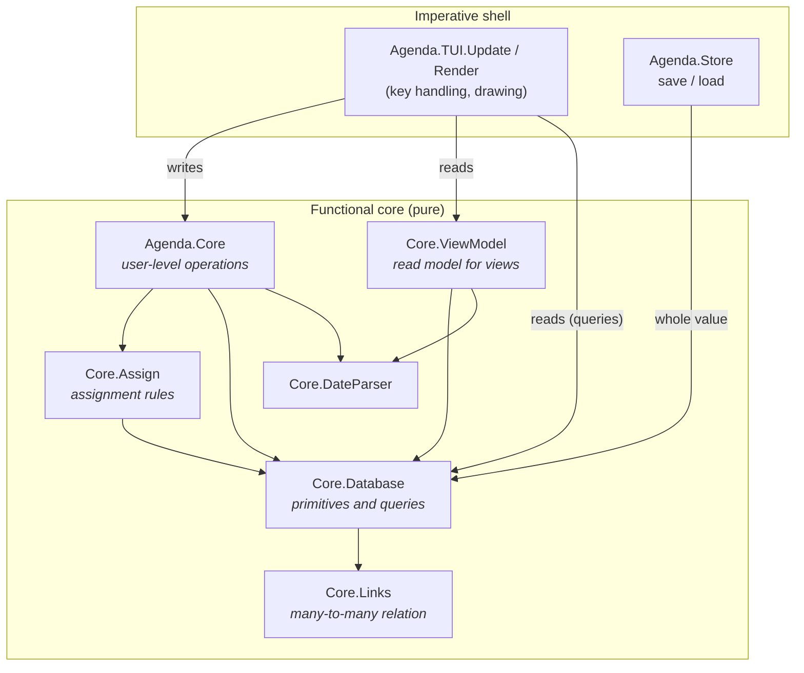
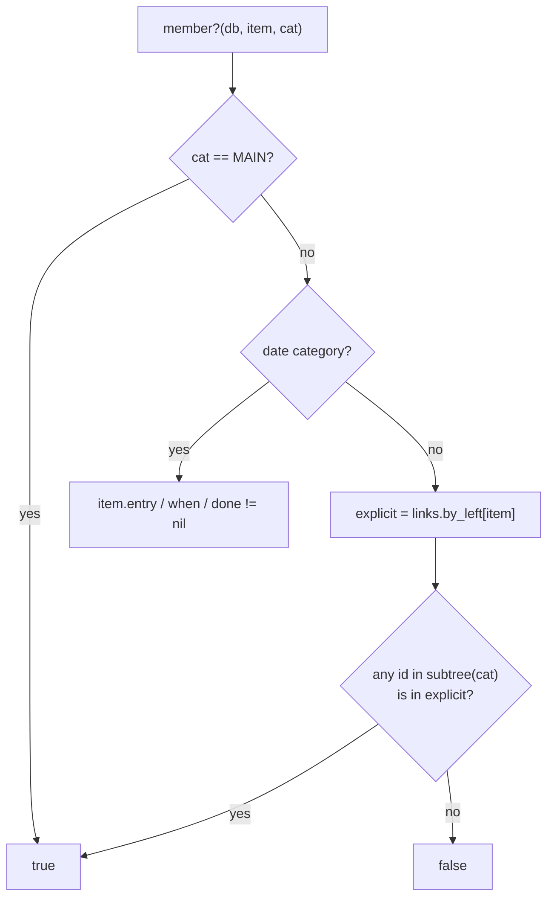
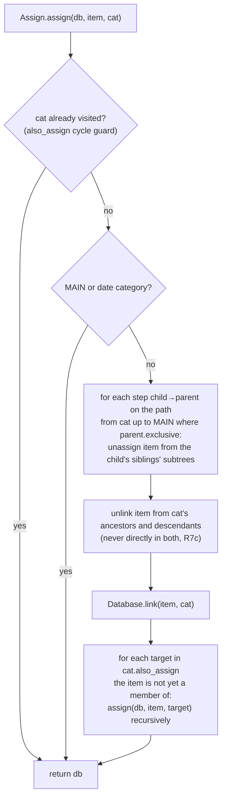
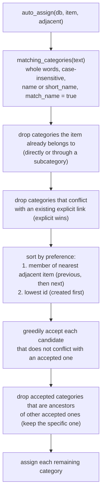
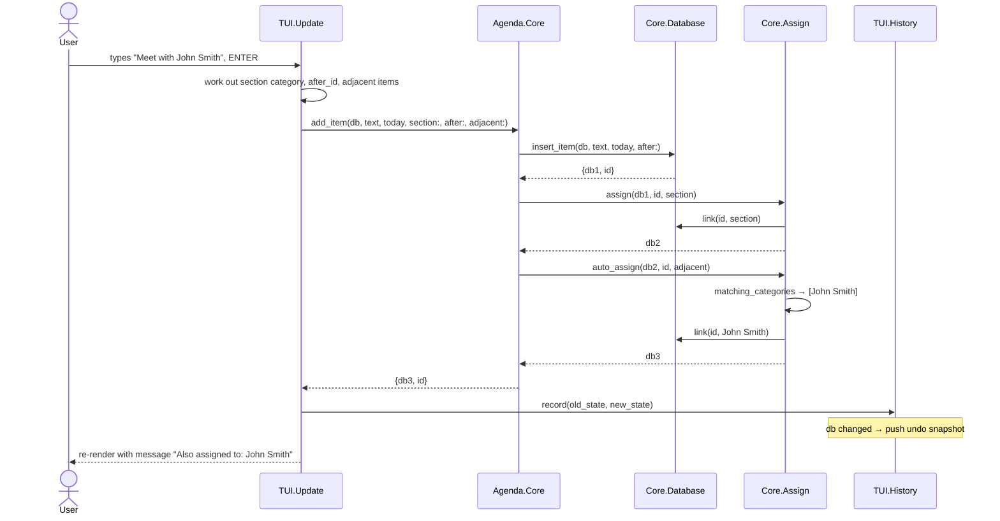
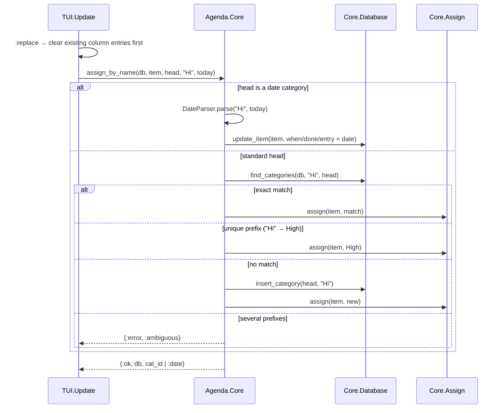
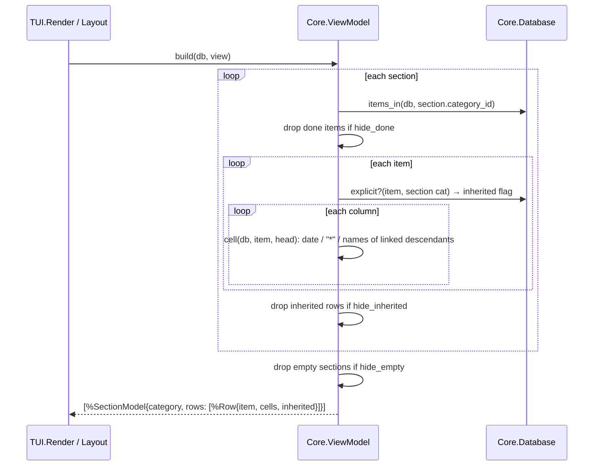

# Data access layer

How the `Database` value is queried and changed. For the structures
themselves, see [`DATA_MODEL.md`](DATA_MODEL.md).

There is no database server and no mutable store. "Data access" is a set of
**pure functions** that take a `Database` and return either an answer or a
new `Database`. Every function here is deterministic. Anything from the
outside world, such as today's date, is passed in as an argument.

## Layers

| Layer                  | Use it for                                                                                                                                                     | Do not                                          |
| ---------------------- | -------------------------------------------------------------------------------------------------------------------------------------------------------------- | ----------------------------------------------- |
| `Agenda.Core` (facade) | **All changes made by users.** Applies the rules (assignment, auto-assignment, validation) and returns `{:ok, …}`/`{:error, atom}` where input can be invalid. | Bypass it from the UI for writes.               |
| `Core.ViewModel`       | Building what a view shows (sections, rows, cells).                                                                                                            | Put display formatting elsewhere.               |
| `Core.Assign`          | Rules for how items get into categories. Only the facade calls it.                                                                                             | Re-implement exclusivity or matching in the UI. |
| `Core.Database`        | Primitive writes (no rules) and **all queries**.                                                                                                               | Expect primitives to enforce assignment rules.  |
| `Core.Links`           | The raw relation. Only `Database` touches it.                                                                                                                  | Read `db.links` directly elsewhere.             |

The UI reads freely through `Database` queries (e.g. `member?/3`,
`hierarchy/1`), but **every change goes through `Agenda.Core`**, even
simple field updates with no rules. `test/agenda/architecture_test.exs`
enforces this. It fails if any file under `lib/agenda/tui/` calls a
`Database` write function (`insert_*`, `update_*`, `delete_*`, `link`,
`unlink`, `reorder_item`, …) or updates the `db` struct directly.

## API by concern

### Items

| Function                                                      | Kind  | Description                                                                                                                          |
| ------------------------------------------------------------- | ----- | ------------------------------------------------------------------------------------------------------------------------------------ |
| `Core.add_item(db, text, today, section:, after:, adjacent:)` | write | Insert, assign to the section's category, auto-assign, and read a When date from the text (R14). Returns `{db, id}`.                 |
| `Core.edit_item(db, id, text, today, adjacent)`               | write | Change text, auto-assign again (only adds assignments), and update a When date read from the text when the date words changed (R14). |
| `Core.toggle_auto_date(db)`                                   | write | Turn reading When dates from item text on or off for the file.                                                                       |
| `Core.set_date_format(db, format)` | write | How the file displays dates and times (R41); `DateFormat.date/2`, `time/2`, `date_time/3` format with it. |
| `DateParser.extract(text, today)` / `parse(text, today)`      | read  | The first date in free text, with its words / a date typed on its own (columns, ALT-F2).                                             |
| `Core.set_note/3`, `toggle_done/3`, `mark_done/3`, `toggle_mark/2` | write | Field updates. Marking a recurring item done also adds its next occurrence (R14a). |
| `Core.move_item(db, id, from, to, after:)`                    | write | ALT-F10: leave `from`, join `to` (never MAIN), optionally reorder after an item.                                                     |
| `Core.discard_item(db, id)`                                   | write | Delete the item and all its links.                                                                                                   |
| `Database.item(db, id)` / `items(db)`                         | read  | One item / all items in `item_order`.                                                                                                |
| `Database.reorder_item(db, id, after_id)`                     | write | Move within `item_order`.                                                                                                            |

### Categories and the hierarchy

| Function                                                                           | Kind  | Description                                                                                                                                                                                                                                                                                                                                                                                                                                                                                          |
| ---------------------------------------------------------------------------------- | ----- | ---------------------------------------------------------------------------------------------------------------------------------------------------------------------------------------------------------------------------------------------------------------------------------------------------------------------------------------------------------------------------------------------------------------------------------------------------------------------------------------------------- |
| `Core.add_category(db, parent, name, opts)`                                        | write | Insert under `parent`. The name must be unique among siblings: `{:error, :duplicate}`.                                                                                                                                                                                                                                                                                                                                                                                                               |
| `Core.find_or_create_category(db, name)`                                           | write | Look up by name anywhere, else create under MAIN.                                                                                                                                                                                                                                                                                                                                                                                                                                                    |
| `Core.rename_category/3`                                                           | write | `{:error, :protected}` for MAIN/Entry/When/Done.                                                                                                                                                                                                                                                                                                                                                                                                                                                     |
| `Core.discard_category(db, id)`                                                    | write | Delete the subtree, its links, and view references.                                                                                                                                                                                                                                                                                                                                                                                                                                                  |
| `Core.relocate(db, id, :promote \| :demote \| {:move, parent, after}, resolution)` | write | Restructure the hierarchy. Promote is outline-style and adopts the following siblings (R7d). Items put in conflict (an exclusive family twice, R7b; a category and its ancestor, R7c) are resolved by `:remove_moved` (default; they keep their other assignments), `:remove_other` (they keep the moved category's) or `{:new_category, name}`. Errors: `:cycle \| :protected \| :top_level \| :no_previous_sibling \| :empty \| :duplicate`. Wrappers: `move_category/5`, `promote/3`, `demote/3`. |
| `Core.relocation_conflicts(db, id, relocation)`                                    | read  | `{:ok, item_ids}` the relocation would put in conflict, or its error. Wrappers: `move_conflicts/4`, `promote_conflicts/2`, `demote_conflicts/2`.                                                                                                                                                                                                                                                                                                                                                     |
| `Assign.violations(db, item)`                                                      | read  | How an item breaks the assignment rules: `{:exclusive, family}` and `{:lineage, category, ancestor}`.                                                                                                                                                                                                                                                                                                                                                                                                |
| `Core.make_exclusive(db, cat, :parent \| :first_child \| {:new_child, name})`      | write | Make children mutually exclusive, resolving items already in several children (R7a). `{:error, :protected \| :empty \| :duplicate}`.                                                                                                                                                                                                                                                                                                                                                                 |
| `Core.make_unexclusive/2`, `toggle_match_name/2`                                   | write | Rule flags; assignments are kept.                                                                                                                                                                                                                                                                                                                                                                                                                                                                    |
| `Core.exclusive_conflicts(db, cat)`                                                | read  | Items in more than one child branch (offered for resolution by the UI).                                                                                                                                                                                                                                                                                                                                                                                                                              |
| `Core.set_short_name/3`, `set_category_note/3`                                     | write | Properties; a blank short name clears it.                                                                                                                                                                                                                                                                                                                                                                                                                                                            |
| `Core.toggle_also_assign(db, cat, target)`                                         | write | Add/remove a category link.                                                                                                                                                                                                                                                                                                                                                                                                                                                                          |
| `Database.ancestors/2`, `descendants/2`, `subtree/2`, `depth/2`                    | read  | Tree navigation (ancestors nearest first; descendants in pre-order).                                                                                                                                                                                                                                                                                                                                                                                                                                 |
| `Database.hierarchy(db)`                                                           | read  | Whole tree as `[{id, depth}]` in pre-order (category manager).                                                                                                                                                                                                                                                                                                                                                                                                                                       |
| `Database.find_categories(db, name, root)`                                         | read  | Case-insensitive match on name or short name within a subtree.                                                                                                                                                                                                                                                                                                                                                                                                                                       |
| `Database.previous_sibling/2`, `next_sibling/2`, `protected?/2`                    | read  | Helpers.                                                                                                                                                                                                                                                                                                                                                                                                                                                                                             |

### Assignments and membership

| Function                                                | Kind  | Description                                                                                                               |
| ------------------------------------------------------- | ----- | ------------------------------------------------------------------------------------------------------------------------- |
| `Core.assign(db, item, cat)`                            | write | Explicit assignment with exclusivity and `also_assign` (see below).                                                       |
| `Core.toggle_assignment(db, item, cat)`                 | write | Assignment profile: remove just that explicit link, or `assign`.                                                          |
| `Core.add_condition(db, cat, target, :assigned \| :not_assigned)`, `remove_condition/3`, `cycle_condition/3` | write | Assignment conditions (R15). `{:error, :self \| :duplicate}`. New conditions reach existing items through `reassign_all/2`. |
| `Core.set_action(db, cat, target, action, clock)` / `Core.remove_action/3` / `Core.set_special_action/3` | write | Actions (R15b), run once by every facade change when an item joins the category (`settle/4` in `Agenda.Core`). |
| `Core.set_confirm_assignments(db, :never \| :always)`, `Core.questions/1`, `Core.answer_question(db, item, cats, clock)` | write / read | Suggested assignments (R16): with Always, text matches are suggested; answering assigns the chosen ones explicitly. |
| `Core.execute(db, item_ids, root:, old_assignments:, clock:)` | write | Utilities Execute (R15e): a family's text matching, conditions and actions on existing items. |
| `Core.set_also_match(db, cat, text)` | write | Text conditions (R15d). Text matches are conditional links, broken when the text stops matching (R15c). |
| `Core.set_range_condition(db, cat, target, {from, to, where}, clock)` | write | Date or numeric condition (R15a), checked against `clock`. |
| `Core.recheck_conditions(db, clock)` | write | Re-check every item's conditions (on a new day). Functions that apply conditions (`assign/4`, `set_date/5`, `set_number/5`, …) take an optional clock for date conditions. |
| `Assign.apply_conditions(db, item)`, `conditions_met?(db, item, cat)` | write / read | Check one item against all conditions until stable; every `Core` operation that changes an item's assignments ends with it. |
| `Database.conditional?(db, item, cat)` | read | Was this link made by a condition (and so retractable)? |
| `Core.assign_by_name(db, item, head, text, today)`      | write | Typing in a column: date, number (numeric head), exact name, unique prefix, or a new child. `{:ok, db, cat_id \| :date \| :number}`.                        |
| `Core.completions(db, head, text)` | read | Automatic completion (R32): subcategories of `head` whose names begin with `text` (case- and accent-insensitive), exact name first, then hierarchy order. |
| `Core.item_assignments(db, item)` | read | Everything an item is assigned to, in hierarchy order: dates (`:date`), numbers (`:numeric`), user links (`:explicit`) and condition-made links (`:conditional`). |
| `Core.assign_new_by_name(db, item, head, text)` | write | NEWCAT: assign to a new child named exactly `text` (or the existing child of that name). |
| `Core.remove_from_category(db, item, cat)`              | write | Unlink the category's subtree (or clear the date).                                                                        |
| `Core.set_date(db, item, date_cat, date)`               | write | Set or clear Entry/When/Done. Setting When makes it explicit (it overrides the text); clearing hands it back to the text. |
| `Core.set_number(db, item, numeric_cat, n)` / `Core.clear_number/3` | write | Give an item a number in a numeric category (assigning it there), or remove it (R29). |
| `Core.make_numeric(db, cat)` / `Core.numeric_conversion/2` | write / read | Convert a standard category to numeric; its children become their items' numbers (R29). |
| `Core.set_column_format(db, view, index, format)` | write | A numeric column's `NumberFormat`: symbol, decimals, separators, calculations (R29). |
| `Database.number(db, item, cat)` | read | An item's number in a numeric category, or nil. |
| `Core.reassign_all(db, today)`                          | write | Run auto-assignment again for every item, and date items whose text has a date but that have no When date.                |
| `Database.member?(db, item, cat)`                       | read  | **Membership including subsumption.**                                                                                     |
| `Database.items_in(db, cat)`                            | read  | All member items, in item order.                                                                                          |
| `Database.explicit_categories(db, item)`, `explicit?/3` | read  | Stored links only.                                                                                                        |
| `Database.date_field(db, cat)`                          | read  | `:entry \| :when \| :done \| nil`.                                                                                        |
| `Assign.conflict?(db, a, b)`                            | read  | Can an item be in both? (exclusive families)                                                                              |
| `Assign.matching_categories(db, text)`                  | read  | Categories whose name occurs in the text.                                                                                 |

### Views

| Function                                                                                         | Kind  | Description                                  |
| ------------------------------------------------------------------------------------------------ | ----- | -------------------------------------------- |
| `Core.add_view(db, name, section_ids)`, `rename_view/3`, `discard_view/2`                        | write | `discard_view` refuses the last view.        |
| `Core.move_view(db, view, index)`                                                                | write | Reorder in the view manager (index clamped). |
| `Core.add_section/4`, `remove_section/3`, `toggle_section_collapsed/3`, `set_section_category/4` | write | By index within the view.                    |
| `Core.add_column/5`, `remove_column/3`, `resize_column/4`                                        | write | By index within the view.                    |
| `Core.toggle_view_option(db, view, :hide_done \| :hide_empty \| :hide_inherited)`                | write | View filters.                                |
| `Core.cycle_filter(db, view, :view \| {:section, i}, cat)` | write | Filter by category (R28): none → assigned → not assigned → none. |
| `Search.matches?(item, search)` | read | Text search over item text and/or note (R37). |
| `Core.show_match(db, search)` | write | Fill the "Show View" with every matching item (created once, then updated). |
| `Core.when_at(item)` | read | The When date and time as one value (midnight when no time). |
| `Core.set_alarm(db, item, minutes)`, `cancel_alarm/2` | write | Alarm 0-60 minutes before When (R38). `{:error, :no_when \| :minutes}`. |
| `Core.ring_alarms(db, now)` | write | Rings due alarms, moving them to today's past alarms; returns the items that rang. |
| `Core.alarm_list(db, today)`, `remove_past_alarm/2`, `clear_old_alarms/2` | read / write | Current and past alarms; past ones are forgotten the next day. |
| `DateParser.parse_recurring/3`, `extract_recurring/3` | read | Like `parse_when` / `extract_when`, also giving the `Recurrence` of a recurring date, or nil (R14a). |
| `DateParser.parse_when(text, now, opts)`, `extract_when(text, now, opts)` | read | Dates with times of day (R14b), in the languages of `opts[:languages]` (R14c). Core functions take a `clock`: a date, a date and time, or a `Core.Context` (time plus date languages). |
| `Core.set_sort(db, view, :view \| {:section, i}, keys)` | write | Sort keys (`View.SortKey`, at most two); a section's `nil` uses the view's (R36). |
| `Core.make_dependent(db, item, prerequisites)` / `Core.clear_dependencies/2` | write | Item dependencies (R43); `{:error, :cycle}` if an item would depend on itself. |
| `Core.prerequisites/2`, `Core.dependents/2`, `Core.waiting?/2` | read | Dependencies in item order; whether an item still waits for an unfinished prerequisite. |
| `Core.related_items(db, item, :dependents \| :prerequisites, :one \| :all \| :every)` / `Core.show_items/2` | read / write | Show Depends / Show Prereqs (R43): related items in item order, listed in the Show View. |
| `Core.set_section_sort(db, view, sort, order)` | write | Show the section heads in category order, alphabetically or numerically (R36). |
| `Core.entry_categories(db, view, i)` | read | Categories a new item in section `i` needs to pass the filters. |
| `Core.set_range_filter(db, view, scope, cat, {show, from, to, where}, today)` / `Core.remove_filter/4` | write | A date or numeric filter (R28a): items with a date or number in or outside a range, or without one. |
| `Core.entry_values(db, view, i, today)` / `Core.apply_entry_values/3` | read / write | The dates and numbers a new item in section `i` gets from range filters, and giving them to it. |
| `Core.sort_children(db, parent)`, `sort_views(db)` | write | Alphabetical order (ALT-F5 in the managers). |
| `Assign.criteria_met?(db, item, criteria)` | read | The AND / exclusive-OR rule shared by conditions and filters. |
| `Database.view/2`, `views/1`                                                                     | read  | One view / all in `view_order`.              |
| `ViewModel.build(db, view, today)` | read | The full read model of a view (below); `today` reads relative dates in date filters (R28a). |
| `ViewModel.cell(db, item, head, width)`, `column_entries/3`, `column_label(db, head, width)` | read | What one column shows for one item, and a column head; categories that do not fit in `width` use their short names. |

### Persistence

| Function               | Description                                                                           |
| ---------------------- | ------------------------------------------------------------------------------------- |
| `Store.save(db, path)` | Versioned binary, written atomically. Imperative.                                     |
| `Store.load(path)`     | `{:ok, db} \| {:error, :enoent \| :not_an_agenda_file \| {:unsupported_version, v}}`. |

## Key algorithms

### Membership (subsumption)

Only explicit links are stored, so membership is computed:

`items_in(db, cat)` works the other way round. It unions
`links.by_right[c]` for every `c` in `subtree(cat)`, then filters
`item_order` so the result keeps display order.

Because subsumption is never stored, there is no need to cascade on
deletion. Dropping a category's links removes inherited memberships
automatically (the patent's "deleting C5" example).

### Explicit assignment

### Automatic assignment

Two categories **conflict** when they lie under different children of a
common exclusive ancestor (`Assign.conflict?/3`). The sort and greedy
acceptance implement the patent's ambiguity resolution (claim 7).

## Sequences

### Typing a new item under a section

### Typing in a column cell

### Building a view

## Cost

The data lives in memory and is small (a personal database, thousands of
items), so clarity comes before indexes:

| Operation                                       | Cost                                                          |
| ----------------------------------------------- | ------------------------------------------------------------- |
| `item/2`, `category/2`, `view/2`, `explicit?/3` | O(log n) map lookups                                          |
| `ancestors/2`, `depth/2`                        | O(depth)                                                      |
| `subtree/2`, `descendants/2`                    | O(size of subtree)                                            |
| `member?/3`                                     | O(size of subtree)                                            |
| `items_in/2`                                    | O(subtree links + total items)                                |
| `ViewModel.build/3`                             | O(sections × items × columns × subtree); runs on every render |
| Any write                                       | O(log n) for the change itself; old versions share structure  |

If large files ever become slow, the first candidates are caching
`ViewModel.build/3` per database value and keeping a descendants index.

## Adding to the data layer

1. **New stored field**: add it to the struct with a default. Bump the format
   version in `Store` and migrate old files in `Store.load/1`. Document it in
   `DATA_MODEL.md`.
2. **New query**: add it to `Core.Database` (or `ViewModel` for display),
   with `@spec` and a test in `test/agenda/core/`.
3. **New rule**: implement it in `Core.Assign` and expose it through
   `Agenda.Core`. Give it a rule number in `SPEC.md`.
4. **New user action**: add it to `Agenda.Core`, returning
   `{:ok, db} | {:error, atom}` when input can be invalid. The UI calls it,
   and undo works automatically.
5. Keep every function pure: no clock, no I/O, no processes.
