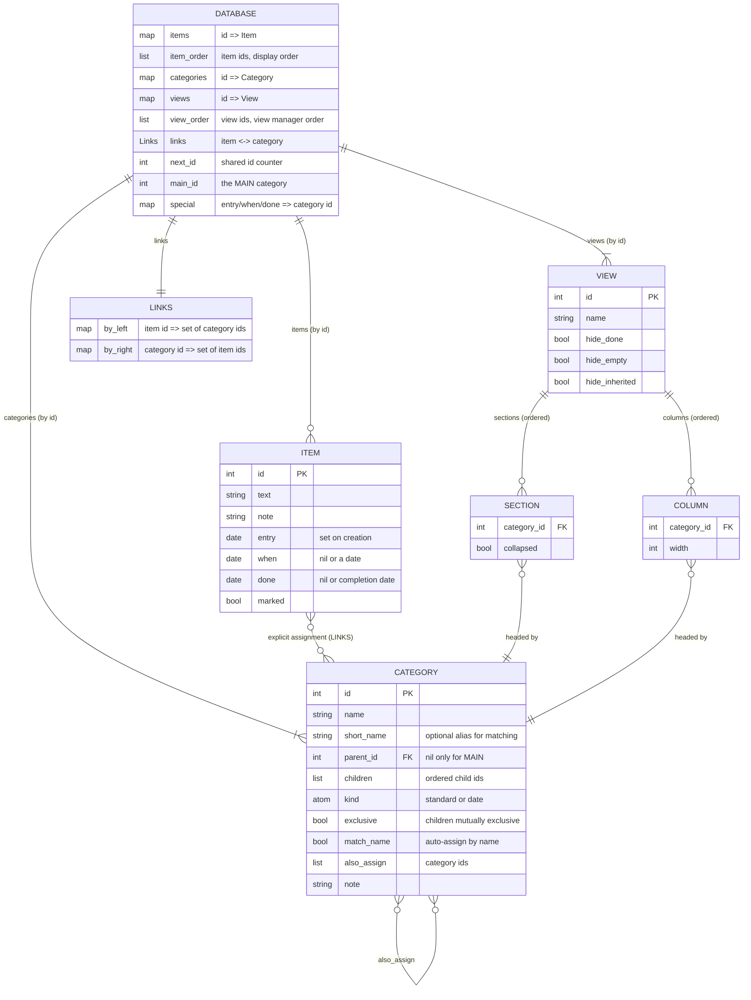
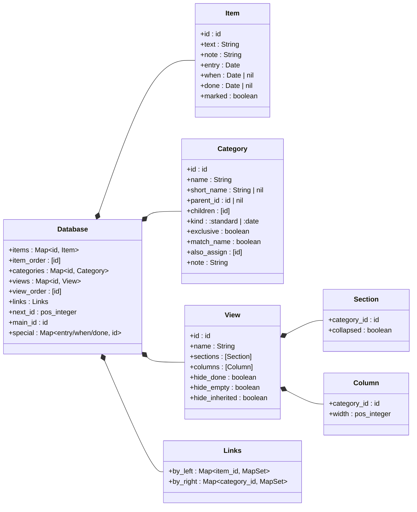
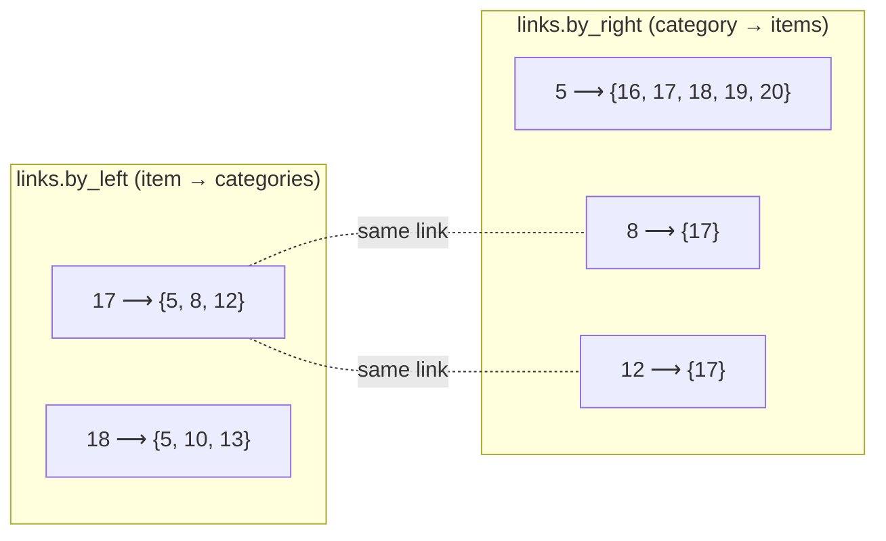
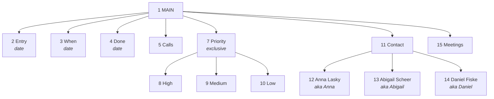
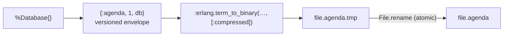

# Data model

How an Agenda file is represented in memory and on disk. For how the data
is read and changed, see [`DATA_ACCESS.md`](DATA_ACCESS.md).

An Agenda file is **one immutable value**, `%Agenda.Core.Database{}`. Every
change produces a new value; nothing is updated in place. This is what
makes undo a matter of keeping old values (`Agenda.TUI.History`).

## Overview



## The structs



| Struct | Module | Notes |
|---|---|---|
| `Database` | `lib/agenda/core/database.ex` | The whole file. Maps are keyed by id; order lives in separate lists. |
| `Item` | `lib/agenda/core/item.ex` | Free text and dates. **Does not know its categories.** |
| `Category` | `lib/agenda/core/category.ex` | Tree node with flags for the assignment rules. **Does not know its items.** |
| `View`, `View.Section`, `View.Column` | `lib/agenda/core/view.ex` | Pure presentation config; references categories by id. |
| `Links` | `lib/agenda/core/links.ex` | Generic bidirectional many-to-many relation. |

### Ids

Items, categories and views draw ids from **one counter**, `next_id`, just as
the patent keeps all objects in one object file (`.AGA`). An id therefore
says nothing about its type; look it up in the right map. Ids are never
reused. Lower ids were created earlier, and the automatic-assignment
tie-break relies on that ("prefer the category created first").

### Ordering

Maps are unordered, so order is stored separately:

| Order | Stored in | Meaning |
|---|---|---|
| Items | `db.item_order` | Global order of items. Sections show their items in this order, and a new item is inserted after the highlighted one. |
| Sibling categories | `category.children` | Order in the hierarchy (category manager, column choices). |
| Views | `db.view_order` | Order in the view manager. The first view opens on start. |
| Sections, columns | `view.sections`, `view.columns` | Top-to-bottom, left-to-right. |

## Items, categories and links

This is the core idea from US patent 5,115,504. Items and categories are
independent objects, joined by independent **link structures**. In the
patent each link is a record with four pointers that chains it into the
item's list and the category's list (FIG. 2, 3B). Here the same relation
is two indexes kept in lockstep:



`Links.link/3` and `Links.unlink/3` always update both maps, and empty
sets are removed. A property test (`test/agenda/core/links_test.exs`)
checks that the two indexes always describe the same relation.

Only **explicit** assignments are stored. Membership through the hierarchy
(subsumption) is computed when asked; see `Database.member?/3` in
[`DATA_ACCESS.md`](DATA_ACCESS.md#membership-subsumption).

### Special categories

`Database.new/1` creates four categories that cannot be renamed, moved
or deleted (`Database.protected?/2`):

| Category | Kind | Membership |
|---|---|---|
| MAIN (`db.main_id`) | standard | Root of the tree. **Every item** is a member; never linked. |
| Entry (`db.special.entry`) | date | Item's `entry` date (set when created). |
| When (`db.special.when`) | date | Item's `when` date (typed in a When column). |
| Done (`db.special.done`) | date | Item's `done` date (F4). |

Date categories are never linked. Their membership *is* the item's date
field (`Database.date_field/2` maps a category id to `:entry`, `:when` or
`:done`).

## Worked example

The demo file (`Agenda.Sample.build/1`), based on the patent's example
view. Its category hierarchy, with ids:



There is one view, `6 "Activities"`, with a section on Calls (5) and
columns When (3), Priority (7) and Contact (11). Note the shared id space:
the view was created between categories `5` and `7`.

Item 17, *"Don't forget to call Anna Lasky with the information she
requested."*, shows the difference between stored links and computed
membership:


Only the three thick edges are stored (`links.by_left[17] == {5, 8, 12}`).
Membership of Priority, Contact and MAIN is derived by walking up the tree.
In the view, item 17 appears in the Calls section. The Priority column
shows "High" (the linked descendant of Priority), and the Contact column
shows "Anna Lasky".

The same database as an Elixir term, abbreviated:

```elixir
%Agenda.Core.Database{
  main_id: 1,
  special: %{entry: 2, when: 3, done: 4},
  next_id: 21,
  item_order: [16, 17, 18, 19, 20],
  items: %{
    17 => %Item{id: 17, text: "Don't forget to call Anna Lasky…", entry: ~D[2026-10-08], when: nil, done: nil},
    ...
  },
  categories: %{
    1 => %Category{id: 1, name: "MAIN", parent_id: nil, children: [2, 3, 4, 5, 7, 11, 15]},
    7 => %Category{id: 7, name: "Priority", parent_id: 1, children: [8, 9, 10], exclusive: true, match_name: false},
    12 => %Category{id: 12, name: "Anna Lasky", short_name: "Anna", parent_id: 11},
    ...
  },
  views: %{6 => %View{id: 6, name: "Activities", sections: [%Section{category_id: 5}], columns: [...]}},
  view_order: [6],
  links: %Links{
    by_left: %{16 => MapSet.new([5, 9]), 17 => MapSet.new([5, 8, 12]), ...},
    by_right: %{5 => MapSet.new([16, 17, 18, 19, 20]), 8 => MapSet.new([17]), ...}
  }
}
```

## Invariants

The core maintains these, and the tests check them (including the property
tests in `database_test.exs` and `links_test.exs`):

1. **Tree.** Every category except MAIN has a `parent_id` present in
   `categories`, and appears exactly once in that parent's `children`.
   Every category is reachable from MAIN; there are no cycles
   (`move_category/4` refuses them).
2. **Links are symmetric.** `item ∈ by_right[c] ⇔ c ∈ by_left[item]`, and no
   empty sets are stored.
3. **Links reference live objects.** Deleting an item drops its links
   (`delete_item/2`). Deleting a category drops the links of its whole
   subtree (`delete_category/2`).
4. **No links to MAIN or date categories.** `Assign.assign/3` ignores them.
5. **Exclusive families hold at most one branch.** `Assign` clears the
   siblings before linking, and `Core.make_exclusive/3` resolves items
   already in several children before setting the flag (SPEC R7a).
   *Gap:* moving a category under an exclusive parent (`move_category/4`,
   `demote/2`) can still put an item in two branches.
6. **Views reference live categories.** `delete_category/2` removes
   sections and columns headed by deleted categories, and also removes the
   deleted ids from every `also_assign` list.
7. **Order lists match the maps.** `item_order` holds exactly the keys of
   `items`, and `view_order` exactly the keys of `views`. At least one view
   always exists (`delete_view/2` refuses to delete the last one).
8. **Protected categories** (MAIN, Entry, When, Done) always exist, keep
   their names, and stay where they are.

## Mapping to the patent

| Patent (US 5,115,504) | This implementation |
|---|---|
| Object file `.AGA` (category, item, view, genealogy objects) | `db.categories`, `db.items`, `db.views` with one `next_id` |
| Link-structure file `.AGB` | `db.links` (`Links`) |
| Link structure joining item and category (FIG. 2) | an entry in both `by_left` and `by_right` |
| Category chains: first/last child, sibling pointers (FIG. 1) | `parent_id` + ordered `children` list |
| Genealogy object (cached ancestors) | `Database.ancestors/2`, computed on demand |
| Subsumption / inheritance (FIG. 4) | `Database.member?/3`, computed on demand |
| View linked to categories (FIG. 5) | `View.sections` / `View.columns` holding category ids |
| Category-to-category links (FIG. 6) | `Category.also_assign` |
| Negative links (FIG. 6, crossed squares) | `Category.exclusive` (for siblings); general negative links are on the roadmap |
| Free object / free link lists | not needed: immutable maps, ids never reused |

## On disk

`Agenda.Store` writes the whole `Database` value as one Erlang term:



- **Loading** uses `binary_to_term(…, [:safe])`, which refuses unknown
  atoms. `Store.load/1` therefore loads the app's modules first, so that
  struct field names exist as atoms.
- **Versioning.** The `1` in the envelope is the format version. Adding a
  field to a struct requires bumping it and migrating older versions in
  `Store.load/1`. Old terms decode to structs *without* the new key.
- The format is not human-readable; a text export is on the roadmap.
  See [ADR 0003](adr/0003-file-format.md).

## UI state around the database

The TUI keeps a few database-related values in `Agenda.TUI.State`. They
are not part of the file:

| Field | Purpose |
|---|---|
| `db` | The current `Database`. |
| `saved_db` | The database as last saved or loaded; `dirty` is `db != saved_db`. |
| `undo`, `redo` | Snapshots `%{db, view_id, cursor_key}` (max 100), see `TUI.History`. |
| `view_id` | The view on screen. |
| `cursor_key` | `{:section, index}` or `{:item, section_index, item_id}`; re-found after every change. |
