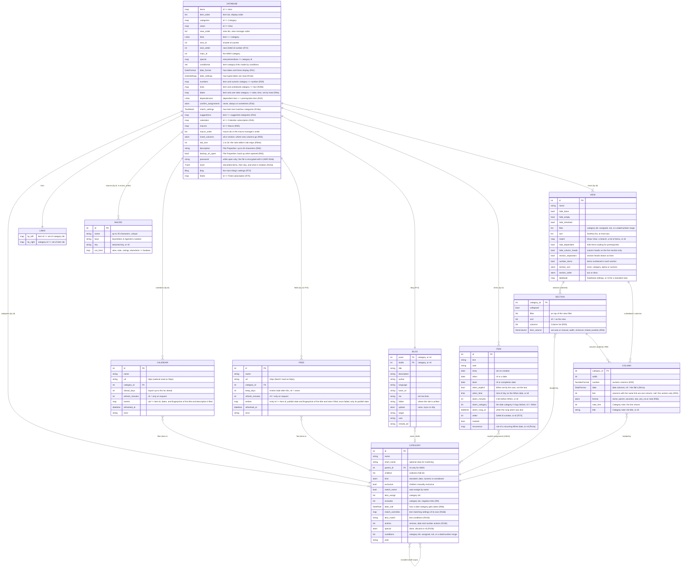
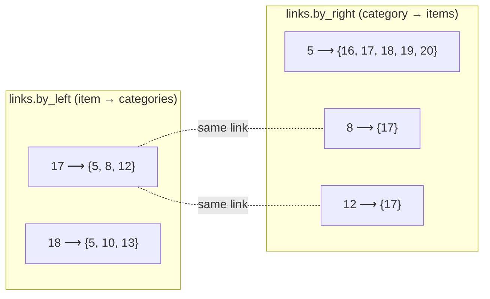
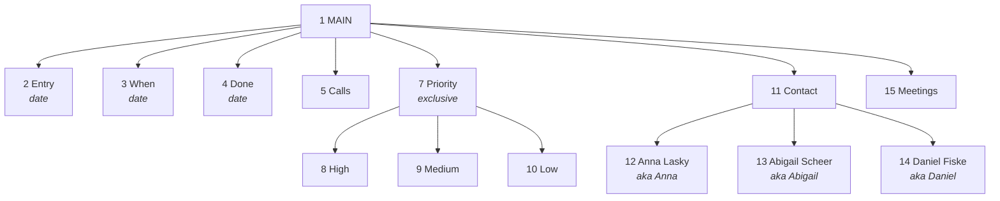
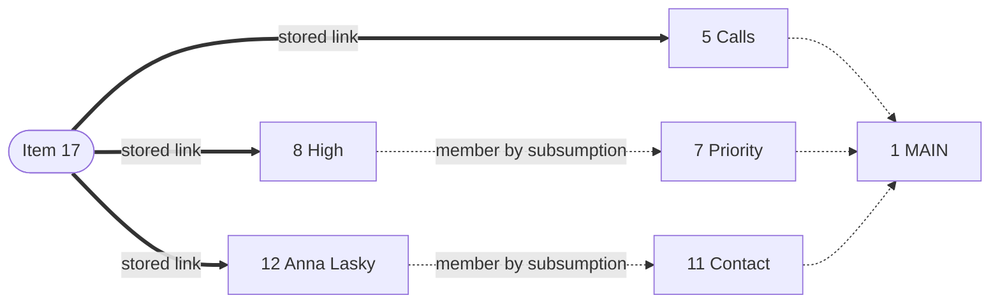
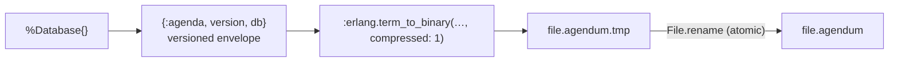

# Data model

How an Agenda file is represented in memory and on disk. For how the data is read and changed, see [`DATA_ACCESS.md`](DATA_ACCESS.md).

An Agenda file is **one immutable value**, `%Agendum.Core.Database{}`. Every change produces a new value; nothing is updated in place. This is what makes undo a matter of keeping old values (`Agendum.TUI.History`).

## Overview



## The structs

```mermaid
classDiagram
    direction LR
    class Database {
        +items : Map~id, Item~
        +item_order : [id]
        +categories : Map~id, Category~
        +views : Map~id, View~
        +view_order : [id]
        +links : Links
        +next_id : pos_integer
        +next_zettel : pos_integer
        +main_id : id
        +special : Map~entry/when/done, id~
        +conditional : MapSet
        +date_format : DateFormat
        +date_settings : DateSettings
        +numbers : Map~item_id and cat_id, float~
        +texts : Map~item_id and cat_id, string~
        +dates : Map~item_id and cat_id, date time explicit~
        +dependencies : Links
        +confirm_assignments : never, always or sometimes
        +match_settings : TextMatch
        +suggestions : Map~item_id, [cat_id]~
        +calendars : Map~id, Calendar~
        +macros : Map~id, Macro~
        +macro_order : [id]
        +insert_columns : all or section
        +tab_size : 1..16
        +description : String
        +backup_on_open : boolean
        +password : String or nil
        +trash : Trash
        +blog : Blog
        +feeds : Map~id, Feed~
    }
    class DateFormat {
        +order : yyyymmdd, mmddyy, ddmmmyy, week, relative…
        +separator : String
        +clock : 12 or 24
        +day_of_week : boolean
        +show : date_time, date, time_date or time
        +am_pm : boolean
        +time_separator : colon or hm
    }
    class DateSettings {
        +week_start, week_end : 1..7
        +quarter_start, year_start : 1..12
        +month_alone : first, last or 2..31
        +morning, afternoon, evening : Time
    }
    class Trash {
        +items : [Item] without assignments, oldest first
        +day : Date or nil
        +empty : on_demand, file_closed, end_of_day or discarded
    }
    class TextMatch {
        +enabled : boolean
        +match_on : what text is matched
        +strength : how closely
        +enclosed_by : quotes, brackets…
        +ignore_suffixes : boolean
        +ignore_accents : boolean
    }
    class Item {
        +id : id
        +text : String
        +note : String
        +entry : Date
        +when : Date | nil
        +done : Date | nil
        +when_explicit : boolean
        +when_time : Time or nil
        +alarm_minutes : 0..60 or nil
        +alarm_category : id or nil
        +alarm_rung_at : NaiveDateTime or nil
        +zettel : non_neg_integer or nil
        +marked : boolean
        +recurrence : Recurrence or nil
    }
    class Recurrence {
        +every : pos_integer
        +unit : day, week, month or year
        +weekday : 1..7 or nil
        +day : 1..31 or nil
    }
    class Category {
        +id : id
        +name : String
        +short_name : String | nil
        +parent_id : id | nil
        +children : [id]
        +kind : :standard | :date | :numeric | :unindexed
        +exclusive : boolean
        +match_name : boolean
        +also_assign : [id]
        +excludes : [id]
        +date_rule : DateRule or nil
        +match_overrides : Map~setting, value~
        +also_match : String
        +actions : [id and action]
        +special : done, discard or nil
        +conditions : [id and kind]
        +note : String
    }
    class DateRule {
        +assign : never, entered, item_text…
        +which : 1..10
        +done_key : boolean
        +when_key : boolean
    }
    class View {
        +id : id
        +name : String
        +sections : [Section]
        +columns : [Column], a datebook's
        +hide_done : boolean
        +hide_empty : boolean
        +hide_inherited : boolean
        +filter : [id and kind]
        +sort : [SortKey]
        +match : Search, item list or nil
        +hide_dependent : boolean
        +hide_column_heads : boolean
        +section_separators : boolean
        +number_items : boolean
        +section_sort : none, category, alpha, numeric
        +section_order : asc or desc
        +datebook : Datebook or nil
    }
    class Search {
        +text : String
        +on : item, note or both
        +ignore_case : boolean
    }
    class SortKey {
        +on : text, category id or note line of a category
        +order : asc or desc
        +na : bottom or top
        +sequence : hierarchy or alpha
        +line : pos_integer
    }
    class Datebook {
        +date_category : id
        +end_category : id or nil
        +section_category : id
        +period : day, week, month, quarter
        +interval : 15, 30, 60, day, week, month or nil
        +start_time, end_time : Time or nil
        +start_day, end_day : 1..7 or nil
        +base : String
    }
    class Section {
        +category_id : id
        +collapsed : boolean
        +filter : [id and kind]
        +sort : [SortKey] or nil
        +columns : [Column]
        +item_column : ItemColumn
    }
    class ItemColumn {
        +set : auto or manual
        +width : pos_integer
        +minimum : pos_integer
        +linked : boolean
        +position : columns left of it
    }
    class Column {
        +category_id : id
        +width : pos_integer
        +number : NumberFormat
        +date : DateFormat or nil
        +link : pos_integer or nil
        +format : name, parent, ancestor, star, yes_no, note
        +note_line : 1..999
        +title : String or nil
    }
    class NumberFormat {
        +symbol : nil, $, %, ¢, £, ¥
        +decimals : integer
        +thousands : boolean
        +negative : minus or parens
        +calcs : [count, total, average, minimum, maximum]
        +percent : boolean
    }
    class Calendar {
        +id : id
        +name : String
        +url : String
        +category_id : id
        +ahead_days : 30, 90, 180 or 365
        +refresh_minutes : nil, 60, 360 or 1440
        +events : Map~uid, snapshot~
        +refreshed_at : NaiveDateTime or nil
        +error : String or nil
    }
    class Feed {
        +id : id
        +name : String
        +url : String
        +category_id : id
        +keep_days : pos_integer or nil
        +refresh_minutes : nil, 60, 360 or 1440
        +entries : Map~entry_id, snapshot~
        +refreshed_at : NaiveDateTime or nil
        +error : String or nil
    }
    class Blog {
        +posts : id or nil
        +drafts : id or nil
        +title, description, author, language : String
        +base_url, me : String
        +folder : String
        +upload : none, rsync or sftp
        +target, user, remote_dir : String
    }
    class Macro {
        +id : id
        +name : String
        +keys : String
        +key : String or nil
        +run_from : Map~place, boolean~
    }
    class Links {
        +by_left : Map~item_id, MapSet~
        +by_right : Map~category_id, MapSet~
    }
    Database *-- Item
    Item *-- Recurrence
    Database *-- Category
    Database *-- View
    Database *-- Links
    Database *-- DateFormat
    Database *-- DateSettings
    Database *-- TextMatch
    Database *-- Trash
    Category *-- DateRule
    Database *-- Calendar
    Database *-- Feed
    Database *-- Blog
    Database *-- Macro
    View *-- Section
    Section *-- Column
    Section *-- ItemColumn
    View *-- Column
    View *-- Datebook
    View *-- SortKey
    View *-- Search
    Section *-- SortKey
    Column *-- NumberFormat
    Column *-- DateFormat
```



| Struct                                | Module                              | Notes                                                                                                |
| ------------------------------------- | ----------------------------------- | ---------------------------------------------------------------------------------------------------- |
| `Database`                            | `lib/agendum/core/database.ex`      | The whole file. Maps are keyed by id; order lives in separate lists.                                 |
| `Item`                                | `lib/agendum/core/item.ex`          | Free text and dates. **Does not know its categories.**                                               |
| `Category`                            | `lib/agendum/core/category.ex`      | Tree node with flags for the assignment rules. **Does not know its items.**                          |
| `View`, `View.Section`, `View.Column` | `lib/agendum/core/view.ex`          | Pure presentation config; references categories by id.                                               |
| `Links`                               | `lib/agendum/core/links.ex`         | Generic bidirectional many-to-many relation.                                                         |
| `DateFormat`                          | `lib/agendum/core/date_format.ex`   | How the file and date columns display dates and times (R41, R41a).                                   |
| `DateSettings`                        | `lib/agendum/core/date_settings.ex` | How the file reads typed dates: week, quarter and year boundaries, month alone, times of day (R14e). |
| `NumberFormat`                        | `lib/agendum/core/number_format.ex` | How a numeric column shows numbers and which calculations it shows; also reads typed numbers (R29).  |
| `Calendar`                            | `lib/agendum/core/extras/calendar.ex`      | A calendar subscription: its address, its category, and the events it last read (R45).               |
| `Feed`                                | `lib/agendum/core/extras/feed.ex`          | A feed subscription: its address, its category, how long entries stay, and the entries it last read (R75). |
| `Blog`                                | `lib/agendum/core/extras/blog.ex`          | The micro-blog's settings: posts and drafts categories, the site's title and address, where it is written and uploaded (R74). |
| `View.SortKey`                        | `lib/agendum/core/view.ex`          | One way to order items: by text, by a category's children, or by a note line (R36).                  |
| `Search`                              | `lib/agendum/core/search.ex`        | A text search, kept in the Show View's `match` (R37).                                                |
| `TextMatch`                           | `lib/agendum/core/text_match.ex`    | How the file matches item text to category names; a category may override settings (R16a, R16b).     |
| `DateRule`                            | `lib/agendum/core/date_rule.ex`     | How a date category gets dates: Assign item date, Which one, Done and When keys (R6b).               |
| `Macro`                               | `lib/agendum/core/macro.ex`         | A macro: name, keystrokes in Agenda's notation, attached key, where it runs (R50).                   |

### Ids

Items, categories and views draw ids from **one counter**, `next_id`, just as the patent keeps all objects in one object file (`.AGA`). An id therefore says nothing about its type; look it up in the right map. Ids are never reused. Lower ids were created earlier, and the automatic-assignment tie-break relies on that ("prefer the category created first").

**Feeds** (R75): `db.feeds` holds the feed subscriptions (`Agendum.Core.Extras.Feed`), each with the item every entry made, its publish date and fingerprints of the title and note it filed (`Feed.snapshot/2`, `Agendum.Core.Extras.Fingerprint`, format 46, ADR 0048), so a refresh changes only what the feed changed and keeps the person's edits, without a copy of the text; an entry that faded or was discarded keeps only its publish date (`Feed.forget/1`, format 45), enough never to bring it back. The entries' items are ordinary items in Feeds ▸ the feed's name; their publish date is their Entry date.

**The blog** (R74): `db.blog` (`Agendum.Core.Extras.Blog`) holds the micro-blog's settings: its posts and drafts categories by id, its title, description, author, language, base address and `rel="me"` links, the folder the site is written to and how it is uploaded (none, rsync, SFTP, ADR 0041). No password is ever stored. The posts themselves are the items of the posts category, computed (`Blog.posts/1`), and the site is made from them each time (`Agendum.Core.Extras.Site`); nothing of the site is stored in the file.

**Zettel ids** (R73, ADR 0039) are a second, separate kind of id: the ids people say and link to, given only to the items made zettels. An item's `zettel` is a number, spelled as a word by `Agendum.Core.Extras.ZettelId` (`bonalaku` is 1); the file's own counter, `next_zettel`, starts at 1 and only goes up, skipping the reserved words, so a Zettel id is never given twice. The JSON writes the word.

### Ordering

Maps are unordered, so order is stored separately:

| Order              | Stored in                       | Meaning                                                                                                               |
| ------------------ | ------------------------------- | --------------------------------------------------------------------------------------------------------------------- |
| Items              | `db.item_order`                 | Global order of items. Sections show their items in this order, and a new item is inserted after the highlighted one. |
| Sibling categories | `category.children`             | Order in the hierarchy (category manager, column choices).                                                            |
| Views              | `db.view_order`                 | Order in the view manager. The first view opens on start.                                                             |
| Sections, columns  | `view.sections`, `section.columns` | Top-to-bottom, left-to-right; a datebook view's columns are `view.columns` (R55).                                  |

## Items, categories and links

This is the core idea from US patent 5,115,504. Items and categories are independent objects, joined by independent **link structures**. In the patent each link is a record with four pointers that chains it into the item's list and the category's list (FIG. 2, 3B). Here the same relation is two indexes kept in lockstep:



`Links.link/3` and `Links.unlink/3` always update both maps, and empty sets are removed. A property test (`test/agendum/core/links_test.exs`) checks that the two indexes always describe the same relation.

Only **explicit** assignments are stored. Membership through the hierarchy (subsumption) is computed when asked; see `Database.member?/3` in [`DATA_ACCESS.md`](DATA_ACCESS.md#membership-subsumption).

### Special categories

`Database.new/1` creates four categories that cannot be renamed, moved or deleted (`Database.protected?/2`):

| Category                   | Kind     | Membership                                                                             |
| -------------------------- | -------- | -------------------------------------------------------------------------------------- |
| MAIN (`db.main_id`)        | standard | Root of the tree. **Every item** is a member; never linked.                            |
| Entry (`db.special.entry`) | date     | Item's `entry` date (set when created).                                                |
| When (`db.special.when`)   | date     | Item's `when` date: read from its text, or set explicitly (`when_explicit`), SPEC R14. |
| Done (`db.special.done`)   | date     | Item's `done` date (F4).                                                               |

Date categories are never linked. Their membership _is_ the item's date field (`Database.date_field/2` maps a category id to `:entry`, `:when` or `:done`).

## Worked example

The demo file (`Agendum.Sample.build/1`), based on the patent's example view. Its category hierarchy, with ids:



There is one view, `6 "Activities"`, with a section on Calls (5) and columns When (3), Priority (7) and Contact (11). Note the shared id space: the view was created between categories `5` and `7`.

Item 17, _"Don't forget to call Anna Lasky with the information she requested."_, shows the difference between stored links and computed membership:



Only the three thick edges are stored (`links.by_left[17] == {5, 8, 12}`). Membership of Priority, Contact and MAIN is derived by walking up the tree. In the view, item 17 appears in the Calls section. The Priority column shows "High" (the linked descendant of Priority), and the Contact column shows "Anna Lasky".

The same database as an Elixir term, abbreviated:

```elixir
%Agendum.Core.Database{
  main_id: 1,
  special: %{entry: 2, when: 3, done: 4},
  next_id: 21,
  item_order: [16, 17, 18, 19, 20],
  items: %{
    17 => %Item{id: 17, text: "Don't forget to call Anna Lasky…", entry: ~D[2026-10-08], when: nil, done: nil},
    ...
  },
  categories: %{
    1 => %Category{id: 1, name: "MAIN", parent_id: nil, children: [2, 3, 4, 5, 7, 11, 15]},
    7 => %Category{id: 7, name: "Priority", parent_id: 1, children: [8, 9, 10], exclusive: true, match_name: false},
    12 => %Category{id: 12, name: "Anna Lasky", short_name: "Anna", parent_id: 11},
    ...
  },
  views: %{6 => %View{id: 6, name: "Activities", sections: [%Section{category_id: 5, columns: [...]}]}},
  view_order: [6],
  links: %Links{
    by_left: %{16 => MapSet.new([5, 9]), 17 => MapSet.new([5, 8, 12]), ...},
    by_right: %{5 => MapSet.new([16, 17, 18, 19, 20]), 8 => MapSet.new([17]), ...}
  }
}
```

### Datebook views

A view with `datebook` set (R47, `Agendum.Core.Datebook`) shows time slots instead of its stored sections, which it ignores: the hours of a day, the days of a week, or the days, weeks or months of a month or quarter, worked out from the settings and the clock every time the view is built (`Datebook.slots/3`), since `base` is typed text such as "today" or "next week". A slot shows the items of the Section category whose date in the date category (and, with an End category, their span up to its date) falls in it; nothing about slots is stored. Deleting a category a datebook uses falls back to When (and the end category to none).

## Invariants

The core maintains these, and the tests check them: `Agendum.Core.Invariants.violations/1` checks them all (and that every object is under its own id, all ids share one id space below `next_id`, and `macro_order` matches `macros`), and the fuzz walks run it after every key, as does the JSON round trip; the property tests in `database_test.exs` and `links_test.exs` check some of them directly:

1. **Tree.** Every category except MAIN has a `parent_id` present in `categories`, and appears exactly once in that parent's `children`. Every category is reachable from MAIN; there are no cycles (`move_category/4` refuses them).
2. **Links are symmetric.** `item ∈ by_right[c] ⇔ c ∈ by_left[item]`, and no empty sets are stored.
3. **Links reference live objects.** Deleting an item drops its links (`delete_item/2`). Deleting a category drops the links of its whole subtree (`delete_category/2`).
4. **No links to MAIN or date categories.** `Assign.assign/3` ignores them.
5. **Exclusive families hold at most one branch.** `Assign` clears the siblings before linking, and `Core.make_exclusive/3` resolves items already in several children before setting the flag (SPEC R7a). `Core.move_category/5`, `promote/3` and `demote/3` resolve items a move would put in two branches (SPEC R7b). Only the `Database` primitives skip these checks; the TUI never calls them directly.
6. **Views reference live categories.** `delete_category/2` removes sections and columns headed by deleted categories, and also removes the deleted ids from every `also_assign` and `excludes` list. Filters and sort keys that name a deleted category are dropped with it. A Show View listing items (`match: {:items, ids}` or `{:circular, ids}`) lists live ones: `delete_item/2` takes a discarded item out of it.
7. **Order lists match the maps.** `item_order` holds exactly the keys of `items`, and `view_order` exactly the keys of `views`. At least one view always exists (`delete_view/2` refuses to delete the last one).
8. **Protected categories** (MAIN, Entry, When, Done) always exist, keep their names, and stay where they are.
9. **No direct link to both a category and its ancestor** (SPEC R7c). An item linked to a category is never also linked to one of its ancestors. `Assign.assign/3` clears the item's links to the category's ancestors and descendants before linking, and category moves resolve the conflicts they would create. Files saved before R7c may still contain such pairs; assigning those items again tidies them up.
10. **Conditional marks are links.** Every `{item, category}` in `db.conditional` is also a link; `Database.unlink/3` and the delete operations remove marks with their links. A user assignment clears the mark, so only condition-made links are ever retracted (SPEC R15).
11. **Zettel ids are unique.** No two items have the same `zettel`, and each is below `next_zettel` (R73). `Core.attach_zettels/2` takes the next number and counts on; nothing else sets one.
12. **The blog's categories exist.** `blog.posts` and `blog.drafts` are categories in the file, or nil; `delete_category/2` clears them when they go (R74).
13. **Feeds file into categories that exist.** A feed's `category_id` is a category; `delete_category/2` ends the subscription with it (R75). A feed's entries name items that exist, or nil (one that faded or was discarded); a refresh clears those the person discarded.
14. **The trash is out of the file** (R24a). An item in `trash.items` is in neither `items` nor `item_order`, is there once, has an id below `next_id`, and kept no When or Done date or alarm (`Core.discard_items/3` strips them); `trash.day` is set exactly while the trash has items. Undisc puts an item back under its own id.

## Mapping to the patent

| Patent (US 5,115,504)                                        | This implementation                                                       |
| ------------------------------------------------------------ | ------------------------------------------------------------------------- |
| Object file `.AGA` (category, item, view, genealogy objects) | `db.categories`, `db.items`, `db.views` with one `next_id`                |
| Link-structure file `.AGB`                                   | `db.links` (`Links`)                                                      |
| Link structure joining item and category (FIG. 2)            | an entry in both `by_left` and `by_right`                                 |
| Category chains: first/last child, sibling pointers (FIG. 1) | `parent_id` + ordered `children` list                                     |
| Genealogy object (cached ancestors)                          | `Database.ancestors/2`, computed on demand                                |
| Subsumption / inheritance (FIG. 4)                           | `Database.member?/3`, computed on demand                                  |
| View linked to categories (FIG. 5)                           | `View.sections` / `Section.columns` holding category ids                     |
| Category-to-category links (FIG. 6)                          | `Category.also_assign`                                                    |
| Negative links (FIG. 6, crossed squares)                     | `Category.exclusive` (for siblings) and `Category.excludes` (any two, R9) |
| Free object / free link lists                                | not needed: immutable maps, ids never reused                              |

## On disk

`Agendum.Store` writes the whole `Database` value as one Erlang term:



- **Loading** uses `binary_to_term(…, [:safe])`, which refuses unknown atoms. `Store.load/1` therefore loads the app's modules first, so that struct field names exist as atoms.
- **Versioning.** The number in the envelope is the format version (`Agendum.Store.format_version/0`); the history is in the table below. Old terms decode to structs _without_ the new keys, so `Store.load/1` accepts every version up to the current one and runs `Store.upgrade/1`, which rebuilds each struct so new fields get their defaults. Adding a field means bumping the version; a change that defaults cannot express (a renamed or reshaped field) also needs a migration step in `upgrade/1`. Files from a newer version are refused.
- **Golden files.** From version 33 on, each format version has a file it wrote, kept in `test/fixtures/formats/` (`v33.agendum`, with what it says in `v33.facts.exs`), made by `mix agendum.golden` from `Agendum.Starters.Golden`, which uses every stored field (a test checks). `test/agendum/golden_files_test.exs` loads every one: it must upgrade, keep the invariants and its facts, open in the UI and save again; and the current version's file must exist. Raising the version means running `mix agendum.golden` and committing what it writes; a new stored field means setting it in `Agendum.Starters.Golden` first.
- The format is not human-readable; File ▸ Transfer ▸ Export writes a file as JSON ([`JSON_FORMAT.md`](JSON_FORMAT.md), ADR 0010). See [ADR 0003](adr/0003-file-format.md); it stays the format of record, for speed at large volumes ([ADR 0034](adr/0034-format-of-record.md)).

Format versions:

| Version | Change |
| ------- | ------ |
| 1 | The first |
| 2 | Added `Item.when_explicit` and `Database.auto_date` (R14) |
| 3 | Added `Category.conditions` and `Database.conditional` (R15) |
| 4 | Added view and section `filter` and `sort` (R28, R36) |
| 5 | Added the view `match` used by the Show View (R37) |
| 6 | Added `Item.when_time`, `alarm_minutes` and `alarm_rung_at` (R14b, R38) |
| 7 | Added `Database.date_format` (R41) |
| 8 | Added `Database.numbers` and `View.Column.number` (R29) |
| 9 | Added `Item.recurrence` (R14a) |
| 10 | Added `Database.dependencies` and `View.hide_dependent` (R43) |
| 11 | Added `Category.also_match` (R15d) |
| 12 | Added `Category.actions` and `Category.special` (R15b) |
| 13 | Added `Database.confirm_assignments` and `Database.suggestions` (R16) |
| 14 | Added `Database.date_settings` (R14e) |
| 15 | Replaced `Database.auto_date` with `Database.when_from` (R14f) |
| 16 | Added `Category.excludes` (R9) |
| 17 | Added `Database.dates` (R6a) |
| 18 | Added `Category.date_rule` (R6b), replacing `Database.when_from` with When's rule |
| 19 | Added `Database.match_settings` (R16a) |
| 20 | Added `Category.match_overrides` (R16b) |
| 21 | Added `View.Column.date` and the `DateFormat` fields `show`, `am_pm` and `time_separator` (R41a) |
| 22 | Added `Database.calendars` (R45) |
| 23 | Added `View.datebook` (R47) |
| 24 | Added `Database.macros` and `macro_order` (R50) |
| 25 | Moved a standard view's columns into its sections and added `View.Column.linked` (R55) |
| 26 | Added `Database.insert_columns` (R55) |
| 27 | Replaced `View.Column.linked` with `link`, so each column added is a column of its own (R55) |
| 28 | Added `View.Section.item_column` (R55) |
| 29 | Added the item column's `position` among the columns (`View.Section.item_column`, R55) |
| 30 | Added `NumberFormat.percent` (Display % of total, R29) |
| 31 | Added `View.Column.format`, `note_line` and `title` (standard column formats, R56) |
| 32 | Added `View.hide_column_heads` (R57) |
| 33 | Added `View.section_separators` (R58) |
| 34 | Added `Item.zettel` and `Database.next_zettel`, Zettel ids (R73) |
| 35 | Added `Database.blog`, the micro-blog's settings (`Agendum.Core.Extras.Blog`, R74) |
| 36 | Added `Database.feeds`, feed subscriptions (`Agendum.Core.Extras.Feed`, R75) |
| 37 | Added `Database.tab_size`, File Properties ▸ Tab size (R64e) |
| 38 | Moved the extras' stored structs, `Feed`, `Blog` and `Calendar`, to `Agendum.Core.Extras.*` (ADR 0044); loading maps the old names |
| 39 | Added `View.number_items`, View Properties ▸ Number items (R79) |
| 40 | Added `Database.texts` and the `:unindexed` kind of `Category`, unindexed categories (R29b) |
| 41 | Added `Item.alarm_category`, the date category an alarm rings before (R38) |
| 42 | Added `Database.description` and `backup_on_open`, File Properties' File description and Make backup on open (R82) |
| 44 | Added `Database.trash`, an `Agendum.Core.Trash` (`items`, `day`, `empty`), the trash: discarded items kept without their assignments until it is emptied, and File Properties ▸ Empty trash (R24a) |
| 43 | Added `Database.password`, never written: a file with one is saved encrypted, `AGENDUM-ENC1`, the description, salt, nonce, tag and the encrypted file (ADR 0046) |
| 45 | A feed entry that faded or was discarded keeps only `%{item: nil, published}`, not its title, note and link (`Feed.forget/1`); `upgrade/1` trims older files' (meeting 2026-10-26-4, § 5) |
| 46 | A live feed entry keeps `title_print` and `note_print`, fingerprints of what it filed, instead of `title`, `note` and `link`; a calendar event `summary_print` and `description_print` instead of `summary` and `description` (`Agendum.Core.Extras.Fingerprint`); `upgrade/1` converts older files (ADR 0048; meeting 2026-10-26-5, § 5) |

## UI state around the database

The TUI keeps a few database-related values in `Agendum.TUI.State`. They are not part of the file:

| Field          | Purpose                                                                                |
| -------------- | -------------------------------------------------------------------------------------- |
| `db`           | The current `Database`.                                                                |
| `saved`        | The file as last saved or loaded: `db` (`dirty` is `db != saved.db`), `stamp` of its bytes and `conflict` (R71). |
| `undo`, `redo` | Snapshots `%{db, view_id, cursor_key}` (max 100), see `Agendum.TUI.History`.            |
| `view_id`      | The view on screen.                                                                    |
| `cursor_key`   | `{:section, index}` or `{:item, section_index, item_id}`; re-found after every change. |
