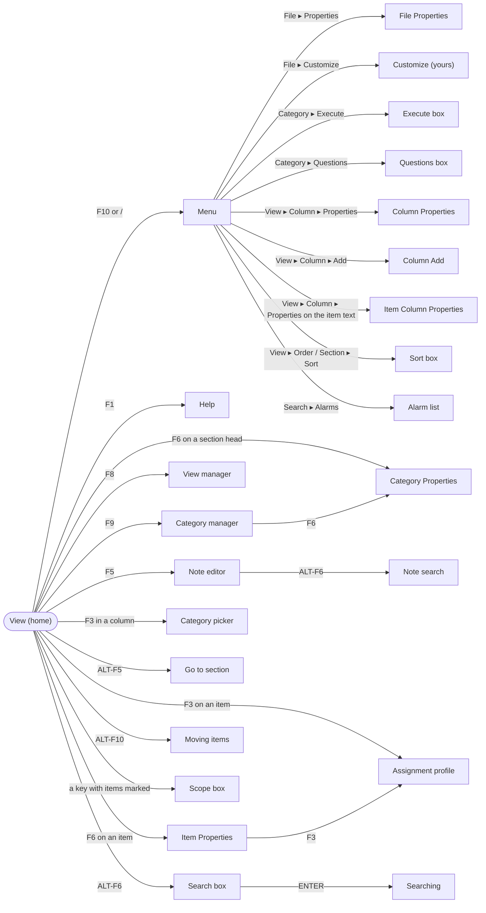
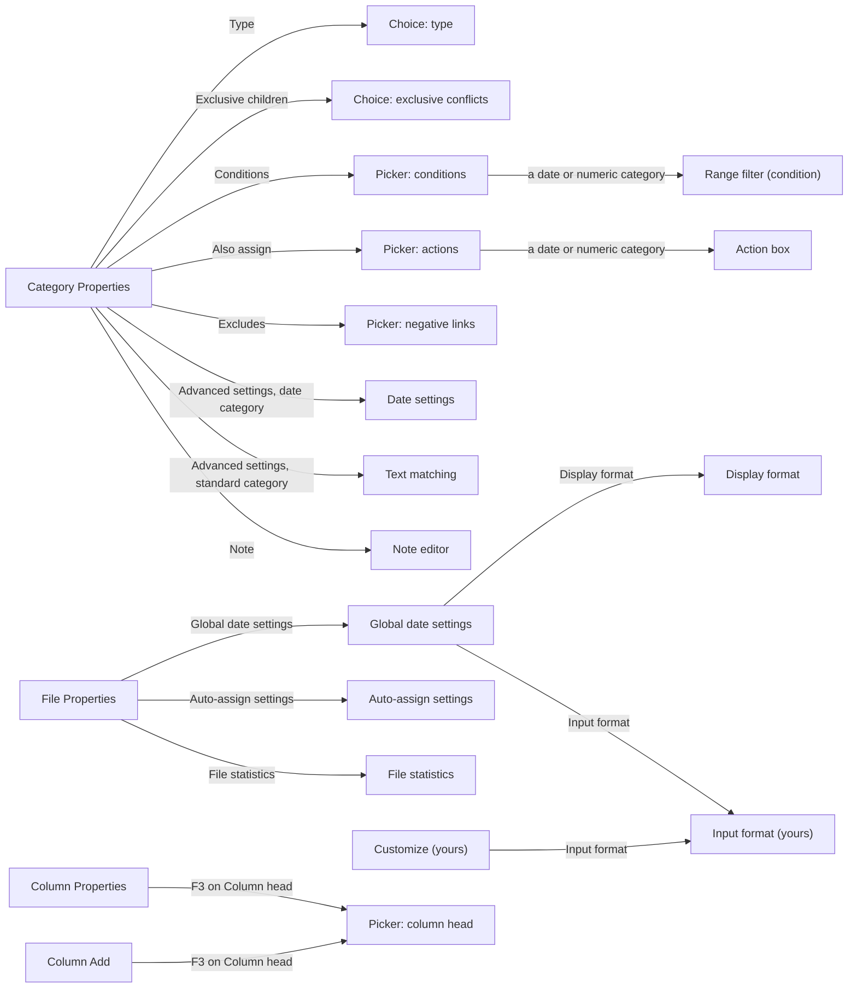

# Screens and boxes of the TUI

A map of every screen, box and control-panel mode, how to reach each one, and
what it opens in turn. For keys in detail see `docs/KEYBOARD.md` and the F1 help;
for the rules behind each box, the SPEC rule named in the tables.

## How screens stack

Everything the TUI shows on top of the current view is a **mode** on a stack,
`state.modes` (`Agendum.TUI.State`): opening a box pushes one, ESC pops it and
returns to what was underneath. `Agendum.TUI.Update.handle/2` sends each key to
the mode on top; `Agendum.TUI.Render` draws the stack. Modes come in three kinds:

- **Full screens** replace the view: the category manager, the view manager,
  help and the note editor.
- **Boxes** are drawn over the view (or over a full screen) in a frame with a
  title. A box opened from a box sits one line lower and two columns right.
- **Control-panel modes** use only the two lines at the top: the menu, prompts,
  Y/N questions, searching and moving items.

Each mode is a map with a `type` (the atom in the tables below) and its own
fields (cursor, the category or item it is for, a purpose).

## The map

The view is home. The main paths from it:

Category Properties and File Properties open boxes of their own:

## Everything, by where it is reached

Indentation shows what opens what. `type` is the mode's type; the module draws
or handles it.

- **View** (no mode): the current view's sections, items and columns.
  `Agendum.TUI.Update.ViewKeys`, `Agendum.TUI.Layout`, `Agendum.TUI.Render.View`.
  - **Menu** `:menu` (F10 or `/`): File, Item, Category, View, Search, Undo,
    Redo, Print, Quit. `Agendum.TUI.Menu`. Its commands open most of the boxes below;
    the menu path is given with each.
  - **Help** `:help` (F1; also from the category manager): keys and commands.
    `Agendum.TUI.Render.Help`.
  - **Prompt** `:prompt`: one line of text in the control panel (a file name,
    a new view's name, a category name). `Agendum.TUI.Update.Prompts`.
    - **Select File** `:select_file` (F3 in a prompt for a file name): the
      folder's subfolders and the files that fit, to pick one (R51).
      `Agendum.TUI.Boxes.SelectFile`.
  - **Question** `:confirm`: a Y/N question (discard, save changes, make a
    date category) in a small untitled box, as Agenda's (screenshots 36,
    141): the question with its answer highlighted, Yes at first.
    `Agendum.TUI.Update.Prompts`.
  - **Datebook settings** `:datebook_props` (View ▸ Properties of a datebook
    view; after View ▸ Add with Type Datebook): its categories, period,
    interval, start and end, base date (R47), Hide column heads (R57) and
    Section separators (R58). `Agendum.TUI.Boxes.DatebookBox`.
    - **Picker** `:picker` for the Date category, End category and Section.
    - **Prompt** `:prompt` for a time (Start at / End at of a day) or the base date.
  - **Section Properties** `:section_props` (View ▸ Section ▸ Properties, F6
    on a section head): the section's head, Item sorting, Section
    statistics, Filter and its columns (R61). `Agendum.TUI.Boxes.SectionBox`.
    - **Picker** `:picker` for the section head or the filter.
    - **Sort** `:sort` for Item sorting; **Column Add** `:column_add` for INS.
    - **Select Numeric Functions** `:numeric_functions`: Count, Total,
      Average, Minimum, Maximum for the section's numeric columns.
      `Agendum.TUI.Boxes.NumericFunctionsBox`.
  - **Choice** `:choice` (View ▸ Add, after the name): Standard or Datebook.
  - **Choice** `:choice` (View ▸ Column ▸ Remove on a column linked into
    other sections): All sections in view or Current section only (R55).
  - **Browsing** `:browse` (View ▸ Browse, ALT-B, in a datebook view or a
    view with a date filter): the view flips to other periods, or its date
    filter moves, until ENTER keeps it or ESC goes back (R47, R48).
    `Agendum.TUI.Moves.Browse`.
    - **Prompt** `:prompt` for a date to go to (ALT-F5).
  - **Column width** `:column_width` (View ▸ Column ▸ Width): the control
    panel shows the highlighted column's width; ← →, a typed number or
    SHIFT-? (fit, R22a) change it in the view until ENTER keeps it or ESC
    goes back; on the item text, the section's item column (R55).
    `Agendum.TUI.Moves.ColumnWidth`.
  - **Moving a column** `:column_move` (View ▸ Column ▸ Move, ALT-F10 on a
    column head): ← → move it in its section, shown at once, until ENTER
    keeps it or ESC puts it back (R55); on the item text, the item column.
    `Agendum.TUI.Moves.ColumnMove`.
  - **Moving a section** `:section_move` (View ▸ Section ▸ Move, ALT-F10 on
    a section head): the sections collapsed, ↑ ↓ move it, ENTER keeps it or
    ESC puts it back (R62). `Agendum.TUI.Moves.SectionMove`.
  - **Calendar** `:calendar` (F3 in a date column; ALT-C anywhere in a
    view): the pop-up calendar, to pick a date (and time) for the entry or
    to look one up (R46). `Agendum.TUI.Boxes.CalendarBox`.
    - **Prompt** `:prompt` for a time (F6) or a date to go to (typing).
  - **Scope** `:scope`: with items marked, whether a command (F3, F4, ALT-F2,
    ALT-F4, ALT-F9, ALT-F10, ALT-M, DEL) acts on the highlighted item or all marked
    ones (R35). `Agendum.TUI.Update.Marked`.
  - **Moving items** `:move_item` (ALT-F10, Item ▸ Reposition): the item
    follows the cursor until ENTER (R26). `Agendum.TUI.Update.Marked`.
  - **Copy** `:copy_items` (ALT-F9): the view's sections; ENTER puts the
    item(s) in the chosen one as well (R42). `Agendum.TUI.Boxes.CopyBox`.
  - **Note editor** `:note` (F5, Item ▸ Note): a full screen for an item's
    note; also a category's note from Category Properties or the category
    manager. `Agendum.TUI.Typing.TextEdit`, `Agendum.TUI.Update.Notes`.
    - **Note search** `:note_search` (ALT-F6 in a note): search and replace,
      then Y/N per match (R39). `Agendum.TUI.Typing.NoteSearch`.
  - **Item Properties** `:item_props` (F6 on an item, Item ▸ Properties):
    text, note, statistics, dependencies, every assignment (R34, R43).
    `Agendum.TUI.Boxes.ItemProperties`.
    - **Assignment profile** `:profile` (F3).
    - **Item Properties** of a dependency (ENTER on one), on top.
    - **Note editor** `:note` (ENTER on Note).
  - **Assignment profile** `:profile` (F3 on an item, Item ▸ Show): every
    category with the item's assignments marked; SPACE assigns.
    `Agendum.TUI.CategoryScreens.Profile`.
  - **Group profile** `:group_profile` (F3 with items marked, "all marked"):
    the same for several items (R35).
    `Agendum.TUI.CategoryScreens.Profile`.
  - **Category picker** `:picker`: choose a category from the hierarchy,
    with search. `Agendum.TUI.CategoryScreens.Picker`. Its `purpose` says
    what the choice does:
    - a column entry (F3 in a column), assigning items (ALT-M, Item ▸
      Categorize), a section's category (F3 on a head), a new section (ALT-D,
      ALT-U) or column (ALT-R, ALT-L), a new view's first section
    - filters (View ▸ Filter, Section ▸ Filter, R28); a date or numeric
      category opens the **Range filter** box `:range_filter`
      (`Agendum.TUI.Boxes.RangeFilterBox`, R28a)
    - sort keys from the Sort box, the Execute box's root, moving a category
      (ALT-F10 in the category manager), conditions, actions and negative
      links (from Category Properties)
  - **Category Properties** `:props` (F6 on a section head; F6 in the
    category manager), in Agenda's two columns (screenshot 74): name,
    parent (shown), short name, Also match, note, exclusive children and
    special actions on the left; type, name matching, conditions, actions
    and negative links on the right; advanced settings across the bottom.
    `Agendum.TUI.CategoryScreens.Properties`. Note, Statistics and Advanced
    settings show "..." and open boxes of their own with SPACE.
    - **Category statistics** `:category_stats` (Statistics ...): the items
      in the category, its children, the sections it heads, and the view
      filters, conditions and actions that name it; nothing to change.
    - **Choice** `:choice`: a list of choices with an explanation: the
      category's type (Standard, Numeric, Date; R6a), how to resolve items
      that break exclusive children (R7a) or a move (R7b).
      `Agendum.TUI.CategoryScreens.Choices`.
    - **Picker** `:picker` for Conditions, Also assign and Excludes (R15,
      R15b, R9).
      - **Range filter** `:range_filter` as a condition on a date or numeric
        category (R15a).
      - **Action box** `:action_box`: a date or numeric action (R15b).
        `Agendum.TUI.Boxes.ActionBox`.
    - **Date settings** `:date_rule` (Advanced settings of a date category,
      R6b). `Agendum.TUI.Boxes.DateRuleBox`.
    - **Text matching** `:category_match` (Advanced settings of a standard
      category, R16b). `Agendum.TUI.Boxes.CategoryMatchBox`.
    - **Note editor** `:note`.
  - **Category manager** `:catmgr` (F9, Category ▸ Manager): full screen of
    the hierarchy; add, rename, promote, demote, move, sort, discard (R2–R8).
    `Agendum.TUI.CategoryScreens.Manager`.
    - **Category Properties** `:props` (F6), **Note editor** `:note` (F5),
      **Help** `:help` (F1), **Picker** `:picker` (ALT-F10, where to move),
      **Choice** `:choice` (conflicts of a move).
  - **View manager** `:viewmgr` (F8, View ▸ Manager): a box over the view,
    as Agenda's (screenshot 40): the views' names, * before a datebook
    view; switch, add, rename, reorder, discard (DEL or F4).
    `Agendum.TUI.Boxes.ViewManager`.
  - **Go to** `:goto` (ALT-F5): jump to a section (R42). `Agendum.TUI.Boxes.GoTo`.
  - **Choices** `:choice_list` (F3 on a setting in a box that has a list
    of choices): its choices, the current one first; ENTER takes the
    highlighted one (§5). `Agendum.TUI.Boxes.ChoiceListBox`.
  - **Search box** `:search_box` (ALT-F6, Search ▸ View or File): what to
    find, in item text, note or both, the direction, ignoring case (R37). `Agendum.TUI.Boxes.SearchBox`.
    - **Searching** `:searching`: ALT-N / ALT-P step through matches, F7
      marks. A file search shows the Show View instead.
  - **Sort box** `:sort` (View ▸ Order, View ▸ Section ▸ Sort): the sort keys
    of a view or a section (R36). `Agendum.TUI.Boxes.SortBox`.
    - **Picker** `:picker` for a key's category or note category.
  - **File Properties** `:file_props` (File ▸ Properties): Insert new
    columns in (R55), and two "..." rows opening Agenda's boxes, nested as in
    Agenda 2.0; drawn from a layout like Agenda's (screenshot 130).
    `Agendum.TUI.Boxes.FileProperties`.
    - **Global date settings** `:date_settings` (Global date settings): the
      week, quarter, year and times of day (R14e). `Agendum.TUI.Boxes.DateSettingsBox`.
      - **Display format** `:display_format` (Display format): how the file
        shows dates, with a sample (R41, R41a). `Agendum.TUI.Boxes.DisplayFormatBox`, rows
        from `Agendum.TUI.Boxes.DateFormatRows`.
      - **Input format** `:input_format` (Input format): the person's number
        order, date separator and clock, saved as preferences (R41b).
        `Agendum.TUI.Boxes.InputFormatBox`.
    - **Auto-assign settings** `:auto_assign` (Auto-assign settings): text
      matching for the file and Confirm assignments (R16, R16a).
      `Agendum.TUI.Boxes.AutoAssignBox`.
    - **File statistics** `:file_stats` (File statistics ...): the items,
      items with notes, categories and the average assignments, as
      Agenda's (screenshot 140); nothing to change.
      `Agendum.TUI.Boxes.FileStatsBox`.
  - **Calendars** `:calendars` (File ▸ Transfer ▸ Calendars): calendar
    subscriptions; INS subscribes (two prompts), ENTER reads now, F and A
    change how often and how far ahead, DEL unsubscribes (R45).
    `Agendum.TUI.Boxes.CalendarsBox`.
  - **Customize** `:customize` (File ▸ Customize): the person's theme, date
    language and fallback language, saved as preferences (R40, R14c).
    `Agendum.TUI.Boxes.CustomizeBox`.
    - **Input format** `:input_format` (Input format).
  - **Column Properties** (View ▸ Column ▸ Properties, on a column entry):
    `:column_props`, one box for every column as in Agenda (screenshot
    142): head, category type, width and Link with other sections (R55);
    a standard column's Format, with Line number and Column title for
    Category note (R56, screenshot 127); below them a numeric column's
    number format and calculations (R29) or a date column's own date
    format or the global defaults (R41a).
    `Agendum.TUI.Boxes.ColumnBox`.
    - **Picker** `:picker` for the column head (F3 on Column head).
  - **Item Column Properties** (View ▸ Column ▸ Properties on the item
    text): `:item_column`, the section head, Set width (Automatically or
    Manually), Width or Minimum width, Link with other sections (R55).
    `Agendum.TUI.Boxes.ItemColumnBox`.
    - **Picker** `:picker` for the section head (F3 on Section head).
  - **Column Add** (View ▸ Column ▸ Add): `:column_add`, a new column's
    head, its category type (a standard head can become date or numeric),
    width, a standard column's Format (R56), Position (right or left of the current column) and Insert
    in (all sections or this one, overriding the file's setting; R55).
    ENTER adds it. `Agendum.TUI.Boxes.ColumnAddBox`.
    - **Picker** `:picker` for the column head (F3 on Column head).
  - **Execute** `:execute` (Category ▸ Execute): apply conditions and actions
    to existing items, from a root category (R15e). `Agendum.TUI.Boxes.ExecuteBox`.
    - **Picker** `:picker` for the root.
  - **Questions** `:questions` (Category ▸ Questions): confirm suggested
    assignments, item by item (R16). `Agendum.TUI.Boxes.QuestionsBox`.
  - **Show Schedule** `:schedule` (Search ▸ Schedule): one date's items in
    the Show View (R49). `Agendum.TUI.Boxes.ScheduleBox`.
    - **Picker** `:picker` for the date category, section head and filter.
    - **Prompt** `:prompt` for the date; **Calendar** `:calendar` (F3).
  - **Macros** `:macros` (ALT-F3, also from notes and the category
    manager): the macro manager; INS names a new macro, F7 learns its
    keystrokes, ENTER runs it (R50). `Agendum.TUI.Macros`.
    - **Prompt** `:prompt` for a new macro's name.
    - **Choice** `:choice` (F7 on a macro with keystrokes): replace or append.
    - **Note editor** `:note` (F2): the macro edit screen, its keystrokes as text.
    - **Macro Properties** `:macro_props` (F6): name, keystrokes, attached key,
      where it can run (R50). `Agendum.TUI.Boxes.MacroProps`.
      - **Prompt** `:prompt` for the name or the key.
  - **Alarm list** `:alarm_list` (Search ▸ Alarms):
    current and past alarms (R38). `Agendum.TUI.Boxes.AlarmList`.

- **Developer tools** `:devtools` (ESC ?, hidden, from anywhere but while
  typing): a full screen of debugging facts and a key tester; see
  `docs/KEYBOARD.md`. `Agendum.TUI.DevTools`.

Commands that act at once and open nothing (F4 done, F7 mark, ALT-O
dependencies after its question, Undo, Save) are not listed.

## By type

| `type`               | Kind          | Module                                   | Reached from                                      | SPEC           |
| -------------------- | ------------- | ---------------------------------------- | ------------------------------------------------- | -------------- |
| `:menu`              | control panel | `Agendum.TUI.Menu`                       | F10 or `/`                                        | §5             |
| `:prompt`            | control panel | `Agendum.TUI.Update.Prompts`             | commands that ask for a line of text              | §5             |
| `:confirm`           | box           | `Agendum.TUI.Update.Prompts`             | commands that ask Y/N                             | §5             |
| `:scope`             | box           | `Agendum.TUI.Update.Marked`              | a command with items marked                       | R35            |
| `:copy_items`        | box           | `Agendum.TUI.Boxes.CopyBox`              | ALT-F9 on an item                                 | R42            |
| `:move_item`         | control panel | `Agendum.TUI.Update.Marked`              | ALT-F10, Item ▸ Reposition                        | R26            |
| `:searching`         | control panel | `Agendum.TUI.Boxes.SearchBox`            | the Search box                                    | R37            |
| `:help`              | full screen   | `Agendum.TUI.Render.Help`                | F1                                                | §5             |
| `:note`              | full screen   | `Agendum.TUI.Update.Notes`               | F5, Item Properties, Category Properties          | §5             |
| `:catmgr`            | full screen   | `Agendum.TUI.CategoryScreens.Manager`    | F9, Category ▸ Manager                            | R2–R8          |
| `:viewmgr`           | box           | `Agendum.TUI.Boxes.ViewManager`          | F8, View ▸ Manager                                | §5             |
| `:picker`            | box           | `Agendum.TUI.CategoryScreens.Picker`     | many (see above)                                  | §5             |
| `:profile`           | box           | `Agendum.TUI.CategoryScreens.Profile`    | F3 on an item, Item ▸ Show, Item Properties       | §5             |
| `:group_profile`     | box           | `Agendum.TUI.CategoryScreens.Profile`    | F3 with items marked                              | R35            |
| `:props`             | box           | `Agendum.TUI.CategoryScreens.Properties` | F6 on a section head or in the category manager   | §5             |
| `:choice`            | box           | `Agendum.TUI.CategoryScreens.Choices`    | Category Properties, moves in the manager         | R6a, R7a, R7b  |
| `:choice_list`       | box           | `Agendum.TUI.Boxes.ChoiceListBox`        | F3 on a setting with choices in a box             | §5             |
| `:category_stats`    | box           | `Agendum.TUI.Boxes.CategoryStatsBox`     | Category Properties ▸ Statistics                  | §5             |
| `:item_props`        | box           | `Agendum.TUI.Boxes.ItemProperties`       | F6 on an item, Item ▸ Properties                  | R34, R43       |
| `:goto`              | box           | `Agendum.TUI.Boxes.GoTo`                 | ALT-F5                                            | R42            |
| `:search_box`        | box           | `Agendum.TUI.Boxes.SearchBox`            | ALT-F6, Search ▸ View / File                      | R37            |
| `:note_search`       | box           | `Agendum.TUI.Typing.NoteSearch`          | ALT-F6 in a note                                  | R39            |
| `:sort`              | box           | `Agendum.TUI.Boxes.SortBox`              | View ▸ Order, View ▸ Section ▸ Sort               | R36            |
| `:range_filter`      | box           | `Agendum.TUI.Boxes.RangeFilterBox`       | a filter or condition on a date/numeric category  | R28a, R15a     |
| `:action_box`        | box           | `Agendum.TUI.Boxes.ActionBox`            | Also assign on a date/numeric category            | R15b           |
| `:date_rule`         | box           | `Agendum.TUI.Boxes.DateRuleBox`          | Advanced settings of a date category              | R6b            |
| `:category_match`    | box           | `Agendum.TUI.Boxes.CategoryMatchBox`     | Advanced settings of a standard category          | R16b           |
| `:file_props`        | box           | `Agendum.TUI.Boxes.FileProperties`       | File ▸ Properties                                 | R55, R14e      |
| `:file_stats`        | box           | `Agendum.TUI.Boxes.FileStatsBox`         | File Properties ▸ File statistics                 | §5             |
| `:date_settings`     | box           | `Agendum.TUI.Boxes.DateSettingsBox`      | File Properties ▸ Global date settings            | R14e           |
| `:display_format`    | box           | `Agendum.TUI.Boxes.DisplayFormatBox`     | Global date settings ▸ Display format             | R41, R41a      |
| `:input_format`      | box           | `Agendum.TUI.Boxes.InputFormatBox`       | Global date settings or Customize ▸ Input format  | R41b           |
| `:customize`         | box           | `Agendum.TUI.Boxes.CustomizeBox`         | File ▸ Customize                                  | R40, R14c      |
| `:calendars`         | box           | `Agendum.TUI.Boxes.CalendarsBox`         | File ▸ Transfer ▸ Calendars                       | R45            |
| `:auto_assign`       | box           | `Agendum.TUI.Boxes.AutoAssignBox`        | File Properties ▸ Auto-assign settings            | R16a           |
| `:column_props`      | box           | `Agendum.TUI.Boxes.ColumnBox`            | View ▸ Column ▸ Properties                        | R55, R29, R41a |
| `:column_add`        | box           | `Agendum.TUI.Boxes.ColumnAddBox`         | View ▸ Column ▸ Add                               | R55            |
| `:item_column`       | box           | `Agendum.TUI.Boxes.ItemColumnBox`        | View ▸ Column ▸ Properties on the item text       | R55            |
| `:execute`           | box           | `Agendum.TUI.Boxes.ExecuteBox`           | Category ▸ Execute                                | R15e           |
| `:questions`         | box           | `Agendum.TUI.Boxes.QuestionsBox`         | Category ▸ Questions                              | R16            |
| `:alarm_list`        | box           | `Agendum.TUI.Boxes.AlarmList`            | Search ▸ Alarms                                   | R38            |
| `:calendar`          | box           | `Agendum.TUI.Boxes.CalendarBox`          | F3 in a date column, ALT-C                        | R46            |
| `:datebook_props`    | box           | `Agendum.TUI.Boxes.DatebookBox`          | View ▸ Properties of a datebook view              | R47            |
| `:section_props`     | box           | `Agendum.TUI.Boxes.SectionBox`           | View ▸ Section ▸ Properties, F6 on a section head | R61            |
| `:numeric_functions` | box           | `Agendum.TUI.Boxes.NumericFunctionsBox`  | Section Properties ▸ Select numeric functions     | R61, R29       |
| `:browse`            | control panel | `Agendum.TUI.Moves.Browse`               | View ▸ Browse, ALT-B                              | R47, R48       |
| `:column_width`      | control panel | `Agendum.TUI.Moves.ColumnWidth`          | View ▸ Column ▸ Width                             | R22a, R55      |
| `:column_move`       | control panel | `Agendum.TUI.Moves.ColumnMove`           | View ▸ Column ▸ Move, ALT-F10 on a column head    | R55            |
| `:section_move`      | control panel | `Agendum.TUI.Moves.SectionMove`          | View ▸ Section ▸ Move, ALT-F10 on a section head  | R62            |
| `:schedule`          | box           | `Agendum.TUI.Boxes.ScheduleBox`          | Search ▸ Schedule                                 | R49            |
| `:macros`            | box           | `Agendum.TUI.Macros`                     | ALT-F3                                            | R50            |
| `:macro_props`       | box           | `Agendum.TUI.Boxes.MacroProps`           | F6 in the macro manager                           | R50            |
| `:select_file`       | box           | `Agendum.TUI.Boxes.SelectFile`           | F3 in a file-name prompt                          | R51            |
| `:splash`            | full screen   | `Agendum.TUI.Splash`                     | at start; any key or three seconds close it       | R52            |
| `:devtools`          | full screen   | `Agendum.TUI.DevTools`                   | ESC ? (hidden)                                    | —              |

`test/agendum/tui/screens_doc_test.exs` fails when a mode type is added without
being listed here.
