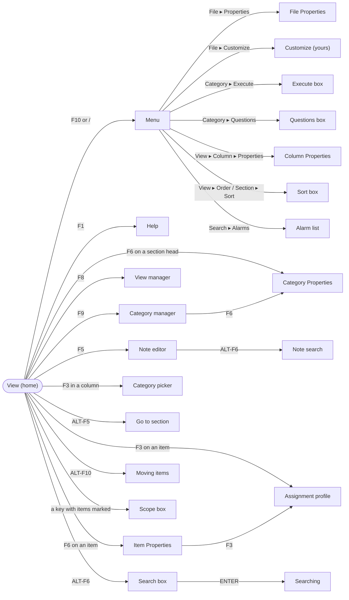
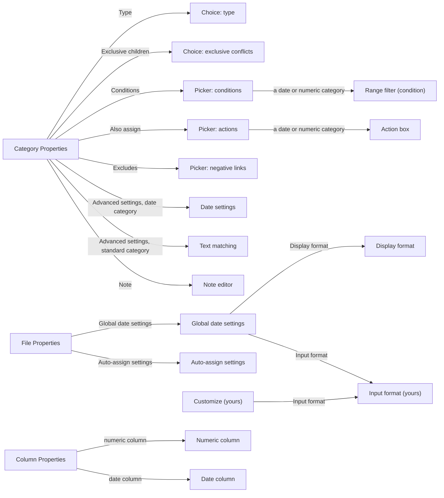

# Screens and boxes of the TUI

A map of every screen, box and control-panel mode, how to reach each one, and
what it opens in turn. For keys in detail see `docs/KEYBOARD.md` and the F1 help;
for the rules behind each box, the SPEC rule named in the tables.

## How screens stack

Everything the TUI shows on top of the current view is a **mode** on a stack,
`state.modes` (`Agenda.TUI.State`): opening a box pushes one, ESC pops it and
returns to what was underneath. `Agenda.TUI.Update.handle/2` sends each key to
the mode on top; `Agenda.TUI.Render` draws the stack. Modes come in three kinds:

- **Full screens** replace the view: the category manager, the view manager,
  help and the note editor.
- **Boxes** are drawn over the view (or over a full screen) in a frame with a
  title. A box opened from a box sits one line lower and two columns right.
- **Control-panel modes** use only the two lines at the top: the menu, prompts,
  Y/N questions, searching and moving items.

Each mode is a map with a `type` (the atom in the tables below) and its own
fields (cursor, the category or item it is for, a purpose).

## The map

The view is home. The main paths from it:

Category Properties and File Properties open boxes of their own:

## Everything, by where it is reached

Indentation shows what opens what. `type` is the mode's type; the module draws
or handles it.

- **View** (no mode): the current view's sections, items and columns.
  `TUI.Update`, `TUI.Layout`, `TUI.Render`.
  - **Menu** `:menu` (F10 or `/`): File, Item, Category, View, Search, Undo,
    Redo, Print, Quit. `TUI.Menu`. Its commands open most of the boxes below;
    the menu path is given with each.
  - **Help** `:help` (F1; also from the category manager): keys and commands.
    `TUI.Render`.
  - **Prompt** `:prompt`: one line of text in the control panel (a file name,
    a new view's name, a category name). `TUI.Update`.
  - **Question** `:confirm`: a Y/N question (discard, save changes, make a
    date category). `TUI.Update`.
  - **Datebook settings** `:datebook_props` (View ▸ Properties of a datebook
    view; after View ▸ Add with Type Datebook): its categories, period,
    interval, start and end, base date (R47). `TUI.DatebookBox`.
    - **Picker** `:picker` for the Date category, End category and Section.
    - **Prompt** `:prompt` for a time (Start at / End at of a day) or the base date.
  - **Choice** `:choice` (View ▸ Add, after the name): Standard or Datebook.
  - **Browsing** `:browse` (View ▸ Browse, ALT-B, in a datebook view or a
    view with a date filter): the view flips to other periods, or its date
    filter moves, until ENTER keeps it or ESC goes back (R47, R48).
    `TUI.Browse`.
    - **Prompt** `:prompt` for a date to go to (ALT-F5).
  - **Calendar** `:calendar` (F3 in a date column; ALT-C anywhere in a
    view): the pop-up calendar, to pick a date (and time) for the entry or
    to look one up (R46). `TUI.CalendarBox`.
    - **Prompt** `:prompt` for a time (F6) or a date to go to (typing).
  - **Scope** `:scope`: with items marked, whether a command (F3, F4, ALT-F2,
    ALT-F4, ALT-F10, ALT-M, DEL) acts on the highlighted item or all marked
    ones (R35). `TUI.Update`.
  - **Moving items** `:move_item` (ALT-F10, Item ▸ Reposition): the item
    follows the cursor until ENTER (R26). `TUI.Update`.
  - **Note editor** `:note` (F5, Item ▸ Note): a full screen for an item's
    note; also a category's note from Category Properties or the category
    manager. `TUI.TextEdit`, `TUI.Update`.
    - **Note search** `:note_search` (ALT-F6 in a note): search and replace,
      then Y/N per match (R39). `TUI.NoteSearch`.
  - **Item Properties** `:item_props` (F6 on an item, Item ▸ Properties):
    text, note, statistics, dependencies, every assignment (R34, R43).
    `TUI.ItemProperties`.
    - **Assignment profile** `:profile` (F3).
    - **Item Properties** of a dependency (ENTER on one), on top.
    - **Note editor** `:note` (ENTER on Note).
  - **Assignment profile** `:profile` (F3 on an item, Item ▸ Show): every
    category with the item's assignments marked; SPACE assigns.
    `TUI.CategoryScreens`.
  - **Group profile** `:group_profile` (F3 with items marked, "all marked"):
    the same for several items (R35). `TUI.CategoryScreens`.
  - **Category picker** `:picker`: choose a category from the hierarchy,
    with search. `TUI.CategoryScreens`. Its `purpose` says what the choice
    does:
    - a column entry (F3 in a column), assigning items (ALT-M, Item ▸
      Categorize), a section's category (F3 on a head), a new section (ALT-D,
      ALT-U) or column (ALT-R, ALT-L), a new view's first section
    - filters (View ▸ Filter, Section ▸ Filter, R28); a date or numeric
      category opens the **Range filter** box `:range_filter`
      (`TUI.RangeFilterBox`, R28a)
    - sort keys from the Sort box, the Execute box's root, moving a category
      (ALT-F10 in the category manager), conditions, actions and negative
      links (from Category Properties)
  - **Category Properties** `:props` (F6 on a section head; F6 in the
    category manager): name, short name, type, exclusive children, matching,
    conditions, actions, negative links, special actions, advanced settings,
    note. `TUI.CategoryScreens`.
    - **Choice** `:choice`: a list of choices with an explanation: the
      category's type (Standard, Numeric, Date; R6a), how to resolve items
      that break exclusive children (R7a) or a move (R7b).
    - **Picker** `:picker` for Conditions, Also assign and Excludes (R15,
      R15b, R9).
      - **Range filter** `:range_filter` as a condition on a date or numeric
        category (R15a).
      - **Action box** `:action_box`: a date or numeric action (R15b).
        `TUI.ActionBox`.
    - **Date settings** `:date_rule` (Advanced settings of a date category,
      R6b). `TUI.DateRuleBox`.
    - **Text matching** `:category_match` (Advanced settings of a standard
      category, R16b). `TUI.CategoryMatchBox`.
    - **Note editor** `:note`.
  - **Category manager** `:catmgr` (F9, Category ▸ Manager): full screen of
    the hierarchy; add, rename, promote, demote, move, sort, discard (R2–R8).
    `TUI.CategoryScreens`.
    - **Category Properties** `:props` (F6), **Note editor** `:note` (F5),
      **Help** `:help` (F1), **Picker** `:picker` (ALT-F10, where to move),
      **Choice** `:choice` (conflicts of a move).
  - **View manager** `:viewmgr` (F8, View ▸ Manager): full screen of the
    views; switch, add, rename, reorder, discard. `TUI.ViewManager`.
  - **Go to** `:goto` (ALT-F5): jump to a section (R42). `TUI.GoTo`.
  - **Search box** `:search_box` (ALT-F6, Search ▸ View or File): what to
    find, in item text, note or both, the direction, ignoring case (R37). `TUI.SearchBox`.
    - **Searching** `:searching`: ALT-N / ALT-P step through matches, F7
      marks. A file search shows the Show View instead.
  - **Sort box** `:sort` (View ▸ Order, View ▸ Section ▸ Sort): the sort keys
    of a view or a section (R36). `TUI.SortBox`.
    - **Picker** `:picker` for a key's category or note category.
  - **File Properties** `:file_props` (File ▸ Properties): two "..." rows
    opening Agenda's boxes, nested as in Agenda 2.0. `TUI.FileProperties`.
    - **Global date settings** `:date_settings` (Global date settings): the
      week, quarter, year and times of day (R14e). `TUI.FileProperties`.
      - **Display format** `:display_format` (Display format): how the file
        shows dates, with a sample (R41, R41a). `TUI.FileProperties`, rows
        from `TUI.DateFormatRows`.
      - **Input format** `:input_format` (Input format): the person's number
        order, date separator and clock, saved as preferences (R41b).
        `TUI.InputFormatBox`.
    - **Auto-assign settings** `:auto_assign` (Auto-assign settings): text
      matching for the file and Confirm assignments (R16, R16a).
      `TUI.AutoAssignBox`.
  - **Calendars** `:calendars` (File ▸ Transfer ▸ Calendars): calendar
    subscriptions; INS subscribes (two prompts), ENTER reads now, F and A
    change how often and how far ahead, DEL unsubscribes (R45).
    `TUI.CalendarsBox`.
  - **Customize** `:customize` (File ▸ Customize): the person's theme, date
    language and fallback language, saved as preferences (R40, R14c).
    `TUI.CustomizeBox`.
    - **Input format** `:input_format` (Input format).
  - **Column Properties** (View ▸ Column ▸ Properties, on a column entry):
    - **Numeric column** `:column_props`: number format and calculations
      (R29). `TUI.ColumnProperties`.
    - **Date column** `:date_column_props`: the column's own date format or
      the global defaults (R41a). `TUI.DateColumnBox`.
  - **Execute** `:execute` (Category ▸ Execute): apply conditions and actions
    to existing items, from a root category (R15e). `TUI.ExecuteBox`.
    - **Picker** `:picker` for the root.
  - **Questions** `:questions` (Category ▸ Questions): confirm suggested
    assignments, item by item (R16). `TUI.QuestionsBox`.
  - **Show Schedule** `:schedule` (Search ▸ Schedule): one date's items in
    the Show View (R49). `TUI.ScheduleBox`.
    - **Picker** `:picker` for the date category, section head and filter.
    - **Prompt** `:prompt` for the date; **Calendar** `:calendar` (F3).
  - **Macros** `:macros` (ALT-F3, also from notes and the category
    manager): the macro manager; INS names a new macro, F7 learns its
    keystrokes, ENTER runs it (R50). `TUI.Macros`.
    - **Prompt** `:prompt` for a new macro's name.
    - **Choice** `:choice` (F7 on a macro with keystrokes): replace or append.
    - **Note editor** `:note` (F2): the macro edit screen, its keystrokes as text.
    - **Macro Properties** `:macro_props` (F6): name, keystrokes, attached key,
      where it can run (R50). `TUI.MacroProps`.
      - **Prompt** `:prompt` for the name or the key.
  - **Alarm list** `:alarm_list` (Search ▸ Alarms):
    current and past alarms (R38). `TUI.AlarmList`.

- **Developer tools** `:devtools` (ESC ?, hidden, from anywhere but while
  typing): a full screen of debugging facts and a key tester; see
  `docs/KEYBOARD.md`. `TUI.DevTools`.

Commands that act at once and open nothing (F4 done, F7 mark, ALT-O
dependencies after its question, Undo, Save) are not listed.

## By type

| `type`               | Kind          | Module                 | Reached from                                     | SPEC          |
| -------------------- | ------------- | ---------------------- | ------------------------------------------------ | ------------- |
| `:menu`              | control panel | `TUI.Menu`             | F10 or `/`                                       | §5            |
| `:prompt`            | control panel | `TUI.Update`           | commands that ask for a line of text             | §5            |
| `:confirm`           | control panel | `TUI.Update`           | commands that ask Y/N                            | §5            |
| `:scope`             | box           | `TUI.Update`           | a command with items marked                      | R35           |
| `:move_item`         | control panel | `TUI.Update`           | ALT-F10, Item ▸ Reposition                       | R26           |
| `:searching`         | control panel | `TUI.SearchBox`        | the Search box                                   | R37           |
| `:help`              | full screen   | `TUI.Render`           | F1                                               | §5            |
| `:note`              | full screen   | `TUI.Update`           | F5, Item Properties, Category Properties         | §5            |
| `:catmgr`            | full screen   | `TUI.CategoryScreens`  | F9, Category ▸ Manager                           | R2–R8         |
| `:viewmgr`           | full screen   | `TUI.ViewManager`      | F8, View ▸ Manager                               | §5            |
| `:picker`            | box           | `TUI.CategoryScreens`  | many (see above)                                 | §5            |
| `:profile`           | box           | `TUI.CategoryScreens`  | F3 on an item, Item ▸ Show, Item Properties      | §5            |
| `:group_profile`     | box           | `TUI.CategoryScreens`  | F3 with items marked                             | R35           |
| `:props`             | box           | `TUI.CategoryScreens`  | F6 on a section head or in the category manager  | §5            |
| `:choice`            | box           | `TUI.CategoryScreens`  | Category Properties, moves in the manager        | R6a, R7a, R7b |
| `:item_props`        | box           | `TUI.ItemProperties`   | F6 on an item, Item ▸ Properties                 | R34, R43      |
| `:goto`              | box           | `TUI.GoTo`             | ALT-F5                                           | R42           |
| `:search_box`        | box           | `TUI.SearchBox`        | ALT-F6, Search ▸ View / File                     | R37           |
| `:note_search`       | box           | `TUI.NoteSearch`       | ALT-F6 in a note                                 | R39           |
| `:sort`              | box           | `TUI.SortBox`          | View ▸ Order, View ▸ Section ▸ Sort              | R36           |
| `:range_filter`      | box           | `TUI.RangeFilterBox`   | a filter or condition on a date/numeric category | R28a, R15a    |
| `:action_box`        | box           | `TUI.ActionBox`        | Also assign on a date/numeric category           | R15b          |
| `:date_rule`         | box           | `TUI.DateRuleBox`      | Advanced settings of a date category             | R6b           |
| `:category_match`    | box           | `TUI.CategoryMatchBox` | Advanced settings of a standard category         | R16b          |
| `:file_props`        | box           | `TUI.FileProperties`   | File ▸ Properties                                | R41, R14e     |
| `:date_settings`     | box           | `TUI.FileProperties`   | File Properties ▸ Global date settings           | R14e          |
| `:display_format`    | box           | `TUI.FileProperties`   | Global date settings ▸ Display format            | R41, R41a     |
| `:input_format`      | box           | `TUI.InputFormatBox`   | Global date settings or Customize ▸ Input format | R41b          |
| `:customize`         | box           | `TUI.CustomizeBox`     | File ▸ Customize                                 | R40, R14c     |
| `:calendars`         | box           | `TUI.CalendarsBox`     | File ▸ Transfer ▸ Calendars                      | R45           |
| `:auto_assign`       | box           | `TUI.AutoAssignBox`    | File Properties ▸ Auto-assign settings           | R16a          |
| `:column_props`      | box           | `TUI.ColumnProperties` | View ▸ Column ▸ Properties, numeric column       | R29           |
| `:date_column_props` | box           | `TUI.DateColumnBox`    | View ▸ Column ▸ Properties, date column          | R41a          |
| `:execute`           | box           | `TUI.ExecuteBox`       | Category ▸ Execute                               | R15e          |
| `:questions`         | box           | `TUI.QuestionsBox`     | Category ▸ Questions                             | R16           |
| `:alarm_list`        | box           | `TUI.AlarmList`        | Search ▸ Alarms                                  | R38           |
| `:calendar`          | box           | `TUI.CalendarBox`      | F3 in a date column, ALT-C                       | R46           |
| `:datebook_props`    | box           | `TUI.DatebookBox`      | View ▸ Properties of a datebook view             | R47           |
| `:browse`            | control panel | `TUI.Browse`           | View ▸ Browse, ALT-B                             | R47, R48      |
| `:schedule`          | box           | `TUI.ScheduleBox`      | Search ▸ Schedule                                | R49           |
| `:macros`            | box           | `TUI.Macros`           | ALT-F3                                           | R50           |
| `:macro_props`       | box           | `TUI.MacroProps`       | F6 in the macro manager                          | R50           |
| `:devtools`          | full screen   | `TUI.DevTools`         | ESC ? (hidden)                                   | —             |

`test/agenda/tui/screens_doc_test.exs` fails when a mode type is added without
being listed here.
